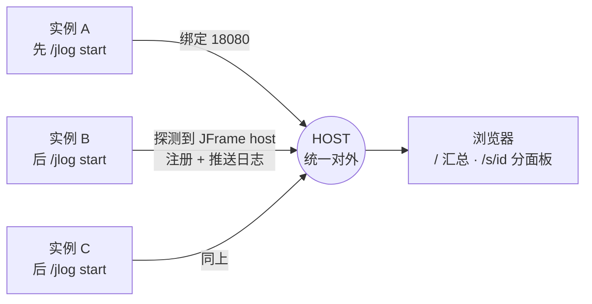

# jframe_logger —— 统一日志模块

> 为依赖 JFrame 的插件提供**统一日志入口**：写入即与 Nukkit 控制台（MCSM 面板）解耦，默认静默不刷屏；再通过 **`/jlog` 手动指令**按需开启 Web 展示端口——**根路由汇总全部子服**、**`/s/<server-id>` 分面板单独审验**，支持实时推送、历史查询与同机多实例自动聚合。不用时无端口、无线程，零资源占用。

---

## 📑 目录

- [一、它解决什么问题](#一它解决什么问题)
- [二、业务插件接入（写日志）](#二业务插件接入写日志)
- [三、/jlog 指令（启停 Web 展示）](#三jlog-指令启停-web-展示)
- [四、Web 页面](#四web-页面)
- [五、同 IP 多面板聚合（host / agent）](#五同-ip-多面板聚合host--agent)
- [六、配置参考](#六配置参考)
- [七、架构与类地图](#七架构与类地图)
- [八、边界与已知限制](#八边界与已知限制)
- [九、测试](#九测试)

---

## 一、它解决什么问题

多插件服务器的日志全部直接打进 Nukkit 控制台（MCSM 面板），各插件消息交错混杂，既无法梳理前后关系，也无法单独审验某个插件的日志上下文。本模块提供：

1. **统一存放入口**：插件日志写入统一日志库（内存环形缓冲，可选按天落盘），不再进面板；
2. **总量 / 分离视图**：Web 页面「全部子服」按时间交错汇总，「单子服 / 单插件」独立过滤审验；
3. **手动按需开启**：端口由 `/jlog start` 指令开启、`/jlog stop` 关闭，不开启时无任何资源占用；
4. **多面板聚合**：同机多个 Nukkit 实例共用一个端口（host/agent 自动协商），一处查看全部。

---

## 二、业务插件接入（写日志）

```java
public class MyPlugin extends PluginBase {

    private JLogger log;

    @Override
    public void onEnable() {
        JFrameMain jframe = (JFrameMain) getServer().getPluginManager().getPlugin("JFrame");
        log = jframe.getLoggerAPI().forPlugin(this);   // 以插件名为来源，同名缓存同实例

        log.info("玩家进入经济系统");                    // 默认静默：只入统一日志库，不进 MCSM
        log.warn("余额接近下限");
        log.error("扣款失败", e);                        // 异常堆栈随条目保存，Web 端可折叠查看

        log.setConsoleMirror(true);                      // 可选：同时镜像回控制台（格式 [插件名/级别] 消息）
        log.setLevel(LogLevel.WARN);                     // 可选：级别下限（默认 INFO），低于则丢弃
    }
}
```

要点：

- **线程安全**：`JLogger` 可在任意线程（含异步线程）调用，不要求 Nukkit 主线程；
- **默认静默是核心语义**：接入即给 MCSM 降噪；确需控制台输出的插件自行开启镜像；
- 自定义来源（子系统命名）用 `getLoggerAPI().getLogger("Economy-Job")`；
- 首次 `getLoggerAPI()` 触发本模块懒加载（也可在 JFrame `config.yml` 的 `modules:` 预加载 `logger`）。

---

## 三、/jlog 指令（启停 Web 展示）

指令由 `plugin.yml` 静态声明、**开机即可用**（op 权限 `jframe.logger`）；首次执行懒加载本模块。**模块加载与服务器启动均不自动开启端口。**

| 命令 | 行为 |
|------|------|
| `/jlog start` | 用 config 端口（默认 18080）探测启动：空闲 → 本机监听（HOST）；被本机其它 JFrame logger 占用 → **自动挂靠**（AGENT） |
| `/jlog start <端口>` | 指定端口（1~65535）同上探测；被非 JFrame 程序占用 / 冲突 → 回报原因并建议 auto |
| `/jlog start auto` | 仍先探测 config 端口（是 host 则挂靠，保持统一入口）；否则 `HttpServer` 绑定端口 0，由 **OS 原子分配**未占用端口（无「先探后绑」竞争）并回报实际端口 |
| `/jlog stop` | 按角色停止：HOST 释放端口并断开 SSE；AGENT 向 host 注销 |
| `/jlog status` | 角色（HOST/AGENT/未运行）+ 地址 + 来源/缓冲统计 |

启动成功后回报完整访问地址；运行中重复 start 会提示先 stop（不支持热换端口，stop→start 即可，且每次 start 重读 `logger.web` 配置）。

---

## 四、Web 页面

浏览器打开 `/jlog start` 回报的地址（如 `http://<服务器IP>:18080/`）：

- **根路由 `/` —— 总量视图**：全部子服日志按时间交错（`timeMillis → server → seq` 稳定归并），子服/来源双彩色标签；
- **`/s/<server-id>` —— 分面板视图**：只看单个子服，便于独立审验上下文；
- **实时**：SSE 推送新日志（连接即先补发历史快照，断线 2s 自动重连）；
- **筛选**：子服下拉、来源（插件）下拉、级别（DEBUG/INFO/WARN/ERROR）、关键字搜索、暂停滚动、清屏；
- **堆栈**：带异常的条目可展开折叠查看完整渲染堆栈；
- 配置 `token` 后所有 API 需带 `?token=`（或 `Authorization: Bearer`），否则 403。

---

## 五、同 IP 多面板聚合（host / agent）

一台机器跑多个 MCSM 面板 / 多个 Nukkit 实例时，「共用一个端口」的实现是 **host/agent 挂靠**（同一端口无法被多个进程绑定）：



- **探测**：`/jlog start` 先 `GET 127.0.0.1:<端口>/api/ping`——返回指纹即挂靠为 agent（不重复开端）；连接被拒则自己绑定；被非 JFrame 程序占用则报错建议 auto；
- **转发**：agent 注册后先补发当前缓冲快照，再批量推送新日志（200ms 或 50 条一批，队列满丢旧计数，不阻塞业务线程）+ 5s 心跳（超时 15s 被 host 剔除）；
- **接管**：host 崩溃后，agent 每 5s 重探——端口空闲则自己绑定接管成为新 host（其它 agent 下轮自动挂靠过来），发现新 host 则重连；窗口期日志保留在 agent 本地缓冲，恢复后随快照补发；
- **serverId**：默认 `server-<本服端口>`（同机唯一），可在 config 用 `logger.web.server-id` 覆盖（URL 安全清洗）；重复注册被 host 拒绝（409）；
- **安全**：agent 管理端点仅接受**回环来源**；host 配 token 时代理需携带相同 token；
- **agent 端点协议**：内部 TSV 行协议（不依赖服务端 Gson 版本），跨机聚合不做（需自行反代）。

---

## 六、配置参考

对应 JFrame 前置插件数据目录的 `config.yml`（缺省值内置，配置缺失不炸）：

```yaml
logger:
  buffer:
    per-source: 5000   # 每来源（每子服×每插件）内存条数上限，满即淘汰最旧
    global: 20000      # 全局内存条数上限（聚合视图收集范围）
  persist: false       # true 时按天/按插件落盘到 <JFrame数据目录>/logs/<来源>/<yyyy-MM-dd>.log（仅本 JVM 自身日志）
  web:
    bind: "0.0.0.0"    # host 对外绑定；挂靠探测/推送固定走 127.0.0.1
    port: 18080        # 默认端口；/jlog start 不带参数时使用，auto/显式端口可覆盖
    server-id: ""      # 子服标识，默认 server-<本服端口>；同机多实例重复会被拒绝，需各自配置
    token: ""          # 非空则 Web 访问需带 ?token=（明文基础防护；agent 需与 host 配置相同 token）
```

> auto 分配 / 挂靠得到的端口仅本次会话有效，**不回写**配置文件；改 bind/token 后 stop→start 即生效，无需重启服务器。

---

## 七、架构与类地图

装配 DAG（[`LoggerModule.load`](src/main/java/io/github/JiangHu/jframe/logger/LoggerModule.java) 内普通 Java 组装）：

```
LoggerConfig ──► LogStore ──►（可选 PersistSink，作为 LogStore 监听器）
                    │
                    └──► WebRuntime（HOST/AGENT/OFF 状态机）──► LoggerAPI（唯一公开服务）
```

| 文件 | 作用 |
|------|------|
| [`LoggerModule.java`](src/main/java/io/github/JiangHu/jframe/logger/LoggerModule.java) | 模块工厂：`id="logger"`，`provides=LoggerAPI`；装配并注册公开服务；`shutdownOrder=900`（最后收尾） |
| [`LoggerAPI.java`](src/main/java/io/github/JiangHu/jframe/logger/LoggerAPI.java) | 公开门面：`forPlugin` / `getLogger` / `sources` + Web 控制（`startWeb(port)` / `stopWeb` / `webStatus`） |
| [`JLogger.java`](src/main/java/io/github/JiangHu/jframe/logger/JLogger.java) | 每插件日志器：级别过滤、堆栈渲染、可选控制台镜像（Server 缺失时静默跳过） |
| [`LogEntry.java`](src/main/java/io/github/JiangHu/jframe/logger/LogEntry.java) / [`LogLevel.java`](src/main/java/io/github/JiangHu/jframe/logger/LogLevel.java) | 日志记录（seq/time/server/source/level/thread/message/stackTrace）与级别枚举 |
| [`LoggerConfig.java`](src/main/java/io/github/JiangHu/jframe/logger/LoggerConfig.java) | `config.yml` 的 `logger:` 节解析（缺省内置） |
| [`JLogCommand.java`](src/main/java/io/github/JiangHu/jframe/logger/JLogCommand.java) | `/jlog` 指令逻辑（纯静态、与 Nukkit 分发解耦，由 `JFrameMain.onCommand` 委托） |
| [`core/LogStore.java`](src/main/java/io/github/JiangHu/jframe/logger/core/LogStore.java) | 统一日志库：server×source 环形缓冲 + 全局队列 + 聚合归并查询 + 追加监听 |
| [`core/PersistSink.java`](src/main/java/io/github/JiangHu/jframe/logger/core/PersistSink.java) | 可选落盘：单守护线程 + BufferedWriter，按天滚动、按来源分文件 |
| [`web/WebRuntime.java`](src/main/java/io/github/JiangHu/jframe/logger/web/WebRuntime.java) | 协调器：探测 → HOST/AGENT 判定、绑定、挂靠、故障接管循环、status |
| [`web/WebLogServer.java`](src/main/java/io/github/JiangHu/jframe/logger/web/WebLogServer.java) | `com.sun.net.httpserver` 封装（零新依赖；端口 0 = OS 原子分配） |
| [`web/LogHttpHandler.java`](src/main/java/io/github/JiangHu/jframe/logger/web/LogHttpHandler.java) | 路由：页面、`/api/ping`、查询 API、SSE、agent 管理端点（回环限定 + token） |
| [`web/SseBroadcaster.java`](src/main/java/io/github/JiangHu/jframe/logger/web/SseBroadcaster.java) | SSE 订阅：先补发历史再实时推送，非阻塞投递（队列满丢旧计数） |
| [`web/HostAgentManager.java`](src/main/java/io/github/JiangHu/jframe/logger/web/HostAgentManager.java) | host 侧 agent 注册表：注册（serverId 查重）/心跳/超时剔除 |
| [`web/AgentForwarder.java`](src/main/java/io/github/JiangHu/jframe/logger/web/AgentForwarder.java) | agent 侧转发：快照补发 + 批量推送 + 心跳 + 重连 |
| [`web/AgentProtocol.java`](src/main/java/io/github/JiangHu/jframe/logger/web/AgentProtocol.java) | 内部协议：探测分类（JFRAME/占用/空闲）+ TSV 行编解码 + HTTP 工具 |
| [`web/Json.java`](src/main/java/io/github/JiangHu/jframe/logger/web/Json.java) | 极简 JSON 输出（手写转义，不依赖服务端 Gson 版本） |
| [`resources/logger-web/index.html`](src/main/resources/logger-web/index.html) | 内嵌单页（原生 JS，无外部 CDN） |

---

## 八、边界与已知限制

- **不捕获**非 JFrame 插件或服务器整体控制台日志（总量视图 = 所有经 `LoggerAPI` 的子服日志交错）；
- **不桥接** JFrame 框架内部日志（`JFrameLog` / `EcsLog` / `FloatingTextLog` / `TitleLog`，后续可用静态钩子接入——core 不能反向依赖本模块）；
- 聚合数据不落盘：host 不为 agent 持久化（host 重启后依赖 agent 快照补发恢复到其内存保留范围）；
- 落盘不做 gz 压缩与自动清理；token 为明文基础防护，无多用户认证体系；
- 无开机自启配置（手动指令启停是明确设计）；跨机器（非同机回环）聚合不支持；
- `/api/ping` 对能连到端口者暴露 app 指纹（仅标识、不含数据），介意者可 bind 回环 + 反代。

---

## 九、测试

34 个 JUnit 5 用例（`mvn -pl jframe_logger test`）：

| 测试类 | 覆盖 |
|--------|------|
| `LogStoreTest` | 环形淘汰 / 分区分源与聚合归并排序 / afterSeq·afterTime 分页 / 级别过滤 / 并发 seq 单调 / 关闭丢弃 |
| `JLoggerTest` | 默认静默不触控制台 / 级别过滤 / 堆栈渲染 / 同名缓存 / Server 缺失容错 |
| `PersistSinkTest` | 格式与 flush / 按天滚动 / 来源名路径清洗 / 他服条目不落盘 |
| `LoggerConfigTest` | 嵌套节解析 / 缺省回退 / 非法值容错 |
| `WebRuntimeTest` | 临时端口起服 / ping 指纹 / servers·logs·sources API / token 403 / SSE 历史补发+实时 / 占用端口报错 / stop 释放再 start |
| `HostAgentTest` | 同进程双实例：挂靠转发、聚合可见、重复 serverId 409、**host 死亡后 agent 自动接管** |
| `JLogCommandTest` | bare/端口/auto 三种 start 的角色判定与回报文案、非法参数、占用提示、启停循环 |
| `LoggerModuleTest` | `ModuleManager` 装配 / 懒加载 / shutdown 清理 |
