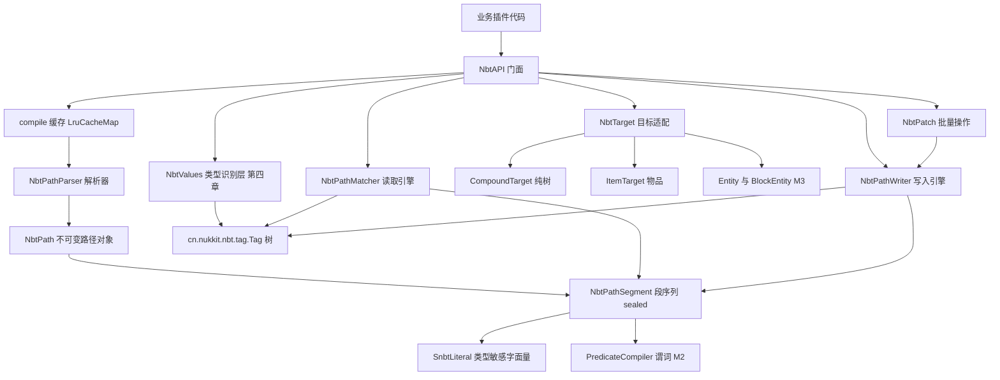

# jframe_nbt 设计方案 · NBT 路径加工工具（NbtPath）

> **文档定位**：本文件是 `jframe_nbt` 模块的**设计文档**（先出方案、用户同意后才实现）。
> 目标是提供一套「以路径表达式读写/加工 NBT」的能力，延续 jframe 家族「参考计算机领域成熟工具」的传统：
> `jframe_command` 参考 Spring MVC、`jframe_scoreboard` 参考前端框架、`jframe_inventory` 的 UI 参考 Qt，
> 本模块参考 **JSONPath / JSON Patch / jq / Minecraft 原生 NBT 路径语法** 四大业界方案（详见第一章论证）。
>
> 本文档只做设计，不包含任何实现代码。文中 Java 代码均为**签名草案 / 用法示例**。

---

## 修订记录

| 日期 | 版本 | 内容 |
|------|------|------|
| 2026-08-21 | v1.2 | 应用户反馈「get 不指定 Class 时能否按接收变量类型直接推断」新增 **目标类型推断读取形态**（3.4）：糖方法 `<T> T get(root, NbtPath)` / `<T> Optional<T> find(root, String)`（编译器按赋值目标推断 T，类型不兼容 = 调用点 ClassCastException，等价 STRICT）、读取三形态分工表、限制清单与业界参照（Spring JdbcTemplate / Gson TypeToken，M1 不引入 TypeToken）；4.3 补交叉引用（该形态不参与 CoerceMode）；流式示例（3.4 示例 8）、测试矩阵（7.1 NbtAPILogicTest）、M1 分期（第八章）同步修订 |
| 2026-08-21 | v1.1 | 应用户反馈「能不能支持自动类型识别」新增 **四、自动类型识别层**：写入推断（4.2）/ 读取解包与严格宽松模式（4.3）/ SNBT 字面量推断（4.4）/ 谓词数值提升（4.5）；同步修订 API 签名（3.4/3.6）、异常体系（3.5，新增 `NbtTypeMismatchException`）、示例表（2.4 新增 #27~#31）、测试矩阵（第七章）、分期计划（第八章）与开放问题（第九章，新增 4 条）；原第四~八章顺延为第五~九章 |
| — | v1.0 | 初版设计：MC 原生路径语法兼容主干 + JSONPath 谓词/通配扩展 + JSON Patch 操作语义 + Java 函数式加工管道 |

---

## 目录

- [〇、调研结论摘要](#〇调研结论摘要)
- [一、业界参考选型论证](#一业界参考选型论证)
- [二、路径语法规范（NbtPath DSL）](#二路径语法规范nbtpath-dsl)
- [三、API 设计](#三api-设计)
- [四、自动类型识别层（Type Inference & Auto-Coercion）](#四自动类型识别层-type-inference--auto-coercion)
- [五、模块结构规划](#五模块结构规划)
- [六、与 MC 原生 /data 路径语法的关系](#六与-mc-原生-data-路径语法的关系)
- [七、测试策略](#七测试策略)
- [八、分期实现计划](#八分期实现计划)
- [九、风险与开放问题](#九风险与开放问题)

---

## 〇、调研结论摘要

设计前的调研发现（作为本设计的扎根依据）：

### 0.1 jframe_nbt 现状

- 模块是**空壳**：仅有 [pom.xml](pom.xml)（继承父 POM，无任何自有依赖）与空目录骨架
  `src/main/java/io/github/JiangHu/jframe/nbt/`、`src/main/resources/`、`src/test/java/`。
- 包根已确定为 `io.github.JiangHu.jframe.nbt`。
- 根 [../pom.xml](../pom.xml) 已全局提供 `cn.nukkit:Nukkit:MOT-SNAPSHOT`（provided）、Spring 6.2.1、Lombok，
  因此本模块**无需引入第三方 NBT 库**，直接使用 Nukkit 原生 `cn.nukkit.nbt.tag.*`。

### 0.2 平台事实：Nukkit MOT（基岩版），非 Paper

根 README（[../README.md](../README.md)）与父 POM 明确：JFrame 是 **Nukkit MOT（基岩版服务端）+ Spring** 的插件框架，
不是 Bukkit/Paper。这对设计的影响：

1. NBT 类型系统采用 Nukkit 的 `cn.nukkit.nbt.tag.*`：`CompoundTag` / `ListTag` / `StringTag` / `IntTag` /
   `DoubleTag` / `ByteTag` / `ShortTag` / `LongTag` / `FloatTag` / `ByteArrayTag` / `IntArrayTag` / `EndTag`。
   （`LongArrayTag` 在 Nukkit MOT 中是否存在需实现期确认，见 [9.4](#94-技术风险)。
2. 物品 NBT 入口是 `Item.getNamedTag()` / `Item.setNamedTag(CompoundTag)`（项目内已有用例，见 0.4）。
3. 基岩版服务端**没有 `/data` 命令**，因此「与 MC 原生路径语法互转」的实际意义是与 Java 版社区生态
   （文档、配置、工具链）交换路径字符串，而非对接本服命令（详见第六章）。

### 0.3 项目通用惯例（新模块必须遵循）

抽样阅读 `jframe_command`、`jframe_ai`、`jframe_scoreboard_depend_template`、`jframe_inventory` 归纳：

| 惯例 | 依据 |
|------|------|
| 门面命名 `XxxAPI`，轻量委托、不持业务逻辑，可选实现 `ForPlugin<XxxPluginScope>` | [CommandAPI.java](../jframe_command/src/main/java/io/github/JiangHu/jframe/command/CommandAPI.java) |
| 单向 DAG 分层：Registry/Parser（无依赖）→ Engine → API，构造器注入 | [command-spring.xml](../jframe_command/src/main/resources/command-spring.xml) |
| `config/XxxSpringConfig` = `@Configuration` + `@ImportResource("classpath:xxx-spring.xml")` | [CommandSpringConfig.java](../jframe_command/src/main/java/io/github/JiangHu/jframe/command/config/CommandSpringConfig.java) |
| 模块在 `ConfigEnum` 注册，由 `JFrameMain` 动态导入装配 | [ConfigEnum.java](../jframe_main/src/main/java/io/github/JiangHu/jframe/main/utils/ConfigEnum.java) |
| 「路径」类工具：不可变、线程安全、段（Segment）模型、解析后不再变化 | [PathPattern.java](../jframe_command/src/main/java/io/github/JiangHu/jframe/command/routing/PathPattern.java) |
| 异常继承 `RuntimeException`，消息中文、场景化 | `InventoryCodecException`、`ArgumentConversionException` |
| 测试命名 `XxxLogicTest`，纯 JDK 逻辑测试、无需启动服务器 | `ThreadAPILogicTest`、`AiAPILogicTest` 等 |
| 文档双轨：包目录下 `README.md`（用法）+ `DEVELOPER.md`（内部实现），中文、表格丰富、含「为什么这么设计」 | 各模块 |
| Java 24 语言特性可用（record、sealed、switch 模式匹配），Lombok 可用 | 父 POM、[PathPattern.java](../jframe_command/src/main/java/io/github/JiangHu/jframe/command/routing/PathPattern.java) |

### 0.4 项目内既有 NBT 资产（协同对象）

- [NbtJsonConverter.java](../jframe_inventory/src/main/java/io/github/JiangHu/jframe/inventory/codec/NbtJsonConverter.java)：
  NBT ↔ JSON 互转，`__nbt` 类型标记保真（属 `jframe_inventory` 的 codec 子包）。
- [ItemCodec.java](../jframe_inventory/src/main/java/io/github/JiangHu/jframe/inventory/codec/ItemCodec.java)：
  物品 ↔ Base64-NBT / JSON，证明了 Nukkit Tag 类**可脱离服务器实例化与测试**。
- `jframe_core` 提供可复用件：`LruCacheMap`（路径编译缓存）、`ForPlugin` / `PluginClassLoaderFactory`（跨插件作用域）。

---

## 一、业界参考选型论证

### 1.1 候选方案对比

| 能力维度 | JSONPath（Goessner） | XPath 3.1 | jq | JSON Pointer (RFC 6901) + Patch (RFC 6902) | MC 原生 NBT 路径 | SpEL / JEXL | Lens / Zipper（函数式） |
|----------|----------------------|-----------|-----|---------------------------------------------|------------------|--------------|------------------------|
| **寻址** | `$.a.b[0]`，点分 + 下标，直观 | 轴导航（child::、attribute::），极强但重 | `.a.b[0]`，同 JSONPath 风格 | `/a/b/0` 纯寻址，RFC 标准化 | `a.b[0]`，点分 + 下标 | 属性导航，面向对象图 | 无文本语法，纯代码 |
| **过滤谓词** | `[?(@.x > 1)]` 比较谓词，表达力强 | `[x > 1]` + 全套函数，最强 | `select(.x > 1)`，图灵完备 | **无**（只能寻址） | `[{Name:"x"}]` 复合键值**子集匹配** | 完整表达式语言 | 代码即谓词 |
| **写入/更新** | 规范只定义查询，写入靠实现扩展（Jayway 的 set/put） | 需 XQuery Update（另一个复杂标准） | `=`、`|=`、`+=` 赋值 + map 管道，最强 | **Patch 六操作**（add/remove/replace/move/copy/test），操作语义的黄金标准 | `/data merge / remove / modify` 命令级写入 | 赋值表达式 | 天然函数式更新（返回新树） |
| **通配符** | `*`（单层）、`..`（递归下降）、切片 `[1:3]` | `*`、`//`（后代） | `.[]`（迭代）、`..`（递归） | **无** | `[]`（全体元素） | 无（`?.` 是安全导航非通配） | — |
| **学习成本** | 低 | 高（轴、类型系统） | 中高（自有语言） | 极低 | 中（MC 玩家/插件作者已熟悉） | 中 | 高（需懂 FP） |
| **与 MC 生态契合度** | 中（社区常见但非官方） | 低 | 低 | 低 | **极高**（事实标准，文档/教程海量） | 中（scoreboard 模块已用 SpEL 做模板插值） | 低 |
| **Java 嵌入成本** | 低（语法简单可自研） | 高 | 高（无成熟嵌入实现） | 极低 | 低（语法简单可自研） | 低（Spring 自带，但语义面向 Bean 非 NBT） | 中（自研抽象） |

### 1.2 逐项取舍论证

- **采用 MC 原生语法为主干**：目标用户是 MC 插件开发者，`Items[0].tag.display.Name`、
  `Attributes[{Name:"generic.movement_speed"}].Amount` 这类写法是他们已有心智模型；且语法本身足够精炼
  （点分键 + 下标 + 复合过滤），自研解析器成本低。**生态契合度是第一权重**。
- **借鉴 JSONPath 的谓词与通配**：MC 原生过滤只能做「键值子集相等匹配」，无法表达
  `Amount > 0.1` 这类比较；JSONPath 的 `[?(@.x > 1)]` 是业界最广为人知的比较谓词写法，作为 **M2 扩展**
  （语法超集，不破坏主干）。`*` 键通配同样取自 JSONPath 语义（单层、非递归）。
- **借鉴 JSON Patch 的操作语义**：get/set/insert/merge/delete 的操作集合对齐 RFC 6902 的
  add/remove/replace + MC `/data` 的 merge/insert，形成「寻址（路径）× 操作（op）」正交模型；
  批量操作以「操作列表原子应用」的形式吸收 Patch 的 **ops 序列**思想（`NbtPatch`）。
- **不采用完整 jq 语言**：jq 的价值在管道式文本 DSL，但（a）Java 侧无成熟可嵌入实现；
  （b）在 Java 宿主里 `UnaryOperator<Tag>` + 内置函数库天然就是管道，类型安全且可调试；
   （c）学习成本与 MC 用户群不匹配。**modify 管道用 Java 函数式实现，文本管道 DSL 列为开放问题**（见 9.1）。
- **不采用 XPath**：NBT 树只有 Compound / List / 值三类节点，没有属性、命名空间、文档序，
  XPath 的轴与类型系统完全用不上，属于「杀鸡用牛刀」。
- **不采用 JSON Pointer 作为语法**：无过滤、无通配，表达力不足；但吸收其
  「**规范化形式唯一、无歧义**」的思想——`NbtPath` 解析后提供规范化字符串输出，用于日志与去重
  （与 [PathPattern.patternString()](../jframe_command/src/main/java/io/github/JiangHu/jframe/command/routing/PathPattern.java) 同一手法）。
- **Lens/Zipper 只吸收思想**：不可变 `NbtPath`（编译一次、并发使用）对应 Lens 的「聚焦器」概念；
  写入引擎按「定位 → 就地更新/返回新根」组织，对应 Zipper 的上下文重建。不引入 FP 术语到公开 API。

### 1.3 选型结论

> **以 MC 原生 NBT 路径语法为兼容主干（点分键 + 下标 + 复合过滤，与 Java 版 `/data` 一致），
> 谓词与通配借鉴 JSONPath（`[?(...)]` 比较谓词、`*` 键通配，M2 扩展），
> 操作语义借鉴 JSON Patch 与 `/data modify`（get/set/insert/merge/delete/modify + 批量 ops），
> 加工管道用 Java 函数式（`UnaryOperator<Tag>` + 内置函数库）而非类 jq 文本语言；
> XPath 与 Lens 仅吸收思想，不进入语法。**

边界说明：M1 交付的语法**严格落在 MC 原生兼容子集内**；M2 的谓词/通配是**超集扩展**，
扩展语法无法被 Java 版 `/data` 理解（互转策略见第六章）。

---

## 二、路径语法规范（NbtPath DSL）

### 2.1 形式化语法（EBNF）

```ebnf
(* ============ NbtPath v1 语法 ============ *)

nbt_path       = [ root_filter ] , segment , { segment } ;

(* 根部复合过滤：对整棵根做子集匹配，如 {id:"minecraft:diamond"} *)
root_filter    = compound_filter ;

(* 路径段：点分键段 或 裸下标段 *)
segment        = "." , key , { index_sel }          (* 键段，后可串联多个下标/过滤 *)
               | index_sel , { index_sel } ;        (* 裸下标段，用于 List/数组根或连续下标 *)

(* 首段的点可省略：display.Name 等价 .display.Name（解析器层面归一化） *)

key            = identifier | quoted_string | "*" ; (* * = 单层键通配，匹配 Compound 全部值 *)
identifier     = ? 不含 '.' '[' ']' '{' '}' '"' '*' 且非空的字符序列 ? ;
quoted_string  = '"' , { char | escape } , '"' ;    (* 含特殊字符的键名 *)
escape         = '\"' | '\\' ;

index_sel      = "[" , selector , "]" ;
selector       = integer                             (* 单个下标，支持负索引 *)
               |                                     (* 空 = 全体元素通配 [] *)
               | compound_filter                     (* 复合键值过滤 {k:v,...} *)
               | predicate ;                         (* 比较谓词 ?(...) ，M2 *)

integer        = [ "-" ] , digit , { digit } ;

compound_filter = "{" , [ filter_entry , { "," , filter_entry } ] , "}" ;
filter_entry   = filter_key , ":" , snbt_literal ;
filter_key     = identifier | quoted_string ;

predicate      = "?" , "(" , predicate_expr , ")" ;  (* M2 *)
predicate_expr = ? JSONPath 风格比较表达式：@.键 op 字面量，&& / || 组合 ? ;

(* 过滤条件中的 SNBT 字面量（M1 仅标量） *)
snbt_literal   = string_literal
               | number_literal                       (* 可带后缀 b/s/L/f/d，如 1b、2.5f *)
               | boolean_literal ;                    (* true / false，语义等同 1b / 0b *)
string_literal = quoted_string ;
```

> 语法树模型与 [PathPattern](../jframe_command/src/main/java/io/github/JiangHu/jframe/command/routing/PathPattern.java)
> 同构：**字符串 → 有序段序列，段为密封类型（sealed）**；解析一次、不可变、线程安全。

### 2.2 段类型与语义

| 段类型 | 语法 | 作用节点类型 | 语义 | 期次 |
|--------|------|--------------|------|------|
| 根过滤 | `{k:v}`（路径最前的独立 `{...}`） | `CompoundTag`（根） | 根须为 Compound 且**包含**给定键值（子集匹配）；不匹配则整条路径 0 命中 | M1 |
| 键段 | `display` / `"weird.name"` | `CompoundTag` | 取该键对应的值；键不存在 → 0 命中 | M1 |
| 键通配 | `*`（作键段） | `CompoundTag` | 展开 Compound 的**全部值**（单层，不递归） | M2 |
| 下标 | `[0]` / `[-1]` | `ListTag` / `ByteArrayTag` / `IntArrayTag` | 取对应元素；负索引从尾部数（`-1` = 最后一个）；越界 → 0 命中（读）/ 报错或追加（写，见 2.5） | M1 |
| 全体元素 | `[]` | `ListTag` / 数组类型 | 展开全部元素（等价于逐一下标的并集） | M1 |
| 复合过滤 | `[{Name:"x", Amount:0.1d}]` | `ListTag<CompoundTag>` | 选出**包含**全部给定键值（子集匹配、类型敏感）的 Compound 元素 | M1 |
| 比较谓词 | `[?(@.Amount >= 0.1)]` | `ListTag<CompoundTag>` | JSONPath 风格：`@` 指当前元素，对其求值比较表达式，保留为真的元素 | M2 |

**多匹配语义**（关键设计，对齐 MC 原生与 JSONPath）：路径的求值结果是**命中集合**（有序、按文档序）：

- `get` 返回 `List<Tag>`（0 / 1 / N 个）；
- `set` / `delete` / `modify` 作用于**全部**命中节点；
- `getSingle` / `setSingle` 要求**恰好一个**命中，否则抛异常（见 3.5）。

**数组类型的处理**：`ByteArrayTag` / `IntArrayTag`（以及若存在的 `LongArrayTag`）在路径中**视作数值列表**，
可用 `[i]` / `[]` / 谓词寻址，元素按数值参与过滤比较；但**写入数组元素按原数组元素类型收窄**（见 2.5）。

**类型敏感的过滤比较**（对齐 MC 原生）：`[{Count:1b}]` 只匹配 `ByteTag(1)`，不匹配 `IntTag(1)`；
数值字面量后缀决定期望类型，无后缀整数 → `IntTag`、无后缀小数 → `DoubleTag`、`true/false` → `ByteTag(1/0)`
（字面量推断规则全表见 [4.4](#44-snbt-字面量的类型自动推断)）。
（跨类型数值比较仅在 M2 谓词中支持，如 `[?(@.Amount > 1)]` 将数值提升到公共类型后比较——
提升算法与「过滤敏感 vs 谓词提升」两套语义的分工见 [4.5](#45-谓词比较中的数值提升)。）

### 2.3 转义与引号规则

| 场景 | 写法 | 说明 |
|------|------|------|
| 键名含 `.` `[` `]` `{` `}` `"` `*` 或空格 | `"weird.name"` / `"my key"` | 双引号包裹的键段 |
| 引号内的引号 | `"say \"hi\""` | `\"` 转义 |
| 引号内的反斜杠 | `"a\\b"` | `\\` 转义 |
| 过滤条件中的字符串值 | `[{Name:"§b屠龙剑"}]` | 同引号规则，支持中文/颜色码 |
| 数值后缀 | `1b` `2s` `3` `4L` `5.0f` `6.0d` | byte/short/int/long/float/double |

### 2.4 示例表

以下示例统一使用这棵 NBT 树（物品箱 NBT，混合了 Compound / List / 数组 / 各数值类型）：

```
{                                          ← 根 CompoundTag
  Items: [                                 ← ListTag<CompoundTag>
    { id: "minecraft:diamond", Count: 64b, tag: { display: { Name: "§b钻石", Lore: ["§7闪闪发光"] } } },
    { id: "minecraft:iron_ingot", Count: 3b, Damage: 0s }
  ],
  Attributes: [                            ← ListTag<CompoundTag>
    { Name: "generic.movement_speed", Amount: 0.1d },
    { Name: "generic.max_health",  Amount: 20.0d }
  ],
  custom: { "weird.key": 1, Payload: [I; 1, 2, 3] },
  version: 1
}
```

| # | 路径表达式 | 操作 | 结果 / 语义 | 期次 |
|---|-----------|------|-------------|------|
| 1 | `Items[0].tag.display.Name` | get | `["§b钻石"]`（经典点分寻址） | M1 |
| 2 | `Items[-1].id` | get | `["minecraft:iron_ingot"]`（负索引） | M1 |
| 3 | `Items[].Count` | get | `[64b, 3b]`（全体元素展开 + 继续下钻） | M1 |
| 4 | `Items[{id:"minecraft:diamond"}].Count` | get | `[64b]`（按 key 过滤 List 元素） | M1 |
| 5 | `Items[{id:"minecraft:diamond", Count:64b}].tag.display.Lore[]` | get | `["§7闪闪发光"]`（复合条件 + 数组展开） | M1 |
| 6 | `Attributes[{Name:"generic.movement_speed"}].Amount` | get | `[0.1d]`（任务书原始示例） | M1 |
| 7 | `{version:1}` | get | 命中根自身 → `[整棵树]`（根过滤） | M1 |
| 8 | `custom."weird.key"` | get | `[1]`（引号转义键名） | M1 |
| 9 | `custom.Payload[1]` | get | `[2]`（IntArray 元素寻址） | M1 |
| 10 | `Items[*].Count` | get | 同 #3（`*` 键通配的语义说明：对 List 用 `[]`，`*` 用于 Compound，见 #11） | M2 |
| 11 | `custom.*` | get | `[1, [1,2,3]]`（Compound 全部值，单层） | M2 |
| 12 | `Attributes[?(@.Amount >= 20)].Name` | get | `["generic.max_health"]`（JSONPath 风格谓词） | M2 |
| 13 | `Items[0].tag.display.Name` | set `"§c红钻"` | 单命中，就地替换该 StringTag | M1 |
| 14 | `Items[].Count` | set `new ByteTag("",1)` | 多命中，**全部**元素 Count 被替换 | M1 |
| 15 | `Items[5]` | set | 0 命中且下标越界 → 抛 `NbtModifyException`（或 `insert` 语义追加，见 2.5） | M1 |
| 16 | `Items` | insert `{id:"minecraft:stick", Count:1b}` | List 末尾追加一个元素 | M1 |
| 17 | `Items[1]` | insert `{...}` | 在下标 1 处插入，原元素后移（对齐 `/data insert`） | M1 |
| 18 | `tag` | merge `{display:{Lore:["x"]}}` | 深合并：同名 Compound 递归合并，标量覆盖 | M1 |
| 19 | `Items[{id:"minecraft:iron_ingot"}].Damage` | delete | 删除命中元素的 Damage 键（其余保留） | M1 |
| 20 | `Items[0].tag` | delete | 删除后 `Items[0]` 只剩 id/Count | M1 |
| 21 | `Attributes[{Name:"generic.movement_speed"}].Amount` | modify `t -> t * 1.5` | 函数式加工：读旧值、算新值、写回（全部命中） | M2 |
| 22 | `Items[0].id` | getSingle | 恰一命中 → `Optional` 有值；若路径写成 `Items[].id` 则多命中 → 抛异常 | M1 |
| 23 | `Items[0].Count` | set `new IntTag("",64)` | 类型不匹配（原为 ByteTag）→ 默认拒绝，抛 `NbtPathTypeException`（可关，见 2.5） | M1 |
| 24 | `Items[0` | — | 语法错误（未闭合 `[`）→ `NbtPathSyntaxException`（含位置） | M1 |
| 25 | `Items[0].id.x` | get | `id` 是 StringTag，继续键导航 → 0 命中（读时静默） | M1 |
| 26 | `Items[0].id.x` | set | 0 命中且中间节点非 Compound → 抛 `NbtModifyException`（写时严格） | M1 |
| 27 | `Items[0].tag.display.Name` | set `"§c红钻"`（String 直传） | **写入推断**：`set(path, Object)` 重载自动推断 StringTag，等价 #13 但无需手工构造 Tag（4.2） | M1 |
| 28 | `Items[0].Count` | set `32`（Integer 直传） | **写入推断 + autoFit**：旧值为 ByteTag，Integer 32 可被 Byte 无损容纳 → 写回 `ByteTag(32)` 而非 IntTag（4.2） | M1 |
| 29 | `custom` | merge `Map.of("rev", 2, "note", "x")` | **写入推断**：Map → CompoundTag、Integer → IntTag，递归构造后深合并（4.2） | M1 |
| 30 | `Items[0].Count` | get `Integer.class` | **读取解包**：ByteTag 宽化为 Integer 32（读宽容默认 LENIENT，无需关心存储窄类型，4.3） | M1 |
| 31 | `Attributes[?(@.Amount >= 20)]` | get | **谓词数值提升**：Amount 为 DoubleTag、字面量 `20` 为 IntTag → 提升到 double 后比较（对比 #12，强调跨类型，4.5） | M2 |

### 2.5 写入语义细则（对齐 JSON Patch + `/data`）

| 操作 | 0 命中时 | 1 命中 | N 命中 | 说明 |
|------|----------|--------|--------|------|
| `set` | 默认抛 `NbtModifyException`；可选 `createPath=true` 自动创建中间 Compound（吸收 Patch `add` 语义） | 替换 | 全部替换 | 替换时默认**类型校验**：与旧值同 NBT 类型才允许（防 `1b` 被写成 `1` 破坏游戏行为），可用宽松模式关闭；传 `Object` 值时的自动推断与 autoFit 旧值无损适配见 [4.2](#42-写入方向java-值--nbt-tag-自动推断) |
| `insert` | 路径须指向**存在的 List**；下标越界正数 → 抛异常；`append=true` → 末尾追加 | 插入该下标，元素后移 | — | insert 只作用于 List/数组 |
| `merge` | 0 命中且 `createPath` → 逐层创建；否则抛异常 | 深合并 | 全部合并 | 仅 Compound；同名键：双方 Compound → 递归合并，否则覆盖 |
| `delete` | **静默成功**（幂等，对齐 Patch `remove` 的宽容惯例与 `/data remove`） | 删除 | 全部删除 | 删除 List 元素后后续元素前移 |
| `modify` | 静默跳过（0 个元素调用变换器 0 次） | 变换后写回 | 逐个变换写回 | 变换器返回 `null` → 视为 delete |

> 读宽容、写严格：**读取**时类型不符/路径断裂一律返回空集合（不抛异常），便于探测式编程；
> **写入**时默认严格（可配置），因为静默丢失写入是持久化场景最危险的 bug。

---

## 三、API 设计

### 3.1 核心类型总览

```
NbtAPI（门面，Spring Bean）
 ├── NbtPath            不可变路径对象：compile / select / 便捷写操作
 │    ├── NbtPathParser        手写递归下降解析器（字符串 → 段序列）
 │    ├── NbtPathSegment       sealed 段类型（Key / Index / AllElements / AllKeys / CompoundFilter / Predicate）
 │    ├── NbtPathMatcher       读取引擎：Tag × 段序列 → 命中集合
 │    └── NbtPathWriter        写入引擎：set / insert / merge / delete / modify
 ├── SnbtLiteral        过滤条件中的类型敏感字面量（字面量推断规则见 4.4）
 ├── NbtValues          Tag ↔ Java 值静态工具：of(Object) 写入推断 / asXxx 读取解包 / toJavaValue 深解包（4.2/4.3）
 ├── CoerceMode         读取转换模式枚举（STRICT / LENIENT，4.3）
 ├── NbtReadOption      类型化读取选项（coerceMode + defaultValue，4.3）
 ├── NbtOperation       sealed 操作（Get/Set/Insert/Merge/Delete/Modify）→ NbtPatch 批量
 ├── NbtTarget          读写目标抽象（纯树 / Item / 未来 Entity、BlockEntity）
 └── NbtPathException   异常体系（见 3.5）
```

### 3.2 `NbtPath` —— 路径对象（对标 `PathPattern` 的地位）

```java
package io.github.JiangHu.jframe.nbt.core.path;

/**
 * NBT 路径对象 —— 解析、选择、写入的核心。
 * <p>
 * 将形如 {@code Items[0].tag.display.Name} 的路径字符串解析为有序的
 * {@link NbtPathSegment 段序列}，对 NBT 树求值得到命中集合。
 *
 * <h3>不可变与线程安全</h3>
 * 解析后字段不再变化，线程安全；同一实例可被多线程并发求值
 * （与 jframe_command 的 PathPattern 同一约定）。
 * 建议对高频路径用 {@code NbtAPI.compile} 走 LRU 缓存复用实例。
 */
public final class NbtPath {

    /**
     * 解析路径表达式（每次解析产生新实例；高频路径请用 NbtAPI 的缓存入口）。
     *
     * @param expression 路径表达式，如 {@code "Items[0].tag.display.Name"}
     * @throws NbtPathSyntaxException 表达式非法（消息含出错位置）
     */
    public static NbtPath compile(String expression);

    /** 根部复合过滤（无可为 null）。 */
    public CompoundFilter rootFilter();

    /** 有序段列表（不可变）。 */
    public List<NbtPathSegment> segments();

    /** 规范化字符串（用于日志/去重/相等比较）。 */
    public String expression();

    // ========== 读取 ==========

    /** 求值：返回全部命中（按文档序；0 命中返回空列表，不抛异常）。 */
    public List<Tag> select(Tag root);

    /** 恰好一个命中 → Optional 有值；0 个 → empty；多个 → 抛 NbtPathNotFoundException。 */
    public Optional<Tag> selectSingle(Tag root);

    /** 是否至少命中一个。 */
    public boolean matches(Tag root);

    // ========== 写入（便捷实例方法，委托 NbtPathWriter；返回实际根，便于链式） ==========

    /** 替换全部命中（选项控制类型校验与 createPath）。 */
    public Tag set(Tag root, Tag value, NbtWriteOption option);

    /** List 末尾追加 / 指定下标插入。 */
    public Tag insert(Tag root, Tag value);

    /** 深合并到全部命中的 Compound。 */
    public Tag merge(Tag root, CompoundTag patch);

    /** 删除全部命中（幂等）。 */
    public Tag delete(Tag root);

    /** 函数式加工全部命中（M2）。 */
    public Tag modify(Tag root, UnaryOperator<Tag> transformer);

    // ========== 组合 ==========

    /** 拼接子路径，返回新 NbtPath（Builder 风格组合）。 */
    public NbtPath resolve(String subExpression);

    /** 去掉最后一段，返回新 NbtPath（无段时抛 IllegalStateException）。 */
    public NbtPath parent();
}
```

### 3.3 `NbtPathSegment` —— 段模型（sealed）

```java
package io.github.JiangHu.jframe.nbt.core.path;

/** NBT 路径段 —— 密封类型，一种语法构造对应一种段。 */
public sealed interface NbtPathSegment {

    /** 键段：{@code display} 或 {@code "weird.name"}；name 为 {@code "*"} 时表示键通配（M2）。 */
    record Key(String name) implements NbtPathSegment {}

    /** 下标段：{@code [0]} / {@code [-1]}；负值从尾部数。 */
    record Index(int index) implements NbtPathSegment {}

    /** 全体元素段：{@code []}。 */
    record AllElements() implements NbtPathSegment {}

    /** 复合过滤段：{@code [{id:"x", Count:64b}]}，子集匹配、类型敏感。 */
    record CompoundFilter(Map<String, SnbtLiteral> entries) implements NbtPathSegment {}

    /** 比较谓词段：{@code [?(@.Amount >= 0.1)]}（M2，表达式原文 + 预编译形式）。 */
    record Predicate(String expression) implements NbtPathSegment {}
}
```

> 与 [PathPattern.Segment](../jframe_command/src/main/java/io/github/JiangHu/jframe/command/routing/PathPattern.java)
> 的差异说明：命令路径用「Kind 枚举 + record 字段」的扁平模型（段种类少）；
> NBT 路径段种类多且携带数据各异，改用 **sealed interface + record 子类**，
> 求值引擎用 switch 模式匹配分派（Java 24）。

### 3.4 `NbtAPI` —— 门面（遵循 `XxxAPI` 惯例）

```java
package io.github.JiangHu.jframe.nbt;

/**
 * NBT 加工服务（面向用户的统一入口）：暴露 NBT 路径工具的全部公开 API。
 * <p>
 * 轻量门面，自身不持有业务逻辑，仅做委托转发：
 * <ul>
 *   <li>{@code compile} → 委托解析器 + LRU 缓存（复用 jframe_core 的 LruCacheMap）</li>
 *   <li>{@code get/set/insert/merge/delete/modify} → 委托 NbtPathMatcher / NbtPathWriter</li>
 *   <li>{@code of} → 构造 NbtTarget（纯树 / Item / ...）</li>
 * </ul>
 * Spring 装配见 nbt-spring.xml；经 JFrameMain 的 getNbtAPI() 暴露给业务插件。
 */
public class NbtAPI {

    /** 解析并缓存路径（高频路径复用不可变实例）。 */
    public NbtPath compile(String expression);

    // ========== 目标入口（适配层） ==========

    /** 纯 NBT 树目标（就地读写）。 */
    public NbtTarget of(CompoundTag root);

    /** 物品目标：读写自动走 Item.getNamedTag / setNamedTag。 */
    public NbtTarget of(Item item);

    // ========== 字符串便捷入口（一步到位） ==========

    public List<Tag> get(Tag root, String path);
    public Optional<Tag> getSingle(Tag root, String path);

    /** 类型化读取便捷方法（NbtValues 委托）。 */
    public Optional<String> getString(Tag root, String path);
    public OptionalInt getInt(Tag root, String path);
    public OptionalDouble getDouble(Tag root, String path);

    // ========== 自动类型识别（第四章） ==========

    /**
     * 类型化读取：命中 Tag 按目标类型解包（数值宽化/窄化依 CoerceMode，见 4.3）。
     * <p>0 命中或解包失败（LENIENT）→ Optional.empty；STRICT 下类型不符抛 NbtTypeMismatchException。
     *
     * @param type 目标 Java 类型（Integer/Long/Double/String/Boolean/byte[]/int[]/Map/List...，映射见表 4-2）
     */
    public <T> Optional<T> get(Tag root, String path, Class<T> type);

    /** 类型化读取 + 选项（coerceMode / defaultValue，见 4.3）。 */
    public <T> Optional<T> get(Tag root, String path, Class<T> type, NbtReadOption option);

    // ========== 目标类型推断读取（v1.2 新增，分工表与限制清单见本节末尾） ==========

    /**
     * 目标类型推断读取：不传 Class，由编译器按<b>赋值目标</b>推断 {@code T} 并在调用点插入
     * checkcast / 拆箱指令，如 {@code int version = api.get(root, api.compile("version"));}。
     * <p>返回按 NBT 原生类型解包的 Java 值（IntTag→Integer、StringTag→String、
     * CompoundTag→CompoundTag，映射见表 4-2「未指定目标」语义）。
     * <p><b>失败语义（擦除边界）</b>：泛型擦除使运行时拿不到 T，无法主动宽化/窄化——
     * 类型不兼容在<b>调用点</b>抛 {@link ClassCastException}（效果等价 STRICT，但不在 3.5 异常体系内）。
     * 0 命中返回 null；多命中取文档序首个（严格恰一请用 getSingle）。
     */
    public <T> T get(Tag root, NbtPath path);

    /**
     * 同语义的 Optional 版本：0 命中 / 路径断裂 → {@code Optional.empty()}；
     * 类型不兼容仍为调用点 ClassCastException（同上）。
     */
    public <T> Optional<T> find(Tag root, String path);

    /** 布尔读取：ByteTag 非零为 true（语义确认见开放问题 7）。 */
    public Optional<Boolean> getBoolean(Tag root, String path);

    /**
     * 写入重载：传原生 Java 值，按表 4-1 自动推断 NBT 类型（Integer→IntTag、Map→CompoundTag、
     * List→ListTag 且元素归一、Boolean→ByteTag(1/0)），无需手工构造 Tag。
     * <p>set(path, null) 等同 delete；推断失败抛 NbtTypeMismatchException（见 4.2）。
     */
    public Tag set(Tag root, String path, Object value);

    /** insert 的 Object 重载：值推断同上（见 4.2）。 */
    public Tag insert(Tag root, String path, Object value);

    /** merge 的 Map 重载：Map → CompoundTag 递归推断后深合并（见 4.2）。 */
    public Tag merge(Tag root, String path, Map<String, ?> patch);

    /** 全局默认读取转换模式（影响所有无显式 option 的类型化读取；默认 LENIENT，见 4.3）。 */
    public void setDefaultCoerceMode(CoerceMode mode);

    public Tag set(Tag root, String path, Tag value);
    public Tag insert(Tag root, String path, Tag value);
    public Tag merge(Tag root, String path, CompoundTag patch);
    public Tag delete(Tag root, String path);
    public Tag modify(Tag root, String path, UnaryOperator<Tag> transformer); // M2

    /** 批量应用操作序列（类 JSON Patch，全部成功才生效——先在副本上试算）。 */
    public Tag apply(Tag root, List<NbtOperation> operations);
}
```

**目标类型推断读取形态（v1.2 修订新增）**

应用户反馈「`get` 不指定 `Class` 时能否直接按接收变量的类型推断」增设：编译器按**赋值目标**推断
`T` 并在调用点插入 checkcast / 拆箱指令，业务代码可写出无 `Class` 参数的读取语句。

> **为什么推断版 `get` 的参数是 `NbtPath` 而非 `String`**：既有 `List<Tag> get(Tag, String)` 与
> `<T> T get(Tag, String)` 参数列表相同、仅返回类型不同——Java 不允许这类「同签名不同返回」的重载
> 共存，故推断版 `get` 走 `NbtPath` 参数错开签名；`find` 是全新方法名、无冲突，参数保持 `String` 直传。

**读取三形态分工表**：

| 形态 | 签名 | 适用场景 | 失败语义 |
|------|------|----------|----------|
| 目标推断（本节新增） | `<T> T get(root, NbtPath)` / `<T> Optional<T> find(root, String)` | 最简洁；确知 NBT 原生解包类型与接收变量兼容（`IntTag→int`、`StringTag→String`） | 类型不兼容 → 调用点抛 `ClassCastException`（效果等价 STRICT）；0 命中 → `null` / `Optional.empty()` |
| 显式 `Class` | `<T> Optional<T> get(root, path, Class<T> type[, option])` | 需要**宽化/窄化**（`ByteTag→Integer`）或 `CoerceMode`（STRICT/LENIENT）控制 | 依 [4.3](#43-读取方向tag--java-值解包与数值转换)：LENIENT 降级 empty/默认值，STRICT 抛 `NbtTypeMismatchException` |
| 原生 `Object` | `List<Tag> get(root, path)` / `getSingle` + `NbtValues.unwrap` | 不确定类型、探测式编程 | 读宽容（0 命中空列表 / empty），拿到 Tag 后按运行时类型分派 |

**限制清单**（javadoc 同步明示）：

1. `var` / `Object` 接收时 `T` 退化为 `Object`、无类型约束——拿到的是原生解包值
   （`Integer` / `String` / `Map`…），后续需自行 `instanceof` 分派；
2. 不兼容拆箱在调用点失败：如 `LongTag` 解包 `Long` 赋给 `int` 变量（`T=Integer`）→
   `ClassCastException`；同理 `ByteTag` / `ShortTag` 值不能直接赋 `int`，需显式 `Class` 形态宽化
   （`get(root, "Items[1].Damage", Integer.class)`）；
3. lambda 实参 / 方法参数传参处目标推断可能失效（`T` 推成 `Object` 或推断不出）→
   显式 `Class` 形态兜底；
4. `ClassCastException` 属 JDK 异常，**不在 3.5 异常体系内**（不携带路径/期望类型上下文，
   堆栈定位到调用点行号）——这是该形态「最简洁」换来的代价。

**业界参照**：Spring `JdbcTemplate.queryForObject` 的无 `Class` 重载（靠目标推断返回 `T`）验证了
该形态的可用性边界——便捷但失败即 `ClassCastException`；Gson `TypeToken` 的「超类型令牌」思想
可捕获擦除前的完整泛型类型（如 `List<Integer>`），但**本工具 M1 不引入 TypeToken**：NBT 读取的
基本场景（标量 / String / Compound / 数组）`Class` 与目标推断已足够覆盖，泛型容器读取属低频进阶
需求，不值得为此扩大 API 面积（确需时 `toJavaValue` 深解包 + 手工分派可兜底，见 4.3）。

**流式 / Builder 风格示例**（实现期的 README 素材）：

```java
NbtAPI nbt = jframeMain.getNbtAPI();

// 1. 读：物品名
Optional<String> name = nbt.getString(item.getNamedTag(), "display.Name");

// 2. 写：改物品名（Item 适配，自动回写）
nbt.of(item).set("display.Name", new StringTag("", "§b屠龙剑"));

// 3. 过滤定位 + 批量改
nbt.set(chestNbt, "Items[{id:\"minecraft:diamond\"}].Count", new ByteTag("", 32));

// 4. 函数式加工：移速提升 50%（M2）
nbt.modify(entityNbt, "Attributes[{Name:\"generic.movement_speed\"}].Amount",
        old -> new DoubleTag("", NbtValues.asDouble(old) * 1.5));

// 5. 组合路径（Builder 风格）
NbtPath lore = nbt.compile("Items[0].tag.display").resolve("Lore[]");
lore.delete(chestNbt);

// 6. 批量补丁（类 JSON Patch，原子）
Tag patched = nbt.apply(chestNbt, List.of(
        NbtOperation.set("Items[0].Count", new ByteTag("", 1)),
        NbtOperation.merge("custom", new CompoundTag().putInt("rev", 2)),
        NbtOperation.delete("Items[{id:\"minecraft:stick\"}]")));

// 7. 自动类型识别：直传 Java 值，免构造 Tag（见第四章）
nbt.set(chestNbt, "Items[0].tag.display.Name", "§c红钻");   // String → StringTag
nbt.set(chestNbt, "Items[0].Count", 32);                    // Integer → autoFit 旧 ByteTag
nbt.merge(chestNbt, "custom", Map.of("rev", 2, "meta", Map.of("src", "wiki"))); // Map → CompoundTag 递归
int count = nbt.get(chestNbt, "Items[0].Count", Integer.class).orElse(0);       // ByteTag 宽化解包

// 8. 目标类型推断读取（v1.2）：不传 Class，按接收变量类型推断（分工表与限制见本节）
int version = nbt.get(chestNbt, nbt.compile("version"));                          // IntTag → Integer → 拆箱 int
String itemName = nbt.find(item.getNamedTag(), "display.Name").orElse("§b未命名"); // StringTag → String
```

### 3.5 异常体系

```
NbtPathException (extends RuntimeException, 中文消息)
 ├── NbtPathSyntaxException   语法错误：expression + 出错位置（行列/偏移）
 ├── NbtPathTypeException     类型不匹配：段类型与节点类型冲突（如对 IntTag 用 [0]）、
 │                            set 的类型校验失败（1b ← 1 拒绝）
 ├── NbtTypeMismatchException 自动类型识别/转换失败（第四章）：写入值无法推断（不支持类型、
 │                            异构 List 拒绝、BigInteger 超 long）、autoFit 不可无损容纳、
 │                            读取 STRICT 模式类型不符或窄化溢出/丢精度。
 │                            携带上下文：期望类型、实际类型、路径/值位置。
 │                            与 NbtPathTypeException 的分工：后者管「路径段 × 节点」冲突，
 │                            前者管「Java 值 ↔ Tag」转换失败。
 │                            宽松模式降级行为：LENIENT 下读取**不抛**此异常，
 │                            而是降级为默认值 / Optional.empty（见 4.3 与开放问题 8）
 ├── NbtPathNotFoundException getSingle/selectSingle 的 0 命中或多命中（要求恰一）
 └── NbtModifyException       写入失败：0 命中且不允许 createPath、insert 越界、
                               merge 目标非 Compound、modify 抛出用户异常的包装
```

对齐项目惯例：非受检、消息中文、场景化（参考 `InventoryCodecException` 与
[ArgumentConversionException](../jframe_command/src/main/java/io/github/JiangHu/jframe/command/resolve/ArgumentConversionException.java)）。

### 3.6 `NbtTarget` —— 目标适配层

```java
package io.github.JiangHu.jframe.nbt.core.adapt;

/**
 * NBT 读写目标抽象：把「NBT 树存在哪里、改完写回哪里」与路径引擎解耦。
 * <ul>
 *   <li>纯树：直接持有 Tag 引用，就地修改</li>
 *   <li>物品：read 走 Item.getNamedTag()（无则空 Compound），write 走 setNamedTag()</li>
 *   <li>M3 预留：Entity（namedTag）、BlockEntity（getNamedTag/saveNBT）</li>
 * </ul>
 */
public interface NbtTarget {
    Tag read();
    void write(Tag tag);

    /** 目标上的路径便捷操作（组合 NbtPath，形成 of(item).set(path, value) 流式用法）。 */
    List<Tag> get(String path);
    Tag set(String path, Tag value);
    Tag insert(String path, Tag value);
    Tag merge(String path, CompoundTag patch);
    Tag delete(String path);

    /** Object 重载：Java 值自动推断（映射表见 4.2），如 of(item).set("display.Name", "§b屠龙剑")。 */
    Tag set(String path, Object value);
    Tag insert(String path, Object value);
    Tag merge(String path, Map<String, ?> patch);
}
```

---

## 四、自动类型识别层（Type Inference & Auto-Coercion）

> **本章定位**（v1.1 修订新增）：应用户反馈「能不能支持自动类型识别」增设。目标：业务代码手头是
> 原生 Java 值（`int` / `String` / `Map` / `List` / 数组……）时**无需手工构造 Tag** 即可写入；
> 读取时 `Tag` 可**按需直接解包**为 Java 值，并支持可控的数值宽化/窄化。
> 本章是横切能力层：写入推断服务于 `set/insert/merge`，读取解包服务于 `get/getXxx`，
> 字面量推断服务于路径解析，数值提升服务于 M2 谓词。

### 4.1 设计原则与能力总览

| 原则 | 说明 |
|------|------|
| **便捷层，非替代** | 显式 Tag 构造 API 永远可用且行为不变；推断只附加在 `Object` / `Class<T>` 重载上，不侵入既有签名 |
| **规则即契约** | 映射表是确定性规则（同输入必同输出），不是启发式猜测；**不猜业务意图**（`"64"` 字符串绝不推断成数字） |
| **与家族实践对齐** | `Boolean ↔ ByteTag(1/0)`、Map 中 null 值跳过等规则与 [NbtJsonConverter.java](../jframe_inventory/src/main/java/io/github/JiangHu/jframe/inventory/codec/NbtJsonConverter.java) 的 JSON↔NBT 实践一致——两套工具对同一输入产出等价的树 |
| **读宽容、写严格不变** | 推断/转换失败：写入方向恒抛 `NbtTypeMismatchException`；读取方向依 `CoerceMode`（默认 LENIENT 降级，见 4.3） |

| 能力方向 | 输入 → 输出 | 服务于 | 期次 |
|----------|-------------|--------|------|
| 写入推断（4.2） | Java 值 → NBT Tag | `set/insert/merge` 的 Object 重载、`NbtValues.of` | M1 |
| 读取解包（4.3） | NBT Tag → Java 值（宽化/窄化可控） | `get(path, Class)` / `getXxx` / `NbtValues.asXxx` | M1 宽化；M2 完整 CoerceMode |
| SNBT 字面量推断（4.4） | 字面量文本 → NBT Tag | 过滤条件解析（M1 起）、独立 SNBT 解析（视开放问题 2） | M2/M3 |
| 谓词数值提升（4.5） | 异构数值 Tag → 公共类型比较 | `[?(...)]` 谓词求值 | M2 |

### 4.2 写入方向：Java 值 → NBT Tag 自动推断

入口：`NbtValues.of(Object)` 静态工厂（核心规则所在地）+ `NbtAPI` / `NbtTarget` 的
`set(path, Object)` / `insert(path, Object)` / `merge(path, Map)` 重载。

**表 4-1：Java 值 → NBT Tag 推断映射表（契约）**

| Java 值（运行时类型） | 推断结果 | 说明 |
|---|---|---|
| `Tag`（任意子类） | 原样直通 | 幂等：已是 Tag 不再包装 |
| `Boolean` | `ByteTag(1/0)` | NBT 无布尔类型；基岩惯例 Byte 0/1（对齐 NbtJsonConverter 的 JSON boolean 与 MC SNBT true/false），读取语义见开放问题 7 |
| `Byte` | `ByteTag` | |
| `Short` | `ShortTag` | |
| `Integer` | `IntTag` | 默认整型 |
| `Long` | `LongTag` | |
| `Float` | `FloatTag` | |
| `Double` | `DoubleTag` | 默认浮点 |
| `String` | `StringTag` | 不做数字猜测 |
| `byte[]` | `ByteArrayTag` | |
| `int[]` | `IntArrayTag` | |
| `long[]` | `LongArrayTag` | 平台存在时；否则抛 `NbtTypeMismatchException`（见 9.4） |
| `short[]` / `float[]` / `double[]` / `Object[]` 等其他数组 | `ListTag<Tag>` | 按元素类型递归推断（Short→ShortTag……），走下方 List 归一 |
| `Map<String,?>` | `CompoundTag` | 值递归推断；**null 值跳过该键**（对齐 NbtJsonConverter 跳过 JSON null） |
| `List<?>` | `ListTag<Tag>` | 元素递归推断 + 类型归一（见下） |
| `BigInteger` | `LongTag` | 超 long 值域 → 抛 `NbtTypeMismatchException` |
| `BigDecimal` | `DoubleTag` | STRICT 抛异常（丢精度），LENIENT 转 double（依 CoerceMode） |
| `null`（顶层） | 等同 `delete` | 对齐「modify 返回 null 视为 delete」的既有规则（2.5） |
| 其他类型 | 抛 `NbtTypeMismatchException` | 不做反射/toString 魔法（`Date`、POJO 等请先显式转换） |

**List 元素类型归一**（NBT 规范要求 ListTag 同质；Nukkit 容器虽宽容，异构列表跨工具/跨平台序列化会失真）：

1. 全部元素推断为同一 Tag 类型 → 直接成表；
2. 全部为数值 Tag（`Boolean` 先按 `ByteTag(1/0)` 计入）→ 提升到**最宽公共类型**：
   任一 Double → `DoubleTag`；否则任一 Float → `FloatTag`；否则任一 Long → `LongTag`；
   否则（Byte/Short/Int 混合）→ `IntTag`；
3. 含非数值异构（如 String 与 Integer 混合）→ 默认抛 `NbtTypeMismatchException`（写严格）；
   `NbtWriteOption.listPolicy = ACCEPT_HETEROGENEOUS` 显式放行（Nukkit 允许，兼容性自负）；
4. 空集合 → 空 `ListTag`（无元素类型；后续 `insert` 决定其实际类型）。

**null 的三类边界**（对齐 NbtJsonConverter 实践）：Map 值为 null → 跳过该键；
List 元素为 null → 抛异常（列表位置有语义，静默跳过会错位）；顶层 `set(path, null)` → 等同 delete。

**autoFit：与 set 类型校验的联动**。2.5 规定 set 替换时默认类型校验（防 `1b` 被写成 `1`）。
Object 重载追加**旧值类型无损适配**：推断结果与旧值类型不同、但旧值类型可**无损容纳**该值时
（旧 `ByteTag` + 传 `Integer 32` → 写 `ByteTag(32)`；旧 `FloatTag` + 传 `Double` → 写 `FloatTag`），
按旧值类型写入——保证「读出 → 修改 → 写回」往返不改变原树的类型布局。
不可无损容纳（旧 `ByteTag` + 传 `300`）→ 抛 `NbtTypeMismatchException`。默认开/关见开放问题 10。

### 4.3 读取方向：Tag → Java 值解包与数值转换

入口：`NbtAPI.get(root, path, Class<T>)` / `getXxx` 便捷族 / `NbtValues.unwrap(Tag)`（标量解包）/
`NbtValues.asXxx(tag, CoerceMode)` / `NbtValues.toJavaValue(Tag)`（深解包）。

**表 4-2：解包映射（默认浅层）**

| NBT Tag | Java 值 |
|---|---|
| `StringTag` | `String` |
| `ByteTag` / `ShortTag` / `IntTag` / `LongTag` | 按请求目标类型宽化/窄化（表 4-3）；未指定目标时按自身宽度返回 `Byte/Short/Integer/Long` |
| `FloatTag` / `DoubleTag` | 同上（`Float` / `Double`） |
| `ByteArrayTag` / `IntArrayTag` / `LongArrayTag` | `byte[]` / `int[]` / `long[]` |
| `CompoundTag` | `Map<String, Tag>`（浅层保持 Tag；深解包见 `toJavaValue`） |
| `ListTag` | `List<Tag>`（同上） |

深解包 `toJavaValue(Tag)`：整树递归转为嵌套 `Map/List/标量` 的纯 Java 结构
（无 JSON 依赖版的 `NbtJsonConverter.tagToJson`）。定位是**消费视图**：Byte/Short/Long/Float
解包后即丢失 NBT 类型信息，需要往返保真请用 NbtJsonConverter（`__nbt` 标记）或 SNBT，不用此方法。

**表 4-3：数值转换矩阵**（行 = 源 Tag，列 = 请求目标；宽 = 无损自动；窄 = 依 CoerceMode）

| 源 \ 目标 | byte | short | int | long | float | double |
|---|---|---|---|---|---|---|
| byte | = | 宽 | 宽 | 宽 | 宽 | 宽 |
| short | 窄 | = | 宽 | 宽 | 宽 | 宽 |
| int | 窄 | 窄 | = | 宽 | 宽\* | 宽 |
| long | 窄 | 窄 | 窄 | = | 窄 | 窄\* |
| float | 窄 | 窄 | 窄 | 窄 | = | 宽 |
| double | 窄 | 窄 | 窄 | 窄 | 窄 | = |

\* int→float、long→double 在超出 2^24 / 2^53 精度域时丢精度，此时按「窄」对待（STRICT 拒绝、LENIENT 接受）。

**严格/宽松两模式（`CoerceMode` 枚举）**：

| 模式 | 数值类型不符 | 窄化溢出/丢精度 | 不可转换（如 StringTag → int） |
|------|-------------|------------------|-------------------------------|
| `STRICT` | 抛 `NbtTypeMismatchException`（含期望/实际类型与路径） | 抛 | 抛 |
| `LENIENT`（读取默认） | `xxxValue()` 尽力转（Java 原生窄化语义：高位截断） | 截断接受 | 降级返回：Optional 系 → `Optional.empty()`，原生系 → 类型零值（语义确认见开放问题 8） |

配置三档（由轻到重）：

1. **方法重载**：`NbtValues.asInt(tag)` 单参默认 LENIENT；`asInt(tag, CoerceMode.STRICT)` 显式覆盖；
2. **选项对象**：`NbtReadOption`（`coerceMode` + `defaultValue` + 是否深解包），配合 `get(root, path, type, option)`；
3. **门面级默认**：`NbtAPI.setDefaultCoerceMode(mode)` 全局覆盖所有无显式 mode 的调用。

读取默认 LENIENT 的理由：与 2.5「读宽容」总原则一致（探测式编程不因类型不符炸掉）；
需要强约束的场景（配置校验）显式选 STRICT。

**与 3.4 目标类型推断形态的边界（v1.2）**：`get(root, NbtPath)` / `find(root, String)`
（[3.4](#34-nbtapi--门面遵循-xxxapi-惯例)）**不参与本节 CoerceMode**——泛型擦除使运行时拿不到
`T`，无从选择宽化/窄化策略，类型不兼容直接在调用点抛 `ClassCastException`（效果等价 STRICT，
但异常类型与上下文不同）；需要宽化/窄化或 STRICT/LENIENT 控制时必须使用 `Class<T>` 显式形态。
读取三形态分工表与限制清单见 3.4。

### 4.4 SNBT 字面量的类型自动推断

现状：2.1 EBNF 已定义过滤条件中的标量 `snbt_literal`（M1 起使用）；完整 SNBT 解析是开放问题 2。
本节固化**字面量 → Tag 的推断规则**，供过滤条件解析（M1 起）与未来独立 `SnbtParser`
（M2/M3，视开放问题 2 结论）共用同一套规则，避免两处语义漂移。

**表 4-4：字面量推断规则**

| 字面量 | 推断结果 | 说明 |
|---|---|---|
| `"..."`（含 `\"` `\\` 转义） | `StringTag` | |
| `true` / `false` | `ByteTag(1/0)` | MC 语义：SNBT 无布尔类型 |
| `1.5` / `-0.5`（无后缀小数） | `DoubleTag` | 浮点默认 double |
| `1.5f` / `1.5F` | `FloatTag` | 后缀强制 |
| `1.5d` / `1.5D` | `DoubleTag` | 后缀强制 |
| `3`（无后缀整数） | 依 `SnbtNumberMode`（见下） | 唯一双义字面量 |
| `3b` / `3B` | `ByteTag` | 后缀强制；值域越界（如 `300b`）→ 解析期 `NbtPathSyntaxException`（含位置） |
| `3s` / `3S` | `ShortTag` | 同上 |
| `3L` / `3l` | `LongTag` | |
| `3d` / `3D` | `DoubleTag(3.0)` | |
| `[B;1,2]` | `ByteArrayTag` | MC 数组前缀语法（M2，随嵌套字面量支持） |
| `[I;1,2]` | `IntArrayTag` | 同上 |
| `[L;1,2]` | `LongArrayTag` | 平台存在时 |
| `[1,2,3]` | `ListTag` | 元素递归推断 + 4.2 归一（M2） |
| `{a:1b}` | `CompoundTag` | 递归（M2） |

**`SnbtNumberMode`：无后缀整数的双义处理**（本章最关键的兼容性决策）：

| 模式 | `3` 的推断 | 用途 |
|------|-----------|------|
| `VANILLA` | 恒 `IntTag` | 对齐 MC 原生（Java 版 `/data` 中无后缀整数恒为 int） |
| `SMALLEST` | 按值域选最窄：∈ byte → `ByteTag`，∈ short → `ShortTag`，∈ int → `IntTag`，否则 `LongTag` | 值构造场景的省心模式（「整数按值域自动选」诉求） |

**场景绑定（不可漂移）**：

- **过滤条件内**（`[{k:v}]`、根过滤、谓词右值）：恒 `VANILLA` 且**不可配置**——
  类型敏感匹配（2.2）依赖「无后缀整数 = IntTag」这一锚点；若按值域自动选窄类型，
  `64` 会推断成 `ByteTag`，`[{Count:64}]` 的匹配语义被静默改变，破坏 M1 的 MC 兼容承诺。
- **值构造场景**（`SnbtLiteral.toTag()`、独立 `SnbtParser.parse`）：默认值见开放问题 9
  （建议 VANILLA，保持全局一致、可预测）。

### 4.5 谓词/比较中的数值提升

2.2 已定调「跨类型数值比较仅在 M2 谓词中支持」，本节固化提升算法（`PredicateCompiler` 的实现依据）：

1. **秩表**：byte < short < int < long < float < double（对齐 Java 数值宽化链）；
2. **公共类型 = max(两侧秩)**，两侧提升后比较（`IntTag(1)` vs `DoubleTag(1.0)` → 按 double 相等）；
3. 数组元素（`ByteArrayTag` / `IntArrayTag` / `LongArrayTag` 经 `[]` / `[i]` 展开的元素）
   按 byte / int / long 秩参与提升；
4. **float 精度说明**：提升统一走 `doubleValue()`，`0.1f` 会变成 `0.10000000149...`——
   与 Java 浮点 `==` 行为一致，属预期语义，README 明示；
5. **不可比即 false**：任一侧非数值 Tag（`StringTag` vs `IntTag`）、或 `@.键` 不存在 →
   该元素谓词求值为 **false**（不命中），**不抛异常**——谓词是过滤不是断言（JSONPath 宽容语义）；
   `==` / `!=` 对字符串按字符串相等，跨类（数值 vs 字符串）比较为 false；
6. **与 CompoundFilter 的语义分工**（固化 2.2 的伏笔）：

| 构造 | 血统 | 数值语义 | 理由 |
|------|------|----------|------|
| `[{k:v}]` 复合过滤 | MC 原生 | **类型敏感**：`1b` ≠ `1` | M1 兼容承诺的锚点 |
| `[?(...)]` 谓词 | JSONPath | **数值提升**：`@.Count == 1` 对 Byte/Short/Int/Long 的 1 均为真 | 比较语义天然跨类型 |

两套语义并存是刻意设计（各自对齐其参考血统），README 将以对照表显著说明。

### 4.6 模式与选项汇总

| 配置件 | 类型 | 管辖 | 默认 | 期次 |
|--------|------|------|------|------|
| `CoerceMode` | 枚举 `STRICT` / `LENIENT` | 读取解包、窄化、BigDecimal | 读取 LENIENT（读宽容） | M1 基础 / M2 完整 |
| `NbtReadOption` | 选项对象 | 类型化读取（mode + defaultValue + 深解包） | 同上 | M1/M2 |
| `NbtWriteOption.listPolicy` | 枚举 `REJECT`（默认）/ `ACCEPT_HETEROGENEOUS` | 写入 List 异构归一 | REJECT | M1 |
| `NbtWriteOption.autoFit` | 布尔 | set 的旧值类型无损适配 | 开放问题 10 | M1 |
| `SnbtNumberMode` | 枚举 `VANILLA` / `SMALLEST` | SNBT 值构造（过滤场景恒 VANILLA） | 开放问题 9 | M2/M3 |

---

## 五、模块结构规划

### 5.1 包结构树

```
io.github.JiangHu.jframe.nbt
├── NbtAPI.java                        ← 门面：compile 缓存 + 字符串便捷 + 目标入口
├── README.md                          ← 用户文档（实现期交付，遵循家族双文档惯例）
├── DEVELOPER.md                       ← 维护者文档（实现期交付）
│
├── core/                              ← 【库区】无状态能力件
│   ├── path/
│   │   ├── NbtPath.java               ← 不可变路径对象：select + 便捷写操作
│   │   ├── NbtPathSegment.java        ← sealed 段类型（5 种）
│   │   ├── NbtPathParser.java         ← 手写递归下降解析器（EBNF 的直接映射）
│   │   ├── NbtPathMatcher.java        ← 读取引擎：段序列 × Tag → 命中集合
│   │   ├── NbtPathWriter.java         ← 写入引擎：set/insert/merge/delete/modify
│   │   └── NbtWriteOption.java        ← 写入选项（类型校验开关、createPath、追加模式、listPolicy、autoFit）
│   ├── filter/
│   │   ├── SnbtLiteral.java           ← 类型敏感字面量（record：值 + NbtValueType；推断规则见 4.4）
│   │   └── PredicateCompiler.java     ← M2：?() 谓词表达式 → 预编译判断器（数值提升见 4.5）
│   ├── ops/
│   │   ├── NbtOperation.java          ← sealed 操作（Get/Set/Insert/Merge/Delete/Modify）
│   │   └── NbtPatch.java              ← 操作序列 + 原子应用（副本试算）
│   ├── value/
│   │   ├── NbtValueType.java          ← NBT 类型枚举（含数组类型，预留 LONG_ARRAY）
│   │   ├── NbtValues.java             ← Tag ↔ Java 值静态工具：of(Object) 写入推断 / asXxx 解包 / toJavaValue 深解包（4.2/4.3）
│   │   ├── CoerceMode.java            ← 读取转换模式枚举（STRICT / LENIENT，4.3）
│   │   └── NbtReadOption.java         ← 类型化读取选项（coerceMode + defaultValue + 深解包开关，4.3）
│   └── adapt/
│       ├── NbtTarget.java             ← 目标抽象接口
│       ├── CompoundTarget.java        ← 纯树目标
│       └── ItemTarget.java            ← 物品目标（getNamedTag/setNamedTag 适配）
│
├── config/
│   └── NbtSpringConfig.java           ← @Configuration + @ImportResource("classpath:nbt-spring.xml")
│
└── resources/
    └── nbt-spring.xml                 ← Bean 装配（单向 DAG，见 5.2）

src/test/java/io/github/JiangHu/jframe/nbt/
├── NbtPathParserLogicTest.java        ← 解析矩阵
├── NbtPathLogicTest.java              ← 选择语义矩阵
├── NbtPathWriterLogicTest.java        ← 写入语义矩阵
├── SnbtLiteralLogicTest.java          ← 类型敏感匹配
├── NbtValuesLogicTest.java            ← 自动类型识别矩阵（推断映射表全覆盖/归一/窄化/模式对比，见 7.1）
├── NbtPatchLogicTest.java             ← 批量原子性
└── NbtAPILogicTest.java               ← 门面集成 + Item 适配往返
```

### 5.2 Spring 装配（`nbt-spring.xml` 草案）

单向 DAG，与 [command-spring.xml](../jframe_command/src/main/resources/command-spring.xml) 同构：

```
创建顺序：nbtPathParser（无依赖）
        → nbtPathMatcher（依赖 parser 的字面量解析）
        → nbtPathWriter（依赖 matcher）
        → nbtAPI（依赖 parser/matcher/writer，最后创建，公开入口）
```

`NbtSpringConfig` 加入 [ConfigEnum](../jframe_main/src/main/java/io/github/JiangHu/jframe/main/utils/ConfigEnum.java)
（`NBT(NbtSpringConfig.class)`），`JFrameMain` 增加 `getNbtAPI()` 门面方法并注册到 Nukkit `ServiceManager`
——**以上均为实现期对 jframe_main 的改动项，此处仅登记为集成清单**。

### 5.3 与兄弟模块的集成预留点

| 模块 | 集成点 | 期次 |
|------|--------|------|
| `jframe_command` | 在 [ArgumentResolver](../jframe_command/src/main/java/io/github/JiangHu/jframe/command/resolve/ArgumentResolver.java) 注册 `NbtPath` 类型转换（命令参数直接写 `@PathVariable NbtPath path`，语法错误转为 `ArgumentConversionException`）；后续提供 `/nbt get/set` 示例控制器（放 jframe_example） | M3 |
| `jframe_inventory` | `NbtJsonConverter` / `ItemCodec` 与本模块功能互补（它们做「整棵树 ↔ JSON/Base64」，本模块做「树内寻址加工」）；是否将 `NbtJsonConverter` 迁入 jframe_nbt 统一 NBT 工具入口 → 开放问题 9.5（注：4.3 的 `toJavaValue` 深解包已对齐其映射实践，迁移后可合并实现） | M3 评估 |
| `jframe_core` | 复用 `LruCacheMap` 做 compile 缓存；`ForPlugin`/`PluginClassLoaderFactory` 预留跨插件作用域（本模块无扫描需求，暂不需要 PluginScope） | M1 |
| `jframe_serialize` | 未来 `SaveFieldAdapter` 可用 NbtPath 表达「对象字段 ↔ NBT 深处某值」的映射（仅登记，不排期） | — |

### 5.4 模块内架构图



---

## 六、与 MC 原生 /data 路径语法的关系

### 6.1 定位：兼容子集 + 明确超集

| 层面 | 结论 |
|------|------|
| **M1 语法** | **严格落在 Java 版 `/data` 路径语法子集内**：`a.b`、`a[0]`、`a[-1]`、`a[]`、`a[{k:v}]`、根部 `{k:v}`、引号键名——字符串层面与 Java 版完全一致，语义对齐（子集匹配、负索引、类型敏感字面量） |
| **M2 扩展** | `*` 键通配、`[?(...)]` 谓词是**超集**（JSONPath 血统），Java 版 `/data` 不认识 |
| **超集起点** | 允许路径以 `[` 开头（如 `[0].id`，作用于 ListTag 根）——Java 版要求路径以键/过滤开头，此为方便 API 调用方的超集 |
| **操作语义** | `set/insert/merge/delete` 对齐 `/data modify set|insert|merge` 与 `/data remove`；`modify`（函数式）是本模块独有（`/data modify ... value from` 的编程化替代） |

### 6.2 互转策略

- **本模块 → Java 版 `/data`**：提供 `NbtPath.toVanillaCompatible()`（M3）——检查路径是否只含兼容子集构造，
  是则输出等价的原生字符串（可直接粘贴进 Java 版命令/文档），否则报出首个不兼容段。
- **Java 版 `/data` → 本模块**：M1 子集内的字符串**原样可用**（零转换）；含 Java 版特有构造
  （如 `..` 不存在于此语法，无需处理）则天然解析失败并给出语法错误位置。
- **现实约束**：Nukkit MOT（基岩版）服务端没有 `/data` 命令，互转的实际收益是**生态资产复用**——
  Java 版社区的海量 NBT 路径写法（配置、教程、Wiki）可以原样搬进基岩版插件代码。

---

## 七、测试策略

遵循 `XxxLogicTest` 命名惯例，全部为**纯 JDK 逻辑测试**（Nukkit Tag 类可脱离服务器实例化，
已被 [ItemCodec](../jframe_inventory/src/main/java/io/github/JiangHu/jframe/inventory/codec/ItemCodec.java)
的测试实践证明）。

### 7.1 测试矩阵要点

| 测试类 | 覆盖维度 |
|--------|----------|
| `NbtPathParserLogicTest` | 合法/非法表达式矩阵（每条 EBNF 规则至少 1 正 1 反）；转义与引号；错误位置准确性；首段点省略归一化；`expression()` 规范化往返（parse → toString → parse 等价） |
| `NbtPathLogicTest` | **段类型 × 节点类型** 笛卡尔抽样：键段对 List、下标对 Compound、下标对 IntTag（0 命中）……；负索引边界（`[-1]`、`[-size]`、`[-size-1]`）；`[]` 对三种数组类型；根过滤命中/不命中；多命中文档序 |
| `NbtPathWriterLogicTest` | **操作 × 命中数（0/1/N）** 全矩阵；类型校验拒绝 `1b←1`；`createPath` 逐层创建；insert 越界/追加/中间插入后移；merge 深合并/标量覆盖；delete 幂等（二次删除不抛）；modify 多命中逐个变换 |
| `SnbtLiteralLogicTest` | 类型敏感匹配（`1b` vs `1` vs `1.0d`）；后缀解析（b/s/L/f/d）；`true/false` → byte；字符串中文/颜色码 |
| `NbtValuesLogicTest` | **自动类型识别矩阵（第四章）**：写入推断映射表（表 4-1）**逐行全覆盖**（Boolean→ByteTag、Map→CompoundTag、各数组→ListTag、BigInteger/BigDecimal 边界、Tag 直通幂等、未知类型抛异常）；混合 List 归一矩阵（同构直通 / 数值混合提升 / 含 Boolean / 非数值异构默认拒绝 + `ACCEPT_HETEROGENEOUS` 放行 / 空集合）；null 三类边界（Map 值跳过、List 元素抛、顶层=delete）；autoFit（可无损适配写旧类型 / 不可容纳抛异常）；**读取解包**：宽化全链（Byte→int/long/double）、窄化丢精度（Long→int 溢出、Double→float、int→float 超 2^24）严格抛 / 宽松截断**对比**；LENIENT 失败降级（Optional.empty / 类型零值）；`toJavaValue` 深解包快照；SNBT 字面量推断（后缀强制、值域越界报错、true/false、VANILLA vs SMALLEST 对比、过滤场景恒 VANILLA）；谓词数值提升组合抽样（Byte×Int×Long×Float×Double 笛卡尔抽样 + 数组元素参与 + 不可比→false 不抛异常） |
| `NbtPatchLogicTest` | 操作序列原子性（中途失败不落盘半套修改）；Get/Set/Insert/Merge/Delete/Modify 各 op 分派 |
| `NbtAPILogicTest` | 门面委托正确性；compile 缓存命中（同字符串返回同实例）；`ItemTarget` 往返（改 `display.Name` 后 `Item.getNamedTag()` 可见、`ItemCodec.encode/decode` 保真）；并发测试（多线程共享 NbtPath 求值无竞态）；`get(path, Class)` 类型化读取与 `set(path, Object)` 推断写入的端到端往返；**目标类型推断读取（v1.2，3.4）**：成功推断（IntTag→`int`、StringTag→`String`、CompoundTag→`CompoundTag`）；类型不兼容在调用点抛 `ClassCastException`（ShortTag/LongTag 值赋 `int` 变量）；`var`/`Object` 接收退化为原生解包值（无约束通过）；`find` 0 命中返回 empty、多命中取文档序首个 |

### 7.2 验收用例来源

第 2.4 示例表的 31 个用例**逐条转译为测试方法**（编号对应），作为 M1/M2 验收的硬指标。

---

## 八、分期实现计划

### M1 · MVP：解析 + get/set/delete（+insert/merge）+ 类型识别基础

| 项 | 内容 |
|----|------|
| 语法 | 键段 / 引号键 / 下标（含负）/ `[]` / `[{k:v}]` / 根过滤（MC 原生兼容子集） |
| 引擎 | `NbtPathParser` / `NbtPathMatcher` / `NbtPathWriter`（set/insert/merge/delete） |
| API | `NbtPath` + `NbtAPI` 门面 + `SnbtLiteral` + `CompoundTarget`/`ItemTarget` + 异常体系（含 `NbtTypeMismatchException`） |
| 类型识别 | **写入推断 + 读取解包（4.2/4.3 基础）**：`NbtValues.of(Object)` 映射表全量、List 归一、null 边界、autoFit（默认值依开放问题 10）；`get(path, Class)` 宽化解包、`CoerceMode`/`NbtReadOption` 基础档（LENIENT 降级 + STRICT 抛异常）；**目标类型推断读取（3.4，v1.2）**：`get(root, NbtPath)` / `find(root, String)` 糖方法——纯签名糖、实现成本极低，失败 = 调用点 `ClassCastException`（分工与限制见 3.4） |
| 装配 | `NbtSpringConfig` + `nbt-spring.xml` + ConfigEnum/JFrameMain 集成 + `getNbtAPI()` |
| 文档 | 包目录 `README.md` + `DEVELOPER.md`（家族双文档惯例；映射表 4-1/4-2 需在 README 显著公示） |
| **验收** | ① 示例表 M1 用例（#1~#10、#13~#20、#22~#30）全部通过；② `mvn -pl jframe_nbt test` 全绿；③ 对真实 `Item` 改 `display.Name` 后 `ItemCodec` 编解码往返一致；④ NbtPath 并发求值测试通过；⑤ README 示例代码可复制运行；⑥ **类型推断映射表（4.2）与宽化解包（4.3）单测全绿（`NbtValuesLogicTest`，含混合 List 归一与 null 边界）** |

### M2 · 谓词 / 通配 / modify 管道 / 批量补丁 / 类型识别完整化

| 项 | 内容 |
|----|------|
| 语法 | `*` 键通配、`[?(...)]` 比较谓词（`== != > >= < <=`、`&& ||`、`@.键`） |
| 引擎 | `PredicateCompiler`（表达式 → 预编译判断器，**数值提升按 4.5 秩表实现**）、`modify(UnaryOperator<Tag>)`、内置加工函数库（`NbtFunctions`：算术、字符串拼接、min/max/clamp——Java 静态方法，非文本 DSL） |
| API | `NbtOperation` sealed + `NbtPatch` 原子批量 |
| 类型识别 | **CoerceMode 完整语义（4.3）**：窄化丢精度策略、LENIENT 默认值语义（依开放问题 8 结论）、`setDefaultCoerceMode` 门面级默认；**SNBT 字面量推断（4.4）**：嵌套字面量（数组前缀 / `[...]` / `{...}`）+ `SnbtNumberMode`（默认值依开放问题 9 结论；若开放问题 2 判定完整 SNBT 缓行，则本项仅保留谓词右值字面量并顺延 M3） |
| **验收** | ① 示例表 M2 用例（#11、#12、#21、#31）通过；② 谓词优先级与组合（`&&`/`||`）单测；③ `NbtPatch` 中途失败回滚验证；④ 谓词对三种数组类型的数值提升比较；⑤ **严格/宽松模式对比用例（窄化溢出、不可转换降级）与谓词数值提升组合抽样（4.5）全绿** |

### M3 · 命令集成 / 互转 / 目标扩展

| 项 | 内容 |
|----|------|
| 命令 | `ArgumentResolver` 注册 `NbtPath` 参数转换；jframe_example 提供 `/nbt get|set|merge|remove` 示例控制器（走 `@CommandController` 注解路由） |
| 互转 | `NbtPath.toVanillaCompatible()` 降级检查与输出 |
| 目标 | `EntityTarget` / `BlockEntityTarget`（Nukkit `Entity.namedTag` / `BlockEntity.getNamedTag()`） |
| 类型识别 | 若开放问题 2 判定完整 SNBT 解析立项：独立 `SnbtParser` 复用 4.4 推断规则（含 `SnbtNumberMode`） |
| 治理 | 评估 `NbtJsonConverter` 是否迁入本模块（开放问题 9.5 结论落地；迁移时与 `NbtValues.toJavaValue` 统一实现） |
| **验收** | ① `/nbt get <path>` 命令实测可读物品名、`/nbt set` 可改并即时生效；② `@PathVariable NbtPath` 参数语法错误时玩家收到可读的错误反馈；③ 互转检查对 M1 路径全部通过、对 M2 路径正确报不兼容段 |

---

## 九、风险与开放问题

### 9.1 需要用户拍板的决策点

| # | 问题 | 选项与建议 |
|---|------|-----------|
| 1 | **是否需要类 jq 的文本管道表达式**（如 `Attributes[].Amount \| map(.*1.5)`）？ | 建议：**M2 用 Java 函数式 modify + 内置函数库**，文本管道 DSL 暂缓（嵌入成本高、受众窄）；若确有配置文件驱动加工的需求再立 M4 评估 |
| 2 | **SNBT 字面量支持范围**？（v1.1 部分解答） | 建议：M1 仅过滤条件中的**标量**（字符串/带后缀数值/布尔）；M2 支持嵌套 Compound/List 字面量做**子树子集匹配**（MC 原生 `{Items:[{id:"x"}]}` 能力）；完整 SNBT 解析/序列化工具（对标 `tag.toSNBT()` 的反向）不排期。**v1.1 修订：字面量 → Tag 的推断规则已由 4.4 固化**（标量部分随 M1 过滤条件实现；嵌套字面量与独立 `SnbtParser` 仍按本条结论排期 M2/M3，两处共用 4.4 规则） |
| 3 | **作用目标范围**？ | 建议：M1 纯 `CompoundTag` 树 + `Item`；`Entity` / `BlockEntity` 放 M3（API 已用 `NbtTarget` 预留，不破坏兼容） |
| 4 | **写入 0 命中的默认策略**？ | 建议：默认 **fail-fast**（抛 `NbtModifyException`），`NbtWriteOption.createPath=true` 显式开启自动创建——防止手滑路径写错时静默新建一棵歪树 |
| 5 | **`NbtJsonConverter` 是否从 jframe_inventory 迁入**？ | 建议：**暂不迁移**（避免破坏 inventory 已有 58 个测试与稳定 API），M3 出「统一 NBT 工具入口」的迁移评估；短期在两边 README 互相引用（注：4.3 的 `toJavaValue` 已对齐其映射实践，为迁移铺路） |
| 6 | **是否支持递归下降 `..`**（JSONPath 血统）？ | 建议：**不支持**。MC 无此概念、语义复杂（命中集合爆炸）、且 `[]`+`*` 已覆盖主要场景；确需遍历用 `NbtValues` 树遍历工具 |
| 7 | **Boolean 的读取语义**？（v1.1 新增，写入方向已定 `Boolean → ByteTag(1/0)`，对齐 NbtJsonConverter 与 MC 惯例） | 读取方向 `asBoolean` / `getBoolean` 待拍板：A. 非零为 true（**建议**，宽松、与 C 系直觉一致）；B. 仅 1/0 视为布尔、其余 STRICT 抛异常；C. 不提供布尔读取（调用方用 `getInt != 0` 自行判断） |
| 8 | **LENIENT 模式转换失败的默认值语义**？（v1.1 新增） | **A.（建议）Optional 系返回 `Optional.empty()`、原生系返回类型零值**（int→0、boolean→false），可用 `NbtReadOption.defaultValue` 覆盖；B. 一律 Optional.empty（强制调用方显式处理，原生系不提供便捷重载）；C. 未显式配置 defaultValue 时抛异常（变相 STRICT，宽松名不副实） |
| 9 | **无后缀整数的 SNBT 推断默认模式**？（v1.1 新增；过滤场景恒 VANILLA 不可配，见 4.4） | 值构造场景（`SnbtLiteral.toTag()` / `SnbtParser.parse`）默认：**A.（建议）VANILLA**（无后缀整数恒 IntTag，与过滤场景一致、全局可预测）；B. SMALLEST（按值域选最窄类型，更省空间但「同值不同写法、结果类型不同」易 surprises） |
| 10 | **`set(path, Object)` 的 autoFit 默认值**？（v1.1 新增，机制见 4.2） | **A.（建议）默认开启**（「读出 → 修改 → 写回」往返类型稳定，符合直觉）；B. 默认关闭（推断结果即写入类型，类型变化显式可见）；C. 不做 autoFit（类型校验失败即抛异常，让用户显式构造 Tag） |

### 9.2 性能风险

- 大 NBT 树（百级 Items）× 高频谓词求值：`compile` 结果走 `LruCacheMap` 缓存（复用
  [LruCacheMap](../jframe_core/src/main/java/io/github/JiangHu/jframe/core/data/map/LruCacheMap.java)）；
  求值本身是单趟树遍历，复杂度 O(命中数 × 深度)，无正则回溯风险（谓词预编译为判断器而非动态 eval）。
- 类型识别开销可忽略：写入推断是 O(1) 的类型分派（表 4-1），List 归一是 O(n) 单趟；读取解包/数值提升
  均为单值转换，不引入额外树遍历。

### 9.3 语义风险

- **类型敏感匹配**（`1b` ≠ `1`）对齐 MC 原生，但与 JSON 直觉不同，是预期内的学习点——README 需显著说明。
- **多命中写入**（`Items[].Count` set 一次改全部）威力大也危险——`setSingle` 严格版与批量版并存，文档明确引导。
- **自动推断的「太聪明」风险**（v1.1 新增）：Object 重载让用户可以不关心 NBT 类型，但 NBT 是类型敏感的
  持久化格式——推断规则（4.2）与 autoFit 行为（开放问题 10）必须在 README 以映射表形式显著公示，
  避免「写入 32 读回变 32b」造成意外；异构 List 默认拒绝（4.2）是该风险的第一道防线。

### 9.4 技术风险

- **Nukkit MOT 的 NBT API 差异**：`LongArrayTag` 是否存在、`ListTag` 泛型细节、`Tag` 子类的构造签名
  （`new StringTag("", value)` 双参）需实现期以实际依赖确认；`NbtValueType` 枚举预留 `LONG_ARRAY` 位，
  缺失则标记 deprecated 占位（4.2 映射表的 `long[]` 行与 4.4 的 `[L;...]` 行同步降级为抛
  `NbtTypeMismatchException` / 解析报错）。
- **SNBT 解析器缺失**：Nukkit 有 `tag.toSNBT()`（序列化），反向解析未见公开 API——M1 仅需字面量级解析
  （过滤条件标量，推断规则见 4.4），自研成本可控；完整 SNBT 解析若 M2/M3 需要，先调研 Nukkit `NBTIO`
  是否提供（若立项则复用 4.4 规则）。

### 9.5 与本设计的偏差处理

实现期若发现本设计与项目惯例/平台事实冲突，以「平台事实 > 家族惯例 > 本文档」的优先级裁决，
并在 `DEVELOPER.md` 中登记偏差与理由。
