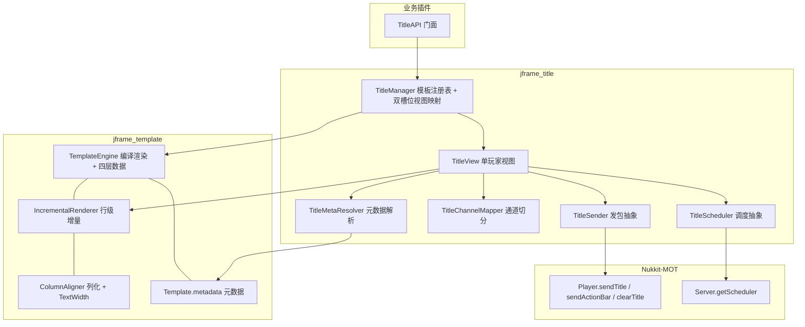
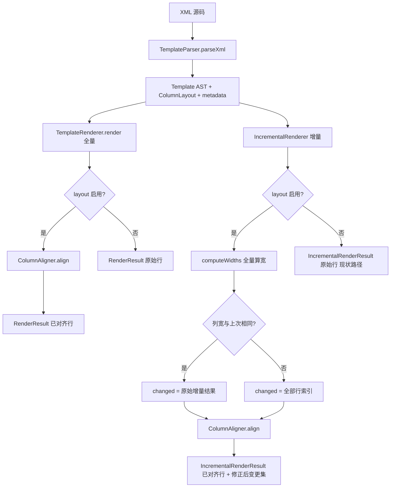
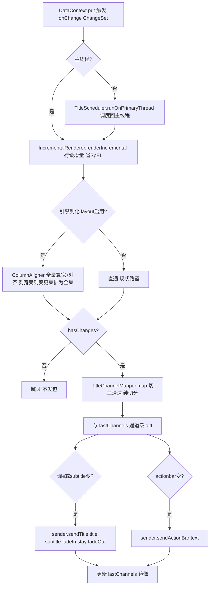
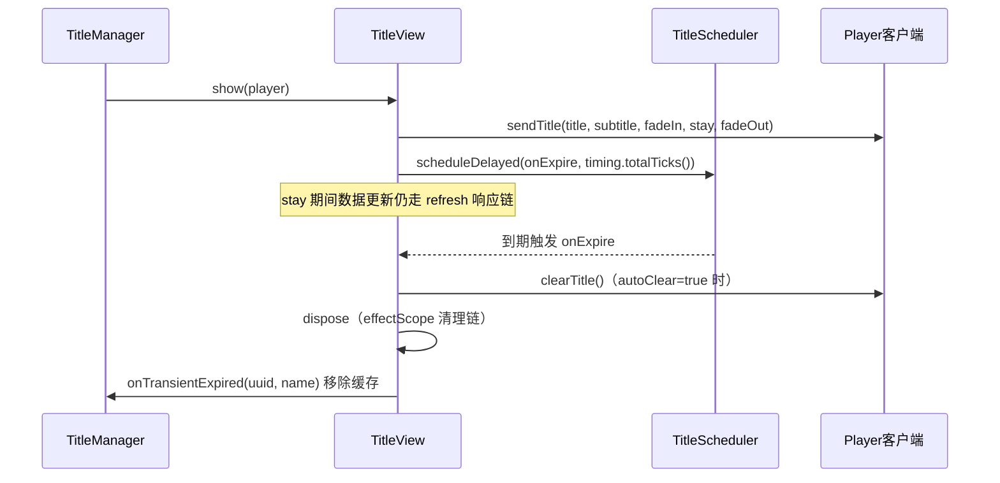

# jframe_title 设计方案 · 基于 Template 的响应式 Title 内容显示 API（v2）

> **文档定位**：本文件是 `jframe_title` 模块的**设计文档**（先出方案、用户同意后才实现）。
> 目标是提供一套「基于 jframe_template 模板引擎的响应式 Title 内容显示 API」，覆盖
> **title（主标题）/ subtitle（副标题）/ actionbar（动作栏）三通道**，支持**数据驱动的响应式更新**
> 与**定时显示**。
>
> **v2 关键变化**：列格式（列对齐）能力**上移至 jframe_template 引擎**（不再由 title 模块后处理），
> 引擎同时新增通用的**元数据标签机制**（模板携带模块特有配置，子模块按需读取）。
> 引擎扩展设计独立成[第三章](#三jframe_template-引擎扩展设计)，未来可拆出为引擎模块独立设计文档。
>
> 本文档只做设计，不包含任何实现代码。文中 Java 代码均为**签名草案 / 用法示例**。
> title 侧架构与 [jframe_scoreboard_depend_template](../jframe_scoreboard_depend_template/src/main/java/io/github/JiangHu/jframe/scoreboard/ScoreboardAPI.java)
> 同构（三层：API → Manager → View），定时显示与元数据消费为 title 特有扩展。

---

## 修订记录

| 日期 | 版本 | 内容 |
|------|------|------|
| 2026-08-22 | v1.0 | 初版设计：三通道映射（约定 + 可覆盖）、列格式后处理器（TitleColumnFormatter）、通道级增量输出、瞬时/常驻双模式 + 双槽位模型、TitleSender/TitleScheduler 适配层、Spring 五步曲接入、测试计划与实施步骤 |
| 2026-08-22 | **v2.0** | **依据用户架构评审意见修订**：① 推翻 v1 决策 B——列格式能力从 title 模块后处理**上移至 jframe_template 引擎**（未来 scoreboard、浮空字等模块同样需要列支持）；② 引擎新增通用**元数据标签机制**（`<meta>`），模板可携带模块特有配置，title 的通道映射/时序等配置改为「模板元数据 + Builder 显式覆盖」双来源；③ title 模块 column 子包整体移除，channel 子包改为元数据解析；④ 实施步骤重组为三阶段（引擎扩展 → title 模块 → main 接入 + 文档）；⑤ 测试计划拆分为引擎侧与 title 侧双矩阵 |

**v2 修订的驱动意见（用户原文）**：

> "架构设计修改意见：列支持可以集成到 template 中，因为未来别的模块也需要列支持；template 应该支持额外数据标签，用于给使用 template 的 scoreboard 和 title 等子模块来适配模块自身的特殊特性内容"

---

## 目录

- [〇、调查结论摘要](#〇调查结论摘要)
- [一、需求分析与设计目标](#一需求分析与设计目标)
- [二、架构总览](#二架构总览)
- [三、jframe_template 引擎扩展设计](#三jframe_template-引擎扩展设计)
  - [3.1 扩展动机与能力边界](#31-扩展动机与能力边界)
  - [3.2 列格式能力](#32-列格式能力)
  - [3.3 元数据标签机制](#33-元数据标签机制)
  - [3.4 引擎扩展类清单与签名草案](#34-引擎扩展类清单与签名草案)
  - [3.5 向后兼容承诺](#35-向后兼容承诺)
- [四、关键设计决策（title 模块）](#四关键设计决策title-模块)
- [五、类设计（title 模块）](#五类设计title-模块)
- [六、数据流与响应式更新](#六数据流与响应式更新)
- [七、定时显示设计](#七定时显示设计)
- [八、生命周期 KeepAlive](#八生命周期-keepalive)
- [九、Spring 接入五步曲](#九spring-接入五步曲)
- [十、测试计划](#十测试计划)
- [十一、实施步骤（三阶段）](#十一实施步骤三阶段)
- [十二、风险与开放问题](#十二风险与开放问题)

---

## 〇、调查结论摘要

设计前的调查发现（作为本设计的扎根依据，均已对照源码核实）。

### 0.1 jframe_title 现状

- 模块是**空壳**：仅有 [pom.xml](pom.xml)（继承父 POM，无任何自有依赖）与空包目录
  `src/main/java/io/github/JiangHu/jframe/title/`。
- 包根已确定为 `io.github.JiangHu.jframe.title`。
- 根 POM 已全局提供 Nukkit-MOT（provided）、Spring 6.2.1、Lombok、JUnit 5.11.4（test）。

### 0.2 参考模块 jframe_scoreboard_depend_template（同构母版）

三层结构（本模块照抄骨架、按 title 特性扩展）：

| 层 | 类 | 职责 |
|----|----|------|
| 门面 | [ScoreboardAPI.java](../jframe_scoreboard_depend_template/src/main/java/io/github/JiangHu/jframe/scoreboard/ScoreboardAPI.java) | 实现 `ForPlugin<ScoreboardPluginScope>`，纯委托；`create(TemplateEngine)` 静态工厂 |
| 管理 | [ScoreboardManager.java](../jframe_scoreboard_depend_template/src/main/java/io/github/JiangHu/jframe/scoreboard/ScoreboardManager.java) | 模板注册表 + `cachedViews`（UUID→模板名→View）KeepAlive 缓存 + `activeTemplate` 激活标记 + `onPlayerQuit` |
| 视图 | [ScoreboardView.java](../jframe_scoreboard_depend_template/src/main/java/io/github/JiangHu/jframe/scoreboard/ScoreboardView.java) | 构造 `(UUID, ScoreboardTemplate, DataContext, TemplateEngine)`；`show/reactivate → deactivate → dispose` 三段式；`refresh(ChangeSet)` 增量渲染；`EffectScope.register(dataContext::dispose)` 清理链 |

关键机制（已核实签名，title 直接复用）：

- **主线程调度**：`refresh` 内 `try { if (!Server.getInstance().isPrimaryThread()) { scheduleTask(...); return; } } catch (Exception ignored) {}`——异步线程自动调度回主线程，单元测试环境（Server 未初始化）直接当前线程执行。
- **增量渲染**：`new IncrementalRenderer()`（有状态、每 View 独立持有）；`renderFull(Template, DataContext)` 首次/结构变更回退；`renderIncremental(DataContext, ChangeSet)` 产出
  [IncrementalRenderResult](../jframe_template/src/main/java/io/github/JiangHu/jframe/content_template/IncrementalRenderResult.java)
  （`getTitle / getAllLines / getChangedLineIndices / isTitleChanged / isStructureChanged / hasChanges`）。
- **四层数据**：引擎全局（`engine.getGlobalData`）→ 玩家全局（`engine.getPlayerData(uuid)`，Session）→ 模板全局（`engine.getTemplateData(name)`）→ 视图局部（`HierarchicalDataContext.of(playerGlobal)`，Request）；读取优先级 玩家 > 模板 > 引擎。
- **Spring 装配**：[scoreboard-spring.xml](../jframe_scoreboard_depend_template/src/main/resources/scoreboard-spring.xml) 单向 DAG `templateEngine → scoreboardManager → scoreboardAPI`（构造器注入）。

### 0.3 模板引擎 jframe_template 的预留契约

[RenderResult.java](../jframe_template/src/main/java/io/github/JiangHu/jframe/content_template/RenderResult.java)
Javadoc 已为 title 预留映射约定：

> 标题（未来）：title → 主标题；lines[0] → 副标题

模板语法：`<template>` 根、`<title>`、`<line>`、块级 `<if>/<elif>/<else>` 与
`<for items="..." var="..." index="..." max="n">`、行内 `<if>/<for>`、插值 `{{ SpEL 表达式 }}`。
引擎层**完全通用**，
不理解 scoreboard / title 等概念——本设计通过[第三章](#三jframe_template-引擎扩展设计)的引擎扩展
（列格式 + 元数据）在**保持该边界**的前提下满足 title 的需求。

### 0.4 Nukkit Title API（实现时需核对）

项目内无 `sendTitle / sendActionBar` 既有调用，本地 Maven 仓库默认路径下也未找到
`cn.nukkit:Nukkit` jar（仓库可能位于其他磁盘）。本设计按 Nukkit 系（Nukkit / Nukkit-MOT 同源）公认 API 编写：

| 方法（`cn.nukkit.Player`） | 用途 |
|------|------|
| `sendTitle(String title)` | 仅主标题 |
| `sendTitle(String title, String subtitle)` | 主标题 + 副标题 |
| `sendTitle(String title, String subtitle, int fadeIn, int stay, int fadeOut)` | 主标题 + 副标题 + 三段时序（tick） |
| `sendActionBar(String text)` | 动作栏文本 |
| `clearTitle()` | 清除当前 title/subtitle 显示 |

> ⚠️ **以上签名与 `Server.getScheduler()` 的 `scheduleTask / scheduleDelayedTask / scheduleRepeatingTask`
> 重载形式，实现第一步必须以本地 Nukkit-MOT jar 反编译或源码核对为准**（见 [12.1](#十二风险与开放问题)）。
> 为隔离该风险，所有 Nukkit 调用收敛到 `DefaultTitleSender / DefaultTitleScheduler` 两个适配类（见决策 E）。

### 0.5 引擎源码深读结论（v2 新增，扩展引擎的扎根依据）

v2 要修改 jframe_template 引擎本身，以下为实现级结论（均已逐行核实）：

| # | 结论 | 涉及源码 | 对扩展设计的影响 |
|---|------|----------|------------------|
| 1 | `Template` **不可变**，两个 public 构造器（XML：`titleNodes + lineEntries`；纯文本：`textNodes`），`isXmlTemplate()` 以 `lineEntries != null` 判断 | [Template.java](../jframe_template/src/main/java/io/github/JiangHu/jframe/content_template/Template.java) | 新增 `columnLayout / metadata` 字段须走**新构造器**（旧构造器委托默认值），外部零破坏 |
| 2 | 解析器对 `<template>` **直接子级的未知标签静默忽略**（`default -> { /* 忽略未知标签 */ }`）；`<template>` **根元素属性当前完全未读取** | [TemplateParser.java](../jframe_template/src/main/java/io/github/JiangHu/jframe/content_template/parser/TemplateParser.java) `parseXml` 的 switch | `<meta>` / `<columns>` 需在 switch 中**新增 case 收集**；根属性 `columns` 需新增 `root.getAttribute` 读取——均为纯增量改动，不触碰既有分支 |
| 3 | 编译缓存按**源码 SHA-256**（`compile`）与**名称 + lastModified**（`getTemplate` 热重载）双轨 | [TemplateEngine.java](../jframe_template/src/main/java/io/github/JiangHu/jframe/content_template/TemplateEngine.java) | 列配置/元数据进 AST 后天然随源码哈希缓存，**缓存机制零改动** |
| 4 | `TemplateRenderer` 无状态线程安全：`renderNodes / renderLineEntry`，每行渲染后 `.strip()`；`render(Template, DataContext)` 产出 `RenderResult(title, lines)` | [TemplateRenderer.java](../jframe_template/src/main/java/io/github/JiangHu/jframe/content_template/render/TemplateRenderer.java) | 全量渲染的列化出口放在 `render` 末尾（layout 启用才进入），`renderText` 不涉及（纯文本无行概念） |
| 5 | `IncrementalRenderer` **有状态**：`template / dependencyMap / titleDependencies / lastTitle / lastLines / lastEntryLineCounts`；条目行数变化 → `structureChanged` → 回退 `renderFull`；行文本 `Objects.equals` 逐行比较收集 `changedIndices` | [IncrementalRenderer.java](../jframe_template/src/main/java/io/github/JiangHu/jframe/content_template/render/IncrementalRenderer.java) | 列化作为**产出 IncrementalRenderResult 前的最后阶段**插入；新增 `lastColumnWidths` 状态；`lastLines` 语义定为「**原始行**（未列化）」缓存 |
| 6 | `IncrementalRenderResult`：`changedLineIndices` 在结构变更时为空集（全量重建语义）；`hasChanges = titleChanged ∥ structureChanged ∥ changedLineIndices 非空` | [IncrementalRenderResult.java](../jframe_template/src/main/java/io/github/JiangHu/jframe/content_template/IncrementalRenderResult.java) | 列宽变化时**扩大 changedLineIndices 为全行集**即可复用既有语义（消费方 scoreboard/title 均按「这些行的最终输出变了」理解），无需新增字段 |
| 7 | `DependencyExtractor` 基于 SpEL AST 收集 `PropertyOrFieldReference`，解析失败保守回退 `WILDCARD` | [DependencyExtractor.java](../jframe_template/src/main/java/io/github/JiangHu/jframe/content_template/render/DependencyExtractor.java) | 列配置/元数据是**编译期静态数据**，不进依赖图——`DependencyExtractor` **零改动** |
| 8 | 语法常量集中管理（`TAG_* / ATTR_* / INTERP_* / CTX_*`） | [TemplateConstants.java](../jframe_template/src/main/java/io/github/JiangHu/jframe/content_template/TemplateConstants.java) | 新增 `TAG_META / TAG_COLUMNS / TAG_COLUMN` 与 `ATTR_COLUMNS / ATTR_SEPARATOR / ATTR_WIDTH / ATTR_ALIGN / ATTR_KEY / ATTR_VALUE` 常量，沿用惯例 |
| 9 | scoreboard 消费点：`ScoreboardTemplate.of/builder` 仅包装显示配置（displaySlot/sortOrder/criteriaName）；`ScoreboardView` 消费 `getAllLines / getChangedLineIndices / isStructureChanged / hasChanges`，**不触碰 Template 构造器** | [ScoreboardTemplate.java](../jframe_scoreboard_depend_template/src/main/java/io/github/JiangHu/jframe/scoreboard/ScoreboardTemplate.java)、[ScoreboardView.java](../jframe_scoreboard_depend_template/src/main/java/io/github/JiangHu/jframe/scoreboard/ScoreboardView.java) | 列格式**默认禁用** + 元数据**默认空 Map** 时，scoreboard 编译/渲染/增量路径逐字节与现状一致（见 [3.5](#35-向后兼容承诺)） |
| 10 | 引擎测试风格：JUnit 5 + `@DisplayName`（中文）+ `@Nested` + text block 内嵌 XML + 纯 JDK（不起服务器） | [IncrementalRendererTest.java](../jframe_template/src/test/java/io/github/JiangHu/jframe/content_template/render/IncrementalRendererTest.java)、[TemplateDemoTest.java](../jframe_template/src/test/java/io/github/JiangHu/jframe/content_template/TemplateDemoTest.java) | 引擎扩展测试沿用同风格，新增类测试放 `content_template` / `content_template.column` / `content_template.render` 对应测试包 |

---

## 一、需求分析与设计目标

### 1.1 用户需求原文

v1 需求：

> 为 jframe title 设计一个基于 template 的响应式我的世界 title 内容显示 api，包括 title subtitle
> actionbar 等，支持更新响应显示和定时显示，与 scoreboard 不同的是 title 要求 template 对列格式的额外支持

v2 架构评审意见（驱动本次修订）：

> 列支持可以集成到 template 中，因为未来别的模块也需要列支持；template 应该支持额外数据标签，
> 用于给使用 template 的 scoreboard 和 title 等子模块来适配模块自身的特殊特性内容

### 1.2 需求拆解

| # | 需求点 | 对应设计 |
|---|--------|----------|
| R1 | 基于 template 的内容显示 | 复用 jframe_template（XML + SpEL + 增量渲染），TitleTemplate 打包显示配置 |
| R2 | title / subtitle / actionbar 三通道 | 通道映射三级来源（引擎约定 + 模板元数据 + Builder 覆盖），见决策 A |
| R3 | 更新响应显示 | 四层数据 + HierarchicalDataContext + IncrementalRenderer（含引擎级列化）+ 通道级 diff，见第六章 |
| R4 | 定时显示 | TitleTiming（fadeIn/stay/fadeOut）+ 瞬时/常驻双模式 + actionbar 周期续期，见第七章；时序配置支持模板元数据声明 |
| R5 | 列格式支持（v2 上移引擎） | **jframe_template 引擎级列格式能力**（`columns` 根属性 + `<columns>` 配置块 + ColumnAligner 增量列化），title 仅消费，见[3.2](#32-列格式能力) |
| R6 | 模板携带模块特有配置（v2 新增） | **jframe_template 引擎级元数据标签**（`<meta key value/>` 编译期收集、运行时只读、引擎语义中立），title 经 `title.*` 命名空间消费，见[3.3](#33-元数据标签机制) |

### 1.3 设计目标

1. **同构**：与 scoreboard 三层结构、API 命名、KeepAlive 语义、Spring 五步曲完全同构，降低学习成本。
2. **引擎通用、模块自治**（v2 改写）：jframe_template 扩展只沉淀**跨模块通用能力**（等宽文本列排版、
   模板元数据携带），**不理解任何游戏显示概念**；title/scoreboard 等子模块的特有语义（通道映射、时序、
   displaySlot）全部由各模块解析元数据自行实现。
3. **向后兼容**：引擎扩展在不启用时（无 `columns` / 无 `<meta>`）行为与现状**完全一致**，
   scoreboard 模块零改动零感知。
4. **可测试**：发包与调度抽象为接口（TitleSender / TitleScheduler），引擎列化/元数据为纯函数，
   核心逻辑可纯 JDK 测试，不依赖 Nukkit 运行时。
5. **网络友好**：title 模块的输出单位是「通道」而非「行」，增量输出按通道 diff，无变化不发包。

---

## 二、架构总览

### 2.1 分层结构（v2）

```
TemplateEngine（jframe_template，通用模板引擎：XML 解析 + SpEL 渲染 + 增量渲染 + 四层数据）
    ├── [v2新增] column/ColumnAligner + TextWidth      列格式：渲染后列化阶段（增量协作）
    ├── [v2新增] Template.metadata                      元数据：<meta> 编译期收集，运行时只读
    └── IncrementalRenderer                             行级增量 + 列宽变化时扩大变更行集合
    ↑
TitleManager（模板注册表 + 双槽位玩家视图映射 + KeepAlive 缓存 + 生命周期）
    ↑
TitleAPI（门面，ForPlugin<TitlePluginScope>，纯委托）  ← 业务插件入口

TitleView（单玩家视图：模板 + 数据 + 通道映射 + 增量输出 + 定时任务）
    ├── TitleMetaResolver    模板元数据 → title 显示配置（title.* 命名空间解析与校验）
    ├── TitleChannelMapper   RenderResult → 三通道切分（title / subtitle 行 / actionbar 行）
    ├── TitleSender          Nukkit 发包抽象（DefaultTitleSender → Player.sendTitle / sendActionBar / clearTitle）
    └── TitleScheduler       调度抽象（DefaultTitleScheduler → Server.getScheduler：延迟 / 周期 / 主线程）
```

> 与 v1 的差异：列格式（TitleColumnFormatter/TextWidth 等）从 title 模块移除，由引擎
> `column` 包承担；title 新增 `TitleMetaResolver` 消费引擎元数据。

### 2.2 模块结构规划

#### 2.2.1 jframe_template（v2 扩展，详见[第三章](#三jframe_template-引擎扩展设计)）

```
jframe_template/src/main/java/io/github/JiangHu/jframe/content_template/
├── Template.java                        # [修改] 新增 columnLayout / metadata 字段与构造器
├── TemplateConstants.java               # [修改] 新增 meta/columns 标签与属性常量
├── parser/TemplateParser.java           # [修改] 解析根属性 columns、<columns> 块、<meta> 标签
├── render/TemplateRenderer.java         # [修改] render 出口列化（layout 启用时）
├── render/IncrementalRenderer.java      # [修改] 增量列化 + lastColumnWidths 状态
└── column/                              # [新增包]
    ├── ColumnLayout.java                # 列布局配置（不可变；DISABLED 单例）
    ├── ColumnSpec.java                  # 单列策略（对齐 + 宽度）
    ├── ColumnAlign.java                 # LEFT / CENTER / RIGHT
    ├── ColumnWidth.java                 # AUTO / FIXED(n) 宽度策略
    ├── ColumnAligner.java               # 列化算法（纯函数核心 + 列宽计算）
    └── TextWidth.java                   # 显示宽度计算（颜色码 0 宽 / CJK 2 宽）
```

#### 2.2.2 jframe_title（v2 修订）

```
jframe_title/
├── pom.xml                                          # 依赖 jframe_core + jframe_template + junit(test)
├── DESIGN.md                                        # 本文档
└── src/
    ├── main/
    │   ├── java/io/github/JiangHu/jframe/title/
    │   │   ├── TitleAPI.java                        # 门面
    │   │   ├── TitleManager.java                    # 管理器（双槽位）
    │   │   ├── TitleView.java                       # 单玩家视图
    │   │   ├── TitleTemplate.java                   # Template + 显示配置打包（Builder；融合元数据）
    │   │   ├── TitleTiming.java                     # 时序值对象（fadeIn/stay/fadeOut）
    │   │   ├── TitleMode.java                       # PERSISTENT / TRANSIENT 枚举
    │   │   ├── TitleConstants.java                  # 常量
    │   │   ├── TitlePluginScope.java                # 插件绑定模板加载作用域
    │   │   ├── channel/
    │   │   │   ├── TitleChannels.java               # 三通道输出值对象
    │   │   │   ├── TitleChannelMapper.java          # RenderResult → 三通道映射（纯切分，无列格式化）
    │   │   │   ├── TitleMetaKeys.java               # [v2新增] title.* 元数据 key 常量与解析规则
    │   │   │   └── TitleMetaResolver.java           # [v2新增] Template.metadata → TitleMetaConfig（解析+校验）
    │   │   ├── nukkit/
    │   │   │   ├── TitleSender.java                 # 发包抽象接口
    │   │   │   ├── DefaultTitleSender.java          # Player 直发实现（Nukkit 签名核对点）
    │   │   │   ├── TitleScheduler.java              # 调度抽象接口
    │   │   │   └── DefaultTitleScheduler.java       # Server.getScheduler 实现（核对点）
    │   │   └── config/
    │   │       └── TitleSpringConfig.java           # @Configuration + @ImportResource
    │   └── resources/
    │       └── title-spring.xml                     # Bean DAG：templateEngine → titleManager → titleAPI
    └── test/java/io/github/JiangHu/jframe/title/
        ├── TitleMetaResolverLogicTest.java          # [v2新增] 元数据解析/校验/优先级
        ├── TitleChannelMapperLogicTest.java
        ├── TitleTemplateLogicTest.java              # Builder > meta > 默认 三级优先级矩阵
        ├── TitleViewLogicTest.java                  # RecordingTitleSender + ManualTitleScheduler 测试桩
        └── TitleManagerLogicTest.java
```

> **v1 → v2 类清单变化**：
>
> | 变化 | 类 | 说明 |
> |------|----|------|
> | ❌ 移除 | `title/column/` 整包（ColumnFormat / ColumnSpec / ColumnAlign / ColumnWidth / TitleColumnFormatter / TextWidth） | 列能力上移引擎 `content_template.column` 包 |
> | ❌ 移除 | `TitleColumnFormatterLogicTest`、`TextWidthLogicTest`（title 侧） | 对应测试移至引擎侧（ColumnAlignerLogicTest / TextWidthLogicTest） |
> | ➕ 新增 | `channel/TitleMetaKeys`、`channel/TitleMetaResolver`、`TitleMetaResolverLogicTest` | 元数据解析（title.* 命名空间） |
> | ✏️ 修改 | `TitleTemplate`（融合元数据三级来源）、`TitleChannelMapper`（去掉列格式化步骤）、`TitleConstants`（移除列常量） | 见第四/五章 |

### 2.3 架构图（v2）



---

## 三、jframe_template 引擎扩展设计

> 本章为 v2 新增的**引擎级扩展设计**，与 title 模块解耦（scoreboard、浮空字等未来消费方同等受益）。
> 本章内容未来可拆出为 `jframe_template/COLUMN_AND_META_DESIGN.md` 独立维护。

### 3.1 扩展动机与能力边界

**动机**（用户评审意见）：

1. **列格式是跨模块需求**：title 的中央多行面板、scoreboard 的多列信息行、浮空字的表格式
   排版，本质都是「多行文本按分隔符拆列、按显示宽度对齐」——同一能力不应在每个子模块重复实现。
2. **模板需要携带模块特有配置**：通道映射、时序、displaySlot 等配置与模板内容天然同源同生命周期
   （换模板即换配置），由模板文件自描述比「代码里逐个 Builder 注册」更符合数据驱动思想。

**能力边界**（引擎扩展后仍然保持的通用性承诺）：

| 能力 | 引擎职责 | 子模块职责 |
|------|----------|------------|
| 列格式 | 按分隔符拆列、显示宽度计算、列宽策略、对齐/截断、增量列化——**纯文本排版**，不知道结果将显示在 title 还是 scoreboard | 决定是否启用（写不写 `columns`）、消费已对齐的行文本 |
| 元数据 | `<meta>` 编译期收集为 `Map<String,String>`，运行时只读——**语义黑盒** | 定义 key 命名空间、解析、校验、fallback |

> 列对齐依赖「等宽字体」假设，这是 Minecraft 显示媒介的公共属性而非 title 特有属性；
> 显示宽度计算（颜色码 0 宽 / CJK 2 宽）同样是 scoreboard / 浮空字通用的——因此两者归引擎，
> 不违反「引擎与游戏内容无关」原则（引擎理解的仍是**字符串排版**，不是任何游戏 UI 概念）。

### 3.2 列格式能力

#### 3.2.1 模板语法设计

**候选方案对比**：

| 方案 | 描述 | 优点 | 缺点 |
|------|------|------|------|
| C1 根属性开关 | `<template columns="\|">`，行内分隔符拆列，全列统一默认策略（LEFT + AUTO） | 语法最简；零学习成本 | 无法逐列配置对齐/宽度/截断——「右列右对齐数字」这类基本诉求表达不了 |
| C2 独立配置块 | `<columns><column align="right" width="10"/></columns>` 声明逐列策略 | 表达力完整 | 单独出现时「是否启用」语义含糊；简单场景也要写块结构，啰嗦 |
| **C3 根属性 + 配置块结合（推荐）** | `columns` 根属性声明分隔符（启用开关）；可选 `<columns>` 块逐列覆盖策略（缺省 LEFT + AUTO） | 简单场景一行属性搞定；复杂场景逐列可配；两语法正交、可独立出现（`<columns>` 块单独出现即隐式启用，分隔符取默认 `\|`） | 两个入口需在文档中写清优先级（仅分隔符一处：根属性 > 默认值） |

**采纳 C3**。完整语法：

```xml
<template columns="|">                        <!-- ① 根属性：出现即启用列格式，值为分隔符 -->
    <meta key="title.subtitle.to" value="4"/> <!-- 元数据，见 3.3 -->
    <columns>                                  <!-- ② 可选：逐列策略，按声明顺序对应第 0/1/2... 列 -->
        <column align="left"/>                 <!-- 第 0 列：左对齐 + AUTO 宽（均为默认可省） -->
        <column align="right"/>                <!-- 第 1 列：右对齐 + AUTO 宽 -->
        <column align="center" width="10"/>    <!-- 第 2 列：居中 + 固定宽 10（超宽截断加省略号） -->
    </columns>
    <title>§6玩家统计</title>
    <line>名字|{{player.name}}</line>
    <line>金币|{{coins}}|{{coinsRank}}</line>
    <line>等级|{{level}}|{{levelRank}}</line>
</template>
```

**语法规则**：

| 规则 | 内容 |
|------|------|
| 启用条件 | 根属性 `columns` 存在，**或** `<columns>` 块存在（二者其一即启用；均缺失 = 禁用，行为与现状完全一致） |
| 分隔符 | `columns` 属性值；仅 `<columns>` 块启用时取默认 `\|`；属性存在但值为空串 → `TemplateParseException`（fail-fast，避免「静默用默认值」的歧义） |
| `<columns>` 位置 | `<template>` 直接子级，可出现 0 或 1 次（多次 → 解析异常）；建议书写在最前（解析器不强制顺序） |
| `<column>` 属性 | `align`（left/center/right，默认 left）、`width`（`auto` 或正整数，默认 auto） |
| 列策略覆盖 | 第 k 列使用第 k 个 `<column>`；列数超出声明数 → 回退最后一个 `<column>` 的策略；`<columns>` 为空块 → 全列默认（LEFT + AUTO） |
| 行内转义 | 单元格内 `\|` 表示字面 `\|`（与 v1 规则一致，迁移自 v1 4.6.1） |
| 作用范围 | 仅作用于 `lines`（`<line>` 及块级 `<if>/<for>` 展开行）；`<title>` 不参与列化（标题是单行字符串，无列语义） |

#### 3.2.2 渲染管线位置

**候选方案对比**：

| 方案 | 描述 | 优点 | 缺点 |
|------|------|------|------|
| P1 IncrementalRenderer 内部逐行列化 | 每个行条目渲染完成后立即拆列对齐 | 无中间列表 | 列宽是**跨行全局属性**，逐行立即对齐必然用错列宽（后续行可能更宽）；`lastLines` 缓存语义混乱（存原始还是对齐行？）；`TemplateRenderer`（全量路径）无法复用 |
| **P2 渲染后独立列化阶段（推荐）** | 行级 SpEL 求值完成、产出完整行列表后，由 `ColumnAligner` 对**全部行**统一拆列→算宽→对齐→重组；全量路径（TemplateRenderer.render 出口）与增量路径（IncrementalRenderer 产出结果前）共用同一纯函数 | 列宽全局正确；SpEL 增量与列化解耦（求值层保持行级增量，列化层全量重算——各用最便宜的增量单位）；ColumnAligner 可独立测试 | 列化每次全量重算（O(行数×列数) 字符串操作，远比 SpEL 求值廉价，可接受——与 v1 决策 C 的论证一致） |

**采纳 P2**。管线位置图：

```
全量路径：TemplateRenderer.render
    AST × DataContext ──SpEL──▶ rawTitle + rawLines ──▶ [layout 启用?]
                                                    是 ──▶ ColumnAligner.align(rawLines, layout) ──▶ RenderResult(已对齐行)
                                                    否 ──▶ RenderResult(原始行)              ← 现状路径，逐字节一致

增量路径：IncrementalRenderer.renderIncremental
    ChangeSet × 依赖图 ──行级增量 SpEL──▶ rawLines + rawChangedIndices   ← 现有逻辑零改动
        └─[layout 启用?]─ 否 ──▶ IncrementalRenderResult(原始行)          ← 现状路径
                        └ 是 ──▶ ColumnAligner.computeWidths(rawLines, layout)
                                  ├─ 列宽未变 → aligned = align(rawLines)；changed = rawChangedIndices
                                  │            （对齐确定性：原始行不变 + 列宽不变 ⇒ 对齐行不变）
                                  └─ 列宽已变 → aligned = align(rawLines)；changed = 全部行索引
                                  └─▶ IncrementalRenderResult(aligned, changed, ...)
```

#### 3.2.3 TextWidth 显示宽度计算（引擎工具类）

从 v1 的 title 模块上移为引擎工具（通用性论证见 3.1），规则不变：

| 输入 | 宽度 |
|------|------|
| 颜色/格式代码 `§x`（§ 后跟一个代码字符） | 0 |
| 颜色代码 `&x` 转义形式（& 后跟一个代码字符） | 0（两种转义都按 0 宽处理，是否把 `&x` 翻译为 `§x` 由业务层决定，宽度计算不依赖翻译） |
| CJK 字符（含中文标点、全角形式） | 2 |
| 其他（ASCII / 半角） | 1 |

配套 `truncateToWidth(text, keepWidth, ellipsis)`：按显示宽度截断，颜色代码不计宽但保留尾部
最后一个颜色/重置代码以延续样式（`§r` 交互问题见 [12.6](#十二风险与开放问题)）。

#### 3.2.4 列宽与对齐策略（语义规则表）

规则自 v1 4.6.1 迁移并通用化（`TitleColumnFormatter` → `ColumnAligner`）：

| 规则 | 内容 |
|------|------|
| 拆列 | 每行按 `separator` 拆分为单元格；`\|`（反斜杠转义）表示字面 `\|`（separator 非默认时转义序列相应跟随，文档示例以 `\|` 为准） |
| 列数不齐 | 某行列数少于最大列数 → 缺失单元格视为空串；多于 → 多余单元格原样拼接进最后一列 |
| 列宽 AUTO | 该列全部单元格 `TextWidth.displayWidth` 最大值；空列（全空串）宽度 0 |
| 列宽 FIXED(n) | 超过 n → `truncateToWidth` 截断加 `...`（省略号宽度计入 n）；不足 n → 按对齐方向补空格 |
| 对齐 | LEFT 左对齐右补空格；RIGHT 右对齐左补空格；CENTER 居中（左侧 `⌊pad/2⌋`、右侧 `⌈pad/2⌉`） |
| 策略覆盖 | 第 k 列使用 `<columns>` 第 k 个 `<column>`（越界回退最后一个；`<columns>` 缺失全列默认 LEFT + AUTO） |
| 重组 | 对齐后的单元格以 `" \| "`（分隔符两侧各一空格）重新拼接为一行——提升可读性 |
| 空行 | 空串行不参与列宽统计，原样输出（面板中做分隔行） |
| 颜色码 | 颜色码 0 宽 ⇒ 含码文本与纯文本同宽对齐，列宽计算天然正确 |

**效果示例**（渲染后原始行 → 列化后输出）：

```
原始行（模板作者写的行）：              列化后（消费方拿到的 allLines）：
名字|{{player.name}}                  名字 | Steve
金币|{{coins}}          ──►           金币 | 12345
等级|{{level}}                      等级 | 42
                                   （"名字/金币/等级"列宽取最大 4，右列 AUTO 对齐；
                                    中文按显示宽度 2 计，两列边缘整齐）
```

#### 3.2.5 API 设计

**Template 暴露列配置**：

```java
// Template.java 新增（旧构造器委托 ColumnLayout.DISABLED / Map.of()，外部零破坏）
public ColumnLayout getColumnLayout();          // 永不返回 null；未启用时为 ColumnLayout.DISABLED
public boolean isColumnLayoutEnabled();         // 便捷判断
```

**RenderResult / IncrementalRenderResult 输出已对齐行**（推荐方案，子模块无感）：

- `RenderResult.getLines()` 与 `IncrementalRenderResult.getAllLines()` 返回的行**已经是列化后的最终输出文本**；
- **不**在结果对象上新增列信息字段（列宽、单元格结构等）——评估过「携带列结构供子模块二次加工」的方案，
  缺乏第二个用例（当前所有消费方都只需要最终文本），且会让结果对象语义膨胀；未来确有需求再扩展
  （加字段不破坏兼容）；
- 子模块（title/scoreboard）对列化**完全无感**：它们拿到的行文本直接可显示。

**ColumnAligner 对外 API**（引擎内部组件，同时公开供高级场景直接使用）：

```java
public final class ColumnAligner {
    /** 纯函数：对行集合执行 拆列→算宽→对齐/截断→重组。layout 禁用时原样返回。 */
    public static List<String> align(List<String> lines, ColumnLayout layout);
    /** 纯函数：只计算各列宽度（增量协作用：与上次宽度比较判断是否扩大变更集）。 */
    public static int[] computeWidths(List<String> lines, ColumnLayout layout);
}
```

#### 3.2.6 增量协作（IncrementalRenderer 扩展）

**核心矛盾**：列宽是跨行全局属性——任一行第 k 列文本变长，**其他行**（即使原始文本未变）对齐后的
输出也会变。这与 IncrementalRenderer「只重渲染受影响行」的模型冲突。

**解决方案：三层各用最便宜的增量单位**（v1 决策 C 的分层思想保留，执行位置从 title 模块移入引擎）：

```
第 1 层 SpEL 求值   → 保持行级增量（依赖图命中才重求值，未变行复用 lastLines 缓存原始行，省 CPU）
第 2 层 列宽重算    → 全量重算 computeWidths(allRawLines)（O(行×列) 字符串操作，廉价）
第 3 层 变更集修正  → 列宽数组与 lastColumnWidths 逐元素比较：
                      · 全部相等 → changedLineIndices = 原始增量比较结果（对齐确定性保证正确）
                      · 任一不同 → changedLineIndices = 0..n-1 全集（列宽变化时扩大变更行集合）
第 4 层 输出        → allLines = align(allRawLines)（已对齐最终文本）
```

**IncrementalRenderResult.changedLineIndices 语义适配**（不新增字段，复用既有语义）：

> `changedLineIndices` 的语义从「原始行文本变化的行」精确化为「**最终输出行文本变化的行**」。
> 对 scoreboard（现状唯一消费方）：未启用列格式时两者恒等（回归测试钉死）；启用列格式的未来
> 消费方按「这些行的最终显示文本变了」理解即可，无需关心是内容变化还是列宽变化引起。

**IncrementalRenderer 状态扩展**：

| 新增字段 | 说明 |
|----------|------|
| `int[] lastColumnWidths` | 上次列化时各列宽度（null = 尚未列化过）；`lastLines` 语义明确为「**原始行**缓存」（列化后的行不缓存，每次由纯函数重算——保证列宽逻辑无隐藏状态） |
| `ColumnLayout currentLayout` | 随 `template` 一并设置（renderFull 时） |

**结构变更回退**：条目行数变化 → 回退 `renderFull` → 全量渲染同样走列化出口 → 返回
`structureChanged = true`（全量重建语义不变，列化不改变结构变更判定）。

**边界情形**：`changeSet` 为空 → 直接返回上次结果（含已对齐行）——现状逻辑，列化不引入新路径。

### 3.3 元数据标签机制

#### 3.3.1 语法设计

**候选方案对比**：

| 方案 | 描述 | 优点 | 缺点 |
|------|------|------|------|
| **M1 显式 `<meta key value/>`（推荐）** | `<meta key="title.timing.stay" value="60"/>`，可出现在 `<template>` 直接子级、可多个 | 语法显式、意图清晰；key 唯一性强（Map 语义自然）；解析实现最小（两个属性）；与 HTML `<meta>` 心智模型一致 | 单 key 单值——多值配置需拆多个 key（如 title.timing.fadeIn/stay/fadeOut 三个 key），命名稍长 |
| M2 `<meta>` 携带任意属性 Map | `<meta key="title.timing" fadeIn="10" stay="60" fadeOut="20"/>`，属性集合即值 | 单 key 聚合多值 | API 退化为 `Map<String, Map<String,String>>`，嵌套取值啰嗦；「哪些属性是配置、哪些是保留字」无约束；YAGNI——当前无必须多值的用例 |
| M3 任意未知标签透传收集 | 解析器把所有未知标签（标签名 + 属性）收进元数据 | 零语法新增 | 与现状「未知标签静默忽略」冲突（拼写错误的 `<lne>` 会变成神秘元数据而非被忽略）；标签名进入 key 空间，命名空间管理混乱；调试困难 |

**采纳 M1**。语法规则：

```xml
<template>
    <meta key="title.subtitle.from" value="0"/>
    <meta key="title.subtitle.to" value="4"/>
    <meta key="title.actionbar.line" value="-1"/>
    <meta key="title.timing.stay" value="1000000"/>
    <meta key="title.mode" value="transient"/>
    <title>...</title>
    <line>...</line>
</template>
```

| 规则 | 内容 |
|------|------|
| 位置 | `<template>` 直接子级（与 `<title>` / `<line>` / `<columns>` 同级），可出现任意多次 |
| 属性 | `key`（必填，非空，否则 `TemplateParseException`）、`value`（必填，允许空串） |
| 顺序 | 不敏感；`<meta>` 可穿插在行之间（建议集中写在最前，可读性） |
| 重复 key | **后声明覆盖先声明**（与 Spring 属性覆盖惯例一致），不报错——热重载/组合模板场景下覆盖是有用语义 |
| 纯文本模板 | `compileText` 无 XML 结构，**无元数据**（`getMetadata()` 返回空 Map），子模块 fallback 到 Builder 显式配置（见 3.3.4） |

#### 3.3.2 Template API

```java
// Template.java 新增
/** 模板元数据（<meta> 编译期收集；XML 模板可为空 Map，纯文本模板恒为空 Map）。不可变，保序。 */
public Map<String, String> getMetadata();                 // 永不返回 null
public Optional<String> getMetadata(String key);          // 便捷读取
```

**结构化 `List<TemplateTag>` 的取舍**：评估过保留标签声明顺序与重复信息的结构化方案
（`record TemplateTag(String key, String value)` 列表）。不采纳：① 当前所有设想用例（title 通道/
时序、scoreboard displaySlot）都是「按 key 查值」，Map 查找 O(1) 且 API 最简；② 重复 key 覆盖
语义下顺序信息无消费方；③ Map 可直接 `forEach` 遍历做前缀过滤（子模块扫 `title.*`）。若未来出现
「需要保留重复 key 顺序」的用例，可新增 `getMetadataTags()` 方法，不破坏现有 API。

#### 3.3.3 引擎语义中立（不校验 key/value）

引擎对元数据的**唯一**约束是 XML 良构性（key/value 属性存在且 key 非空）。key 命名、值格式、
取值范围全部由子模块定义与校验。理由：

1. **职责边界**：引擎若校验 `title.timing.stay` 必须是正整数，就必须理解「title」「timing」
   「stay」的概念——模块语义泄漏进引擎，违背 [RenderResult](../jframe_template/src/main/java/io/github/JiangHu/jframe/content_template/RenderResult.java)
   Javadoc 确立的「引擎与游戏内容无关」原则。
2. **演进自由**：子模块新增 key（如未来 `title.actionbar.refresh`）不需要改引擎；新模块
   （bossbar、浮空字）自带命名空间（`bossbar.*` / `ft.*`）即插即用。
3. **失败局部化**：非法值在**子模块解析时** fail-fast（如 TitleMetaResolver 抛
   `IllegalArgumentException`，中文消息指明模板名 + key + 原值），比引擎期报错更能定位问题
   （引擎不知道哪个模块消费这个 key，报错无从指明去向）。

**key 命名空间约定**（文档约定，引擎不强制）：`<模块前缀>.<语义路径>`，如 `title.*`、
`scoreboard.*`。子模块只解析自己前缀的 key，**其余 key 一律忽略**（可能属于其他模块）。

#### 3.3.4 与 compileText 纯文本模板的关系

纯文本模板（`compileText`，用于 actionbar 单行动态文本等场景）没有 XML 结构，无法携带 `<meta>`：

- `getMetadata()` 恒返回空 Map——**API 契约统一**（消费方永远不需要判空）；
- 子模块 fallback 规则：元数据缺失的配置项退化为**内置默认值**，且 Builder 显式配置永远可用——
  即纯文本模板的全部显示配置走 Builder（与 v1 行为一致，见决策 A 三级来源）。

### 3.4 引擎扩展类清单与签名草案

#### 3.4.1 新增类（`io.github.JiangHu.jframe.content_template.column` 包）

```java
package io.github.JiangHu.jframe.content_template.column;

/** 对齐方向。 */
public enum ColumnAlign { LEFT, CENTER, RIGHT }

/**
 * 列宽策略：AUTO（取该列全部行的最大显示宽度，不足补空格）
 *          FIXED(n)（固定宽度 n，超宽按截断策略收窄）。
 * 不可变值对象，工厂：ColumnWidth.auto() / ColumnWidth.fixed(int n)。
 */
public final class ColumnWidth {
    public static ColumnWidth auto();
    public static ColumnWidth fixed(int width);   // width <= 0 抛 IllegalArgumentException
    public boolean isAuto();
    public int getFixedWidth();
}

/** 单列策略：对齐 + 宽度。工厂：ColumnSpec.left() / right() / center()，可链式 .width(ColumnWidth)。 */
public final class ColumnSpec {
    public static ColumnSpec left();
    public static ColumnSpec right();
    public static ColumnSpec center();
    public ColumnSpec width(ColumnWidth width);   // 默认 auto
    public ColumnAlign getAlign();
    public ColumnWidth getWidth();
}

/**
 * 列布局配置（编译期由 TemplateParser 从根属性 columns + <columns> 块构建，随 Template 不可变持有）。
 * columns 策略列表为空时对全部列应用默认策略（LEFT + AUTO）。
 */
public final class ColumnLayout {
    public static final ColumnLayout DISABLED;    // 单例：禁用（未启用列格式的模板共用）
    public static ColumnLayout enabled(String separator, List<ColumnSpec> columns);  // 分隔符非空校验
    public boolean isEnabled();
    public String getSeparator();                 // 启用时恒非空
    public List<ColumnSpec> getColumns();         // 启用时可为空列表（全列默认策略）
}

/**
 * 列化算法——纯函数、无状态、线程安全（渲染后独立阶段，见 3.2.2）。
 * 语义规则表见 3.2.4。
 */
public final class ColumnAligner {
    /** 拆列 → 全量列宽重算 → 逐列对齐/截断 → 以 " | " 重组行。layout 禁用时原样返回入参。 */
    public static List<String> align(List<String> lines, ColumnLayout layout);
    /** 只计算各列显示宽度（AUTO 列 = 最大内容宽；FIXED 列 = 固定值）。增量协作的比较基准。 */
    public static int[] computeWidths(List<String> lines, ColumnLayout layout);
}

/** 显示宽度计算（颜色码 0 宽 / CJK 2 宽，见 3.2.3）。纯静态工具。 */
public final class TextWidth {
    /** §x / &x 颜色格式代码 → 0 宽；CJK（含中文标点、全角）→ 2 宽；其他 → 1 宽。 */
    public static int displayWidth(String text);
    /** 按显示宽度截断（保留前 keepWidth 宽度，颜色代码不计宽但保留在尾部以延续样式）。 */
    public static String truncateToWidth(String text, int keepWidth, String ellipsis);
}
```

#### 3.4.2 修改类

| 类 | 修改点 |
|----|--------|
| [TemplateConstants.java](../jframe_template/src/main/java/io/github/JiangHu/jframe/content_template/TemplateConstants.java) | 新增：`TAG_META = "meta"`、`TAG_COLUMNS = "columns"`、`TAG_COLUMN = "column"`；`ATTR_COLUMNS = "columns"`（根属性）、`ATTR_SEPARATOR`（预留）、`ATTR_WIDTH = "width"`、`ATTR_ALIGN = "align"`、`ATTR_KEY = "key"`、`ATTR_VALUE = "value"`；列默认值 `DEFAULT_COLUMN_SEPARATOR = "\|"`、`TRUNCATE_ELLIPSIS = "..."`（自 v1 TitleConstants 迁移） |
| [Template.java](../jframe_template/src/main/java/io/github/JiangHu/jframe/content_template/Template.java) | 新增字段 `columnLayout`（默认 DISABLED）与 `metadata`（默认空 LinkedHashMap 不可变包装）；新增全参构造器，**旧两个构造器保留并委托默认值**（scoreboard 等现有调用方零改动）；新增 `getColumnLayout() / isColumnLayoutEnabled() / getMetadata() / getMetadata(String)` |
| [TemplateParser.java](../jframe_template/src/main/java/io/github/JiangHu/jframe/content_template/parser/TemplateParser.java) | `parseXml` 增强：① 读根属性 `columns`（`root.getAttribute`，空值且存在 → 解析异常）；② switch 新增 `case TAG_COLUMNS`（解析 `<column>` 列表 → ColumnLayout，重复块 → 异常）与 `case TAG_META`（收集 key/value → LinkedHashMap，key 缺失/空 → 异常）；③ 未知标签**维持静默忽略**（现状策略不变，M3 方案否决的依据）；④ `parseText` 不变（纯文本无元数据） |
| [TemplateRenderer.java](../jframe_template/src/main/java/io/github/JiangHu/jframe/content_template/render/TemplateRenderer.java) | `render` 末尾：`lines = template.isColumnLayoutEnabled() ? ColumnAligner.align(lines, template.getColumnLayout()) : lines;`（一行出口列化；`renderText` 不涉及） |
| [IncrementalRenderer.java](../jframe_template/src/main/java/io/github/JiangHu/jframe/content_template/render/IncrementalRenderer.java) | ① 新增状态 `lastColumnWidths / currentLayout`（renderFull 时随 template 设置）；② `renderFull` 与 `renderIncremental` 的返回前插入列化阶段（算法见 3.2.6：`lastLines` 存原始行；列宽变化 → changedLineIndices 扩为全集）；③ layout 禁用时**不进入任何新分支**（现状路径逐字节一致）；④ `reset()` 清理新状态 |

#### 3.4.3 引擎扩展数据流



### 3.5 向后兼容承诺

**承诺**：不含 `columns` 根属性、不含 `<columns>` 块、不含 `<meta>` 标签的模板，其编译产物
（除新增的默认值字段外）与渲染/增量行为和扩展前**完全一致**；scoreboard 模块**零改动、零感知**。

**论证**（对照 0.5 深读结论逐点）：

| 路径 | 兼容性 |
|------|--------|
| 编译 | `TemplateParser` 新增 case 只在遇到新标签/属性时触发；旧模板走原 switch 分支 + 旧构造器（委托默认值）；源码哈希缓存 key 不变 |
| 全量渲染 | `TemplateRenderer.render` 出口列化有 `isColumnLayoutEnabled()` 守卫，禁用时直接返回原 lines |
| 增量渲染 | `IncrementalRenderer` 列化阶段同样有守卫；`lastLines` 语义（原始行）在禁用时与现状（唯一行形态）恒等；`changedLineIndices` 语义精确化在禁用时与原语义恒等 |
| 消费方 | scoreboard 只调用 `getAllLines / getChangedLineIndices / isStructureChanged / hasChanges`，这些方法签名与语义（禁用列格式时）不变；`ScoreboardTemplate` 不触碰 Template 新 API |
| 元数据 | 旧模板 `getMetadata()` 返回空 Map——新 API 对旧模板是纯增量信息 |

**回归保障**（纳入阶段一验收，见[第十一章](#十一实施步骤三阶段)）：

1. 现有引擎测试（TemplateDemoTest / IncrementalRendererTest / TemplateEngineThreeLayerDataTest / HierarchicalDataContextTest）**全绿不改**；
2. scoreboard 模块测试全绿（`mvn -pl jframe_scoreboard_depend_template -am test`）；
3. 新增「禁用列格式时输出逐字节等于扩展前」的对照回归用例（同一模板 + 同一数据，断言
   `getAllLines` 与手工预期完全一致、`changedLineIndices` 与原始增量比较结果一致）。

---

## 四、关键设计决策（title 模块）

### 决策 A：三通道映射——「引擎预留约定 + 模板元数据 + Builder 显式覆盖」三级来源（v2 修订）

**背景**：[RenderResult](../jframe_template/src/main/java/io/github/JiangHu/jframe/content_template/RenderResult.java)
只有 `title + lines` 两个字段，title 模块需要把这份 raw 数据映射到三个 Nukkit 通道。
v1 采用「约定 + Builder 覆盖」两级；v2 引擎元数据机制后，模板文件本身可以自描述映射配置，
形成三级来源。

**候选方案对比**：

| 方案 | 描述 | 优点 | 缺点 |
|------|------|------|------|
| A1 纯约定 | 固定 `title→主标题`、`lines[0]→副标题`、`lines[1]→动作栏` | 零配置、与引擎 Javadoc 预留完全一致 | 无法表达「多行副标题面板」「无动作栏」「动作栏取第 3 行」 |
| A2 纯显式配置 | 每个模板必须在 Builder 里声明完整映射 | 完全灵活 | 啰嗦；99% 场景就是预留约定的形态；模板与配置分离两处维护 |
| A3 约定 + Builder 覆盖（v1 采纳） | 默认 = A1 约定；Builder 可覆盖 | 零配置可用、需要时灵活 | 配置在代码里——模板文件不自描述，热重载换模板无法换配置 |
| **A4 约定 + 模板元数据 + Builder 覆盖（v2 推荐）** | 默认 = A1 约定；模板 `<meta key="title.*">` 声明；Builder 显式设置优先级最高 | 三级渐进：零配置 → 模板自描述（换模板即换配置，与内容同生命周期）→ 代码级覆盖（运行时动态场景）；与 Spring「约定优于配置」一脉相承 | 需定义优先级规则与校验时机（见下）；三级来源的调试成本略高（文档 + 日志弥补） |

**采纳 A4**。三级来源与优先级规则：

| 优先级 | 来源 | 说明 |
|--------|------|------|
| ① 最高 | Builder 显式设置 | `TitleTemplate.builder(...).subtitleLines(0, 6)` ——运行时动态覆盖（如同一模板在不同玩法下不同映射） |
| ② 中 | 模板元数据 | `<meta key="title.subtitle.to" value="6"/>`——模板文件自描述 |
| ③ 最低 | 内置默认（= 引擎预留约定） | `title→主标题`、`lines[0]→副标题`、`lines[1]→动作栏` |

**title.* 元数据 key 命名空间**（由 `TitleMetaKeys` 常量类定义，`TitleMetaResolver` 解析）：

| key | 类型 | 默认 | 对应 Builder 项 |
|-----|------|------|-----------------|
| `title.subtitle.from` | int ≥ 0 | 0 | `subtitleLines(from, to)` 的 from |
| `title.subtitle.to` | int ≥ from | 1 | `subtitleLines(from, to)` 的 to（半开区间） |
| `title.actionbar.line` | int，-1 禁用 | 1 | `actionbarLine(index)` |
| `title.timing.fadeIn` | int ≥ 0 | 10 | `timing(...)` |
| `title.timing.stay` | int ≥ 0 | 70 | `timing(...)` |
| `title.timing.fadeOut` | int ≥ 0 | 20 | `timing(...)` |
| `title.mode` | persistent / transient | persistent | `mode(...)` |
| `title.autoclear` | true / false | true | `autoClear(...)` |
| `title.actionbar.refresh` | int ≥ 0，0 不续期 | 0 | `actionBarRefreshInterval(...)` |

**校验规则与时机**（fail-fast，集中在 `TitleTemplate.of / build()`）：

1. **元数据解析期**（`TitleMetaResolver.resolve(Template)`）：`title.*` key 的值非法
   （非数字 / 越界 / 枚举名不识别）→ `IllegalArgumentException`，中文消息含模板名 + key + 原值
   （引擎不校验的理由见 3.3.3，校验责任在 title）；
2. **融合校验期**（三级来源合并后）：`actionbarLine >= 0` 且落在 `[subtitleFrom, subtitleTo)` →
   `IllegalArgumentException`（「动作栏行与副标题区间重叠，请调整区间或禁用动作栏」）；
   `from > to` / 负数 → 同样 fail-fast；
3. **未知 key**：`title.*` 前缀但不在上表（如 `title.foo`）→ **warning 日志不报错**（可能是
   更高版本的 key，向前兼容）；非 `title.*` 前缀 → 静默忽略（属于其他模块）。

**示例**：

```java
// 一级：零配置（约定映射）
TitleTemplate t1 = TitleTemplate.of("welcome", template);

// 二级：模板自描述（XML 内声明，换模板即换配置）
//   <meta key="title.subtitle.to" value="4"/>
//   <meta key="title.actionbar.line" value="-1"/>
TitleTemplate t2 = TitleTemplate.of("stats", statsTemplate);   // 自动读取上述元数据

// 三级：Builder 覆盖元数据（优先级最高）
TitleTemplate t3 = TitleTemplate.builder("stats", statsTemplate)
        .actionbarLine(2)            // 覆盖元数据里的 -1
        .build();                    // 其余配置仍来自元数据/默认值
```

### 决策 B：列格式实现位置——引擎级能力，title 纯消费（v2 推翻 v1-B3）

**背景**：title 常用于屏幕中央多行信息面板（副标题支持换行），需要「多行文本按列对齐形成表格」
的能力。v1 采纳 B3（title 模块内 `TitleColumnFormatter` 渲染后处理），v2 依据用户评审意见推翻。

**v1 → v2 决策变更对照**：

| | v1（B3：模块内后处理） | v2（B4：引擎级能力） |
|---|---|---|
| 决策 | title 内实现 TitleColumnFormatter，引擎零改动 | jframe_template 新增 column 包 + 解析/渲染/增量扩展，title 删除自有列实现 |
| 当时理由 | 引擎保持通用；列宽跨行全局属性与增量模型冲突；「只有 title 需要」 | —— |
| 推翻原因 | **「只有 title 需要」前提不成立**（用户指出 scoreboard、浮空字等未来模块同样需要列支持——重复实现 N 遍 + 各模块行为漂移）；显示宽度计算（颜色码/CJK）同样是跨模块通用需求，并非 title 特有 | |
| 遗留顾虑的化解 | 「破坏引擎通用定位」→ 列对齐本质是**等宽文本排版**（字符串 → 字符串的纯函数），引擎仍不理解任何游戏 UI 概念（3.1 边界论证）；「与行级增量模型冲突」→ 渲染后独立列化阶段 + 列宽变化扩大变更集，增量模型完整保留（3.2.2 / 3.2.6） | |

**候选方案对比（v2 视角）**：

| 方案 | 描述 | 评价 |
|------|------|------|
| B1 引擎新增列标签（v1 原案） | 引擎增加 XML 列语法，渲染期直接产出对齐文本 | v1 否决理由「破坏通用性/与增量冲突」已被 3.1/3.2.6 化解；且「跨模块复用」成为压倒性正面理由——**本方案即 v2 采纳案**（实现细节见第三章） |
| B3 模块内后处理（v1 采纳案） | title 内实现，引擎零改动 | 每个需要列的模块重复实现 + 行为漂移；TextWidth 等工具无法共享——被用户评审否决 |
| **B4 引擎级列能力（v2 采纳）** | 同 B1（列语法 + 列化管线 + 增量协作全部引擎级，见第三章） | 一次实现全局复用；模板语法层面统一（scoreboard 未来启用只需加 `columns` 属性）；title 模块删除 column 包，`TitleChannelMapper` 纯切分 | 

**title 侧的消费方式**：

- `TitleView` 渲染链路中**不存在任何列格式代码**——`IncrementalRenderResult.getAllLines()`
  返回的已是列化后文本；
- `TitleChannelMapper.map` 只做「行区间切分 + \n 拼接 + actionbar 行提取」，**不再调用列格式化器**
  （v1 该步骤删除）；
- 不保留薄封装（评估：v1 的 `TitleColumnFormatter` 在引擎提供 `ColumnAligner` 后无任何剩余职责，
  保留空壳只会误导使用者以为 title 还有列逻辑——**彻底移除**；高级场景直接用引擎
  `ColumnAligner.align` 静态方法）。

### 决策 C：增量渲染与列格式的协作——引擎内语义（v2 修订，分层思想保留）

**背景**：列宽是跨行全局属性——任一行第 k 列文本变长，**其他行**（即使文本未变）对齐后的输出也会变。
v1 的解法是 title 模块内三层分层（SpEL 行级增量 / 列宽全量重算 / 通道级 diff）；v2 列化上移引擎后，
前两层成为**引擎内语义**，title 只保留第三层。

**v2 分层**：

| 层 | 位置 | v1 | v2 |
|----|------|----|----|
| SpEL 求值增量 | 引擎 IncrementalRenderer | 引擎（现状） | 不变 |
| 列宽全量重算 + 变更集修正 | **引擎 IncrementalRenderer 列化阶段** | title 模块 TitleColumnFormatter | **上移引擎**（3.2.6：列宽变化 → changedLineIndices 扩为全集） |
| 通道级 diff 输出 | title TitleView | title 模块 | 不变（比较 `TitleChannels` 三通道最终字符串，无变化不发包） |

**title 与 scoreboard 的输出粒度差异**（v1 论证保留，仍是通道 diff 的依据）：

| | scoreboard | title |
|---|---|---|
| 输出单位 | 行（每行独立 FakeScorer，行级增量直接省网络包） | **通道**（subtitle 无论多少行，最终都是**一次** `sendTitle` 调用的参数） |
| 增量的主要收益 | 网络（少发 SetScorePacket） | **CPU**（少执行 SpEL 求值） |

**候选方案对比**（v1 表格保留，结论不变，仅第 2 层执行者变化）：

| 方案 | 描述 | 评价 |
|------|------|------|
| C1 列格式启用即全量渲染 + 全量重发 | 简单粗暴 | SpEL 全量求值浪费 CPU；且「全量重发」对 title 而言与通道 diff 成本相同（都是一次 sendTitle），C1 的「省」只省在了不该省的地方 |
| C2 逐行 diff + 依赖列宽传播分析 | 精确到「哪列宽度变了 → 哪些行受影响」 | 复杂度高收益低：引擎层已用「列宽变化 → 全集」保守策略，行级精确传播的结果对通道 diff 无增益 |
| **C3 分层增量（推荐，v2 引擎内化）** | SpEL 行级增量（引擎）+ 列宽全量重算与变更集修正（引擎）+ 通道 diff（title） | 每层用最便宜的增量单位；正确性由「全量列宽重算」保证；未启用列格式时引擎列化层直通 |

### 决策 D：瞬时 / 常驻双模式 + 双槽位模型（v2 保留，配置来源扩展）

**背景**：title 与 scoreboard 的本质差异——scoreboard 是**常驻** UI（侧边栏一直在），
title 是**瞬时**显示（公告弹出后消失）；但 actionbar 信息栏又是常驻形态。
且实际场景中「常驻 actionbar 信息栏 + 瞬时 title 公告」需要**同时存在**。

**双模式**（挂在 TitleTemplate 上，模板决定形态；v2 起可由元数据 `title.mode` 声明，Builder 可覆盖）：

| 模式 | 行为 | KeepAlive | 到期处理 |
|------|------|-----------|----------|
| `PERSISTENT`（默认） | 常驻显示，响应式持续更新 | 与 scoreboard 完全一致（deactivate 保留数据，reactivate 恢复） | 无到期 |
| `TRANSIENT` | 显示一次，`fadeIn + stay + fadeOut` 到期后自动清理 | 不参与 KeepAlive（到期即 dispose） | 到期：`autoClear=true`（元数据 `title.autoclear`）时 `clearTitle()` → dispose → 从 Manager 移除 |

> 瞬时模式在 stay 期间**仍然响应数据更新**（如倒计时公告每秒更新剩余时间）——
> 瞬时 ≠ 静态，只是多了「到期自动清理」。

**双槽位**（TitleManager 内部，与 scoreboard 单激活标记的关键差异）：

```
每个玩家两个显示槽：
  TITLE 槽     ← title + subtitle 通道（物理上客户端同一时刻只有一组 title/subtitle）
  ACTIONBAR 槽 ← actionbar 通道
一个模板按其通道映射占用槽位：有副标题内容 → 占 TITLE 槽；actionbar 启用 → 占 ACTIONBAR 槽。
show 时：目标模板占用的槽若被其他激活模板占用 → 先 deactivate 旧视图（KeepAlive），再激活新视图。
```

**候选方案对比**：

| 方案 | 描述 | 评价 |
|------|------|------|
| D1 单激活（完全同构 scoreboard，一个玩家一个 view） | 简单 | 「信息栏 + 公告」场景下公告 show 会顶掉信息栏，且公告 dispose 后信息栏无法自动恢复——核心场景不可用 |
| **D2 双槽位（推荐）** | TITLE 槽与 ACTIONBAR 槽独立激活/切换/KeepAlive | 常驻信息栏与瞬时公告互不干扰；实现仅是把 `activeTemplate: UUID→String` 拆成两个映射，复杂度增量小 |
| D3 通道级三槽（title / subtitle / actionbar 各一槽） | 最细粒度 | title 与 subtitle 由同一次 `sendTitle` 调用发送，拆开会导致互相覆盖，物理上不可行 |

**采纳 D2**。

### 决策 E：TitleSender / TitleScheduler 适配层（v2 保留）

**背景**：测试计划要求纯逻辑测试（不依赖 Nukkit 运行时）；且 Nukkit title API 签名尚未本地核对（0.4）。

把所有 Nukkit 交互收敛到两个接口 + 两个默认实现：

- **TitleSender**（发包）：`DefaultTitleSender` 持有 `Player`，是**唯一**调用
  `sendTitle / sendActionBar / clearTitle` 的类 → Nukkit 签名核对点收敛到一处。
- **TitleScheduler**（调度）：`DefaultTitleScheduler` 是**唯一**调用
  `Server.getInstance() / getScheduler()` 的类，同时承担 scoreboard View 内联的
  「主线程检测 + 调度回主线程」职责 → 定时任务（瞬时到期、actionbar 续期）在测试中可用手动时钟驱动。

收益：① 核心逻辑（元数据解析 / 通道映射 / diff / 生命周期状态机）可纯 JDK 测试（注入
`RecordingTitleSender` + `ManualTitleScheduler` 测试桩）；② Nukkit 版本差异风险隔离；
③ `TitleView` 不再出现 `try-catch Server` 样板（由 scheduler 接口的默认实现承担）。

---

## 五、类设计（title 模块）

> 以下签名均为草案。Javadoc 风格与 scoreboard 一致（中文、含使用示例）。
> 引擎扩展的类签名见[3.4](#34-引擎扩展类清单与签名草案)。

### 5.1 TitleAPI —— 门面

```java
package io.github.JiangHu.jframe.title;

/** Title 显示 API（面向用户的统一入口）：轻量门面，纯委托给 TitleManager。 */
public class TitleAPI implements ForPlugin<TitlePluginScope> {

    public TitleAPI(TitleManager manager, TemplateEngine engine);

    // ===== 模板管理（同构 scoreboard）=====
    public TitleTemplate loadTemplate(String name, String xmlSource);   // 编译 + 元数据融合包装 + 注册
    public TitleTemplate loadTemplate(String name);                     // 经引擎 loader 链加载
    public void loadTemplate(TitleTemplate template);                   // 注册预构建模板

    // ===== 显示控制 =====
    public TitleView show(Player player, String templateName);          // 常驻/瞬时统一入口（形态由模板 mode 决定）
    public int showIf(Predicate<Player> predicate, String templateName);
    public int showAll(String templateName);
    public void hide(Player player);                                    // deactivate 该玩家全部激活视图（双槽）
    public void hideAll();

    // ===== 数据更新（四层，与 scoreboard 完全同构，含 Map 批量变体）=====
    public void updatePlayer(Player player, String key, Object value);          // 玩家全局 Session
    public void updatePlayerAll(Player player, Map<String, Object> entries);
    public void update(Player player, String key, Object value);                // 当前激活视图局部
    public void update(Player player, Map<String, Object> entries);
    public void updateAll(String key, Object value);                            // 全部激活视图局部
    public void updateAll(Map<String, Object> entries);
    public void updateGlobal(String key, Object value);                         // 引擎全局
    public void updateGlobalAll(Map<String, Object> entries);
    public void updateTemplate(String templateName, String key, Object value);  // 模板全局
    public void updateTemplateAll(String templateName, Map<String, Object> entries);

    // ===== 数据访问 =====
    public DataContext getPlayerDataContext(Player player);
    public DataContext getDataContext(Player player);   // 当前 TITLE 槽激活视图的局部上下文
    public DataContext getGlobalDataContext();
    public DataContext getTemplateDataContext(String templateName);
    public TitleView getView(Player player);            // TITLE 槽激活视图
    public TitleView getActionBarView(Player player);   // ACTIONBAR 槽激活视图

    // ===== 生命周期 =====
    public void onPlayerQuit(Player player);            // PlayerQuitEvent 中调用
    public void disposeAll();                           // 彻底清理全部视图与定时任务（onDisable 用，见 9.5）

    // ===== 内部组件 / ForPlugin / 工厂（同构 scoreboard）=====
    public TitleManager getManager();
    public TemplateEngine getEngine();
    @Override public TitlePluginScope forPlugin(Plugin plugin);
    @Override public TitlePluginScope forPlugin(String pluginName);
    public static TitleAPI create(TemplateEngine engine);
}
```

### 5.2 TitleManager —— 管理器（双槽位）

```java
package io.github.JiangHu.jframe.title;

/** Title 管理器：模板注册表 + 双槽位玩家视图映射 + KeepAlive 缓存 + 生命周期。 */
public class TitleManager {

    private final TemplateEngine engine;
    /** 模板注册表：名称 → TitleTemplate */
    private final ConcurrentHashMap<String, TitleTemplate> templates;
    /** KeepAlive 缓存：UUID →（模板名 → TitleView），同 scoreboard */
    private final ConcurrentHashMap<UUID, ConcurrentHashMap<String, TitleView>> cachedViews;
    /** 双槽位激活标记（与 scoreboard 的单 activeTemplate 的差异点，见决策 D） */
    private final ConcurrentHashMap<UUID, String> activeTitleView;      // TITLE 槽
    private final ConcurrentHashMap<UUID, String> activeActionBarView;  // ACTIONBAR 槽

    public TitleManager(TemplateEngine engine);

    // ===== 模板管理 =====
    public void loadTemplate(TitleTemplate template);
    public TitleTemplate getTemplate(String name);
    public void removeTemplate(String name);   // 同 scoreboard：dispose 全部该模板缓存视图 + engine.removeTemplateData

    // ===== 显示控制 =====
    public TitleView show(Player player, String templateName);
    /** 槽位占用逻辑：遍历模板占用的槽位，deactivate 占用者 → reactivate/新建目标视图。
     *  TRANSIENT 视图到期 dispose 时回调本类的 onTransientExpired(uuid, name) 移除缓存。 */
    public TitleView show(Player player, TitleTemplate template);
    public int showIf(Predicate<Player> predicate, String templateName);
    public int showAll(String templateName);
    public void hide(Player player);
    public void hideAll();
    void onTransientExpired(UUID playerId, String templateName);  // 包级：瞬时视图到期回调

    // ===== 数据更新 / 查询（与 ScoreboardManager 同构，update/updateAll 遍历双槽激活视图）=====
    public void updatePlayer(Player player, String key, Object value);
    public void updatePlayerAll(Player player, Map<String, Object> entries);
    public void update(Player player, String key, Object value);
    public void update(Player player, Map<String, Object> entries);
    public void updateAll(String key, Object value);
    public void updateAll(Map<String, Object> entries);
    public void updateGlobal(String key, Object value);
    public void updateGlobalAll(Map<String, Object> entries);
    public void updateTemplate(String templateName, String key, Object value);
    public void updateTemplateAll(String templateName, Map<String, Object> entries);
    public TitleView getView(Player player);
    public TitleView getActionBarView(Player player);
    public DataContext getDataContext(Player player);
    public DataContext getPlayerDataContext(Player player);
    public DataContext getGlobalDataContext();
    public DataContext getTemplateDataContext(String templateName);

    // ===== 生命周期 =====
    public void onPlayerQuit(Player player);   // dispose 全部缓存视图 + engine.removePlayerData
    public void disposeAll();                  // 全部 dispose（含取消定时任务）
}
```

### 5.3 TitleTemplate —— 模板打包（Builder + 元数据融合，v2 修订）

```java
package io.github.JiangHu.jframe.title;

/**
 * Title 模板：Template + 显示配置打包（对标 ScoreboardTemplate）。
 * v2：显示配置三级来源——Builder 显式设置 > 模板元数据（title.*）> 内置默认（引擎预留约定），
 * 见决策 A。列格式不在此配置（由模板 columns 语法声明，引擎渲染期消费，见第三章）。
 */
public class TitleTemplate {

    private final String name;
    private final Template template;
    private final TitleTiming timing;              // 三级融合结果；默认 TitleTiming.DEFAULT（10/70/20）
    private final TitleMode mode;                  // 默认 PERSISTENT
    private final int subtitleFrom;                // 默认 0（含）
    private final int subtitleTo;                  // 默认 1（不含）→ lines[0]
    private final int actionbarLine;               // 默认 1；-1 = 禁用
    private final boolean autoClear;               // TRANSIENT 到期是否 clearTitle，默认 true
    private final int actionBarRefreshInterval;    // actionbar 续期周期 tick，默认 0 = 不续期

    /** 全默认 + 元数据自动融合：TitleMetaResolver.resolve(template) → 与默认值合并。 */
    public static TitleTemplate of(String name, Template template);
    public static Builder builder(String name, Template template);

    /** 模板占用的槽位（由通道映射推导，Manager 用于双槽切换）。 */
    public boolean occupiesTitleSlot();       // 恒 true（title/subtitle 通道始终由本模板驱动）
    public boolean occupiesActionBarSlot();   // actionbarLine >= 0

    // Getter 略（getName/getTemplate/getTiming/getMode/getSubtitleFrom/getSubtitleTo/
    //          getActionbarLine/isAutoClear/getActionBarRefreshInterval）

    public static class Builder {
        /** 显式覆盖项（null = 未设置 → 落到元数据/默认值，三级来源的①级）。 */
        public Builder timing(TitleTiming timing);
        public Builder mode(TitleMode mode);
        public Builder subtitleLines(int from, int to);   // 半开区间，多行副标题
        public Builder actionbarLine(int index);          // -1 禁用
        public Builder autoClear(boolean clear);
        public Builder actionBarRefreshInterval(int ticks);
        /**
         * 融合与校验（决策 A）：
         * 1. TitleMetaResolver.resolve(template) 解析 title.* 元数据（非法值 IAE fail-fast）；
         * 2. Builder 显式项覆盖元数据项，元数据项覆盖默认值；
         * 3. 融合后校验：from <= to、from >= 0、actionbarLine 不落在 [from, to) 内。
         */
        public TitleTemplate build();
    }
}
```

> 与 v1 的差异：删除 `columnFormat` 字段与 `Builder.columnFormat(...)`（列格式由模板
> `columns` 语法声明，**单一来源于模板**——评估过「Builder 覆盖列布局」后不采纳：列格式是模板
> 作者对内容结构的表达（哪些字段进哪列），不是运行时显示配置；允许 Builder 关闭模板声明的列
> 会造成「模板写了对齐但显示没对齐」的排查陷阱）。

### 5.4 TitleTiming / TitleMode / TitleConstants

```java
package io.github.JiangHu.jframe.title;

/** Title 时序值对象（tick）。不可变。 */
public final class TitleTiming {
    public static final TitleTiming DEFAULT = new TitleTiming(10, 70, 20);
    public static TitleTiming of(int fadeIn, int stay, int fadeOut);  // 负数抛 IllegalArgumentException
    public int getFadeIn();
    public int getStay();
    public int getFadeOut();
    /** 瞬时模式总时长 = fadeIn + stay + fadeOut（到期任务延迟）。 */
    public int totalTicks();
}

/** 视图形态：常驻（KeepAlive 同 scoreboard） / 瞬时（到期自动清理）。 */
public enum TitleMode { PERSISTENT, TRANSIENT }

/** Title 模块常量（v2：列格式常量移除，迁至引擎 TemplateConstants）。 */
public final class TitleConstants {
    private TitleConstants() {}
    public static final int DEFAULT_FADE_IN = 10;                 // 0.5s @20tps
    public static final int DEFAULT_STAY = 70;                    // 3.5s
    public static final int DEFAULT_FADE_OUT = 20;                // 1.0s
    public static final int DEFAULT_ACTIONBAR_REFRESH_INTERVAL = 40;  // 2s 续期建议值
    /** 副标题多行面板的行数建议上限（客户端显示区域有限，超过记 warning 日志，不硬拦截）。 */
    public static final int SUGGESTED_MAX_SUBTITLE_LINES = 8;
}
```

### 5.5 channel 包 —— 元数据解析 + 通道映射（v2 修订）

```java
package io.github.JiangHu.jframe.title.channel;

/** title.* 元数据 key 常量与取值规则（决策 A 的 key 表代码化）。 */
public final class TitleMetaKeys {
    public static final String PREFIX = "title.";
    public static final String SUBTITLE_FROM  = "title.subtitle.from";
    public static final String SUBTITLE_TO    = "title.subtitle.to";
    public static final String ACTIONBAR_LINE = "title.actionbar.line";
    public static final String TIMING_FADE_IN = "title.timing.fadeIn";
    public static final String TIMING_STAY    = "title.timing.stay";
    public static final String TIMING_FADE_OUT= "title.timing.fadeOut";
    public static final String MODE           = "title.mode";
    public static final String AUTOCLEAR      = "title.autoclear";
    public static final String ACTIONBAR_REFRESH = "title.actionbar.refresh";
    // 私有构造 + 已知 key 集合（用于未知 title.* key 的 warning 判断）
}

/**
 * 模板元数据解析结果（仅含模板实际声明的项，Optional 语义）。
 * 不可变值对象，Builder 融合时「有值才覆盖默认」。
 */
public record TitleMetaConfig(
        OptionalInt subtitleFrom, OptionalInt subtitleTo, OptionalInt actionbarLine,
        OptionalInt fadeIn, OptionalInt stay, OptionalInt fadeOut,
        Optional<TitleMode> mode, Optional<Boolean> autoClear, OptionalInt actionBarRefresh) {
    public static final TitleMetaConfig EMPTY = ...;
}

/**
 * 元数据解析器：Template.getMetadata() 中 title.* 项 → TitleMetaConfig（纯函数，无状态）。
 * 校验策略（决策 A / 3.3.3）：
 *  - 值非法（非 int / 负数 / 枚举名不识别）→ IllegalArgumentException（中文消息：模板名 + key + 原值）；
 *  - title.* 前缀但非已知 key → JFrameLog warning（不抛）；
 *  - 非 title.* 前缀 → 静默忽略（其他模块的命名空间）。
 */
public final class TitleMetaResolver {
    public static TitleMetaConfig resolve(Template template);
}

/** 三通道输出值对象（发包层的比较与发送单位，见决策 C）。不可变。 */
public final class TitleChannels {
    /** @param title 主标题（null 归一化为 ""）@param subtitle 副标题（多行已 \n 拼接；行文本已由引擎列化）*/
    public TitleChannels(String title, String subtitle, String actionbar);
    public String getTitle();
    public String getSubtitle();
    public String getActionbar();   // 禁用/行不存在时为 null
    /** 通道级 diff：与 old 比较，返回发生变化的通道集合（TITLE/SUBTITLE 视为一个发送单元）。 */
    public boolean titleOrSubtitleChanged(TitleChannels old);
    public boolean actionbarChanged(TitleChannels old);
}

/**
 * 通道映射器：RenderResult + TitleTemplate 映射配置 → TitleChannels（纯函数，无状态）。
 * v2：纯切分——不做列格式化（引擎已完成，见决策 B）。
 */
public final class TitleChannelMapper {
    /**
     * 步骤：title 归一化 → 切副标题行区间 [from, to)（越界裁剪）→ \n 拼接
     *      → actionbar 行（不存在/禁用 → null）。
     */
    public static TitleChannels map(RenderResult result, TitleTemplate template);
}
```

### 5.6 nukkit 包 —— 适配层（决策 E，v2 无变化）

```java
package io.github.JiangHu.jframe.title.nukkit;

/** Title 发包抽象：绑定单个 Player。所有 Nukkit sendTitle/sendActionBar/clearTitle 调用的唯一入口。 */
public interface TitleSender {
    /** 一次调用同时更新 title + subtitle 通道（Nukkit 语义，签名实现时核对）。 */
    void sendTitle(String title, String subtitle, int fadeIn, int stay, int fadeOut);
    void sendActionBar(String text);
    void clearTitle();
    /** 创建绑定指定玩家的 Sender（工厂，Manager 创建 View 时使用）。 */
    static TitleSender of(Player player) { return new DefaultTitleSender(player); }
}

/** Player 直发实现 —— Nukkit-MOT 签名核对点（0.4），核对工作只涉及本类。 */
public class DefaultTitleSender implements TitleSender { /* 委托 Player.sendTitle / sendActionBar / clearTitle */ }

/** 调度抽象：延迟任务 / 周期任务 / 主线程检测 / 取消。所有 Server.getScheduler 调用的唯一入口。 */
public interface TitleScheduler {
    /** 延迟 delayTicks 后主线程执行，返回任务句柄。 */
    Object scheduleDelayed(Runnable task, int delayTicks);
    /** 每 periodTicks 周期主线程执行，返回任务句柄。 */
    Object scheduleRepeating(Runnable task, int periodTicks);
    void cancel(Object handle);          // 句柄为 null 时安全跳过
    boolean isPrimaryThread();           // 主线程检测（异步时调用方应 scheduleDelayed(0) 回主线程）
    /** 若当前非主线程则调度到主线程执行（scoreboard refresh 模式的接口化）。 */
    default void runOnPrimaryThread(Runnable task) {
        if (isPrimaryThread()) task.run();
        else scheduleDelayed(task, 0);
    }
    /** 默认实现工厂（Server.getScheduler，签名实现时核对）。 */
    static TitleScheduler defaultScheduler() { return new DefaultTitleScheduler(); }
}

/** Server.getScheduler 实现 —— 核对点；单元测试环境用测试桩替代。 */
public class DefaultTitleScheduler implements TitleScheduler { /* 委托 Server.getInstance().getScheduler() */ }
```

### 5.7 TitleView —— 单玩家视图

```java
package io.github.JiangHu.jframe.title;

/**
 * 单个玩家的 Title 视图：TitleTemplate + HierarchicalDataContext + TitleSender/TitleScheduler 绑定。
 * 三段式生命周期同 ScoreboardView（show/reactivate → deactivate → dispose），
 * 差异：① 输出按通道 diff（决策 C）；② 瞬时模式到期自动 dispose（决策 D）；
 *      ③ actionbar 周期续期任务；④ EffectScope 额外注册定时任务取消。
 * v2：渲染链路无列格式代码——引擎 IncrementalRenderResult.getAllLines 已是列化后文本（决策 B）。
 */
public class TitleView {

    public TitleView(UUID playerId,
                     TitleTemplate template,
                     DataContext dataContext,       // HierarchicalDataContext.of(playerGlobal)
                     TemplateEngine engine,
                     TitleSender sender,            // DefaultTitleSender.of(player)（测试注入 RecordingTitleSender）
                     TitleScheduler scheduler);     // 测试注入 ManualTitleScheduler

    // ===== 生命周期（同构 ScoreboardView，synchronized）=====
    public synchronized void show(Player player);
    public synchronized void reactivate(Player player);
    public synchronized void deactivate(Player player);   // 移除监听 + clearTitle/停发 + 取消定时任务，保留数据与渲染缓存
    public synchronized void dispose(Player player);      // effectScope 清理链：dataContext.dispose + 全部定时任务取消

    // ===== 响应式刷新 =====
    /** DataContext.onChange 触发：scheduler.runOnPrimaryThread 包裹 doRefresh（决策 E）。 */
    public synchronized void refresh(ChangeSet changeSet);
    private synchronized void doRefresh(ChangeSet changeSet);
    /** 手动全量刷新（模板热重载后）。 */
    public synchronized void refresh();

    // ===== 数据操作（同构 ScoreboardView）=====
    public TitleView set(String key, Object value);
    public TitleView setAll(Map<String, Object> entries);
    public DataContext getDataContext();
    public TitleTemplate getTemplate();
    public boolean isShown();
    public boolean isDisposed();
    public boolean isTransient();     // template.getMode() == TRANSIENT 的便捷判断

    // ===== 包级：定时回调（由 scheduler 任务触发，测试桩可手动驱动）=====
    void onExpire();            // 瞬时到期：autoClear → sender.clearTitle() → dispose → manager.onTransientExpired
    void renewActionBar();      // actionbar 续期：重发 lastChannels.actionbar（内容不变仅续命）
}
```

**TitleView 内部状态**（对照 ScoreboardView 增量）：

| 字段 | 说明 |
|------|------|
| `IncrementalRenderer incrementalRenderer` | 有状态，每 View 独立；deactivate 保留（KeepAlive）；内部含引擎列化状态（lastColumnWidths） |
| `TitleChannels lastChannels` | 上次输出的三通道镜像（通道 diff 基准）；deactivate 保留 |
| `Object expireTaskHandle` | 瞬时模式到期任务句柄（TRANSIENT 且激活时非 null） |
| `Object renewTaskHandle` | actionbar 续期周期任务句柄（interval > 0 且激活时非 null） |
| `EffectScope effectScope` | 清理链：`dataContext::dispose` + `() -> scheduler.cancel(expireTaskHandle)` + `() -> scheduler.cancel(renewTaskHandle)` |

### 5.8 TitlePluginScope / config / spring.xml

```java
package io.github.JiangHu.jframe.title;

/** 插件作用域：与 ScoreboardPluginScope 同构（委托 engine.forPlugin(classLoader).withPrefix(prefix)）。 */
public class TitlePluginScope {
    TitlePluginScope(TitleAPI api, ClassLoader classLoader);   // 包级，由 forPlugin 创建
    public TitlePluginScope withPrefix(String prefix);          // 不可变，返回新实例
    public TitleTemplate loadTemplate(String name);             // 默认前缀 "templates/"
    public TitleTemplate loadTemplate(TitleTemplate template);  // 加载后以自定义配置注册（覆盖默认包装）
}
```

```java
package io.github.JiangHu.jframe.title.config;

/** Title 模块 Spring 配置入口（同构 ScoreboardSpringConfig）。 */
@Configuration
@ImportResource("classpath:title-spring.xml")
public class TitleSpringConfig { }
```

```xml
<!-- src/main/resources/title-spring.xml：单向 DAG，同构 scoreboard-spring.xml -->
<bean class="io.github.JiangHu.jframe.content_template.TemplateEngine" id="templateEngine"/>
<bean class="io.github.JiangHu.jframe.title.TitleManager" id="titleManager">
    <constructor-arg name="engine" ref="templateEngine"/>
</bean>
<bean class="io.github.JiangHu.jframe.title.TitleAPI" id="titleAPI">
    <constructor-arg name="manager" ref="titleManager"/>
    <constructor-arg name="engine" ref="templateEngine"/>
</bean>
```

> 说明：`templateEngine` Bean 的定义方式与
> [scoreboard-spring.xml](../jframe_scoreboard_depend_template/src/main/resources/scoreboard-spring.xml)
> 保持一致（各模块 xml 均可声明，Spring 容器按注册顺序处理同名 Bean；现状 scoreboard 已如此运行，
> title 照做，不引入新约定）。

---

## 六、数据流与响应式更新

### 6.1 四层数据模型（与 scoreboard 完全一致）

```
引擎全局（engine.getGlobalData）              ← Application，所有玩家共享
    ↑ parent
玩家全局（engine.getPlayerData(uuid)）        ← Session，该玩家所有模板/模块共享
    ↑ parent
模板全局（engine.getTemplateData(name)）      ← 可选独立层（API 保留，不强制进主链）
    ↑ parent
视图局部（HierarchicalDataContext.of(...)）   ← Request，单视图私有
```

读取优先级：玩家 > 模板 > 引擎；写入隔离（put 只写 local）；parent 变更自动转发到子 onChange。

### 6.2 响应式更新数据流（v2：列化在引擎内）



要点：

1. **titleChanged / 行变更的通道归并**：`IncrementalRenderResult.isTitleChanged()` 或副标题区间内任一行变更
   （含列宽变化导致的变更集扩大）→ `titleOrSubtitleChanged` → **一次** `sendTitle` 同时刷新两通道
   （Nukkit 语义：title 与 subtitle 是同一数据包的字段，无法单独更新）；actionbar 行变更 → 单独 `sendActionBar`。
2. **结构变更**（`isStructureChanged`）：对 title 无特殊处理——通道映射天然基于 `allLines`
   全量切片，行数变化直接体现在新切片里（对比 scoreboard 需要全量重建 FakeScorer，title 更简单）。
3. **无变化跳过**：`hasChanges() == false` 或通道 diff 全等 → 不发任何包。
4. **列格式与增量的协作（v2 引擎内语义）**：见[3.2.6](#326-增量协作incrementalrenderer-扩展)——
   `renderIncremental` 产出的 `allLines` 已是列化后文本（未变行是 SpEL 缓存值经确定性对齐的结果），
   title 模块零列逻辑（决策 B/C）。

### 6.3 使用示例（完整链路，v2）

```java
TitleAPI title = JFrameMain.getInstance().getTitleAPI();

// 1. 注册多行面板模板——列格式 + 通道映射 + 时序全部在模板内自描述（v2 核心用法）
title.loadTemplate("stats", """
    <template columns="|">
        <meta key="title.subtitle.from" value="0"/>
        <meta key="title.subtitle.to" value="4"/>
        <meta key="title.actionbar.line" value="-1"/>
        <meta key="title.timing.stay" value="1000000"/>
        <columns>
            <column align="left"/>
            <column align="right"/>
        </columns>
        <title>§6玩家统计</title>
        <line>名字|{{player.name}}</line>
        <line>金币|{{coins}}</line>
        <line>等级|{{level}}</line>
        <line>公会|{{guild}}</line>
    </template>
    """);
// 零 Builder：TitleTemplate.of 自动融合上述元数据；列对齐由引擎渲染期完成

// 2. Builder 覆盖（三级来源的①级）：同一模板在不同玩法下动作栏取第 0 行
title.loadTemplate(TitleTemplate.builder("stats-hud", statsTpl)
        .subtitleLines(0, 4)
        .actionbarLine(0)
        .build());

// 3. 常驻信息栏模板（纯文本 actionbar + 周期续期；纯文本无元数据 → 全走 Builder）
Template hudTpl = title.getEngine().compileText("§e金币 §f{{coins}} §8| §e等级 §f{{level}}");
title.loadTemplate(TitleTemplate.builder("hud", hudTpl)
        .subtitleLines(0, 0)                        // 副标题空
        .actionbarLine(0)                           // lines[0] → 动作栏
        .actionBarRefreshInterval(40)               // 2s 续期
        .build());

// 4. 瞬时公告模板（mode 由元数据声明）
title.loadTemplate("notice", """
    <template>
        <meta key="title.mode" value="transient"/>
        <meta key="title.timing.stay" value="70"/>
        <meta key="title.subtitle.to" value="3"/>
        <meta key="title.actionbar.line" value="-1"/>
        <title>§6公告</title>
        <line>服务器将于 5 分钟后重启</line>
        <line>请及时下线保存物品</line>
        <line>带来不便敬请谅解</line>
    </template>
    """);

// 5. 显示：hud 常驻 + notice 瞬时，双槽互不干扰（决策 D）
title.show(player, "hud");
title.show(player, "notice");       // 公告弹出，hud 动作栏不受影响

// 6. 响应式更新：金币变化 → 引擎行级增量 + 列宽重算 → stats 面板 subtitle 通道重发
title.updatePlayer(player, "coins", 9999);
```

---

## 七、定时显示设计

### 7.1 TitleTiming 时序

`fadeIn / stay / fadeOut`（tick，20 tps）打包为不可变值对象，挂在 TitleTemplate（默认 10/70/20；
v2 起可由元数据 `title.timing.*` 声明）。每次 `sendTitle` 调用都携带完整时序——**响应式刷新也会
重置客户端的显示时钟**，因此常驻面板应配置大 stay（如示例中的 1000000），避免刷新时面板闪烁。

### 7.2 瞬时模式（TRANSIENT）生命周期



- 到期任务句柄存 `expireTaskHandle`，deactivate（如被新公告顶替）时取消，dispose 时经 EffectScope 取消。
- 瞬时视图**不参与 KeepAlive**：到期即 dispose 并从 `cachedViews` 移除；重复 show 创建新视图。
- `autoClear=false`（元数据 `title.autoclear`）的场景：到期不清屏（客户端自然淡出），仅内部清理。

### 7.3 常驻模式（PERSISTENT）与 actionbar 周期续期

基岩版 actionbar 显示有时效（客户端约数秒后消失，具体时长**实现时核对**），常驻信息栏需周期重发续命：

- `actionBarRefreshInterval > 0`（元数据 `title.actionbar.refresh`）且视图激活且占用 ACTIONBAR 槽 →
  `scheduleRepeating(renewActionBar, interval)`。
- `renewActionBar` 只重发 `lastChannels.actionbar`（内容不变，仅续命）——**不重新渲染**，开销极小。
- 句柄 `renewTaskHandle` 在 deactivate 时取消（KeepAlive 暂停续期），reactivate 时重建，dispose 时经 EffectScope 取消。
- 周期任务回调内部先检查 `isShown() && !isDisposed()`，防御取消竞态。

### 7.4 主线程调度

所有发包与定时回调统一经 `TitleScheduler`：

- `refresh(ChangeSet)` → `scheduler.runOnPrimaryThread(doRefresh)`（接口默认方法：主线程直跑，否则 `scheduleDelayed(task, 0)`）。
- 单元测试注入 `ManualTitleScheduler`（手动时钟）：`runPending(delayTicks)` 驱动到期/续期断言。
- 与 ScoreboardView 的差异：不再在 View 内写 `try-catch Server.getInstance()` 样板——
  Server 未初始化的兼容逻辑移入 `DefaultTitleScheduler`（`isPrimaryThread` 在 Server 未初始化时返回 true，测试环境直跑）。

---

## 八、生命周期 KeepAlive

### 8.1 三段式状态机（常驻视图，同构 scoreboard）

| 方法 | 显示 | dataContext | 渲染监听 | 定时任务 | 用途 |
|------|------|-------------|----------|----------|------|
| `show` / `reactivate` | 显示 | 不动 | 注册 | 重建（续期/到期） | 进入或恢复激活 |
| `deactivate` | 隐藏（clearTitle） | **保留** | 移除 | **取消** | 双槽切换 / hide（KeepAlive） |
| `dispose` | 隐藏 | 销毁 | 全部摘除 | 全部取消 | 玩家退出 / 瞬时到期 / removeTemplate |

> deactivate 的清屏语义与 scoreboard 不同：scoreboard 的 removeViewer 自带清屏包；
> title 的 deactivate 需要**主动调用 `clearTitle()`**（仅当该视图占用 TITLE 槽），否则面板残留在屏幕中央。
> actionbar 无需清屏（到时自然消失）。
> KeepAlive 保留的渲染缓存含引擎列化状态（IncrementalRenderer.lastColumnWidths），reactivate 后无缝续用。

### 8.2 EffectScope 清理链

```java
// TitleView 构造时注册（Vue3 风格清理链，同 ScoreboardView + 定时任务扩展）
effectScope.register(dataContext::dispose);                        // 断开 parent 监听
effectScope.register(() -> scheduler.cancel(expireTaskHandle));    // 瞬时到期任务
effectScope.register(() -> scheduler.cancel(renewTaskHandle));     // actionbar 续期任务
// dispose() → effectScope.dispose() 依次执行，杜绝调度任务与监听器泄漏
```

### 8.3 玩家退出（onPlayerQuit）

与 scoreboard 完全一致：`activeTitleView / activeActionBarView` 移除标记 →
`cachedViews` 全部视图 `dispose`（含定时任务取消）→ `engine.removePlayerData(uuid)`。

### 8.4 双槽切换示例

```
玩家已有 hud（ACTIONBAR 槽）+ stats（TITLE 槽，常驻面板）
  ↓ show(player, "notice")（瞬时公告，占 TITLE 槽）
stats.deactivate()          ← KeepAlive：保留数据/渲染缓存（含列宽缓存），clearTitle 清屏
notice 激活 + 到期任务注册
  ↓ notice 到期 onExpire
notice.clearTitle + dispose + 移除缓存
  ↓ show(player, "stats")   ← 业务可显式切回；或由业务在公告后自行恢复
stats.reactivate()          ← 数据与渲染状态保留，全量重发
```

> 公告到期后是否**自动恢复**被顶替的常驻面板：M1 不做（业务显式 show 恢复，语义清晰），
> 自动恢复列为开放问题（[12.4](#十二风险与开放问题)）。

---

## 九、Spring 接入五步曲

按 [DEVELOPER.md](../jframe_scoreboard_depend_template/src/main/java/io/github/JiangHu/jframe/scoreboard/DEVELOPER.md)
记载的模块注册流程照做：

| 步 | 文件 | 改动 |
|----|------|------|
| ① | `jframe_title/src/main/java/io/github/JiangHu/jframe/title/config/TitleSpringConfig.java`（新建） | `@Configuration` + `@ImportResource("classpath:title-spring.xml")` |
| ② | `jframe_title/src/main/resources/title-spring.xml`（新建） | Bean DAG：`templateEngine → titleManager → titleAPI`（见 5.8） |
| ③ | [ConfigEnum.java](../jframe_main/src/main/java/io/github/JiangHu/jframe/main/utils/ConfigEnum.java) | 新增枚举项 `TITLE(TitleSpringConfig.class)`（置于 `SCOREBOARD` 之后） |
| ④ | [MainSpringConfig.java](../jframe_main/src/main/java/io/github/JiangHu/jframe/main/config/MainSpringConfig.java) | `@Import` 数组追加 `TitleSpringConfig.class` |
| ⑤ | [JFrameMain.java](../jframe_main/src/main/java/io/github/JiangHu/jframe/main/JFrameMain.java) | ① 新增 `getTitleAPI()`（`getApi(TitleAPI.class)`）；② `registerServices` 中 `server.getServiceManager().register(TitleAPI.class, getTitleAPI(), this, ServicePriority.NORMAL)`；③ `onDisable` 清理钩子（见下） |
| ⑥ | [jframe_main/pom.xml](../jframe_main/pom.xml) | `<dependencies>` 追加 `jframe_title`（1.0-SNAPSHOT，compile） |
| ⑦ | [jframe_title/pom.xml](pom.xml) | 追加依赖：`jframe_core`、`jframe_template`、`junit`（test）——对齐 scoreboard 模块 pom |

**onDisable 清理钩子（与 scoreboard 的差异）**：scoreboard onDisable 调 `hideAll()`（deactivate，
保留缓存）；title 因持有**调度任务句柄**（瞬时到期 / actionbar 续期），仅 deactivate 已取消任务但缓存视图
仍在——插件卸载场景应彻底清理，故调用 `titleAPI.disposeAll()`（dispose 全部视图 + 取消全部任务 +
`engine.removePlayerData` 不动——玩家数据生命周期归引擎/退出事件管理，disposeAll 只清本模块视图）。

---

## 十、测试计划

> v2 拆分为**引擎侧**与 **title 侧**双矩阵。全部沿用现有 `*Test / *LogicTest` 风格
> （JUnit 5 + `@DisplayName` 中文 + `@Nested` + text block + 纯 JDK，不起服务器）。

### 10.1 引擎侧测试（jframe_template，阶段一交付）

| 测试类 | 用例清单 |
|--------|----------|
| `TextWidthLogicTest`（column 包） | 纯 ASCII 宽度；颜色代码 `§a`/格式代码 `§l` 0 宽；`&x` 转义形式 0 宽；连续代码；中文/中文标点宽 2；混排合计；`truncateToWidth` 保留尾部颜色代码、省略号宽度计入 |
| `ColumnAlignerLogicTest`（column 包） | 基本两列对齐（AUTO）；列数不齐（缺失=空串、多余并入末列）；FIXED 截断加 `...`、不足补空格；LEFT/CENTER/RIGHT（奇数 pad 的左右分配）；`\|` 转义；空行直通；颜色码不影响列宽（含码文本与纯文本同宽对齐）；CJK 与 ASCII 混合列对齐；columns 越界回退最后一项策略；`computeWidths` 与 `align` 一致性；DISABLED 布局原样返回 |
| `TemplateParserColumnMetaTest`（parser 包） | `columns` 根属性解析（启用 + 分隔符）；`columns` 属性空串 → TemplateParseException；`<columns>` 块解析（align/width 属性、默认值）；`<columns>` 块单独出现隐式启用（默认分隔符）；重复 `<columns>` 块 → 异常；`<column>` 非法 width → 异常；`<meta>` 基本收集 / 多个 / 重复 key 后者覆盖 / key 缺失或空 → 异常；**未知标签仍然静默忽略**（M3 否决依据的回归钉死）；旧语法模板（无新标签）编译产物与扩展前等价（getColumnLayout = DISABLED、getMetadata 为空） |
| `IncrementalRendererColumnTest`（render 包） | layout 启用：renderFull 输出已对齐行；未变行 + 列宽未变 → changedLineIndices 仅含原始变更行；任一行变长导致列宽变化 → changedLineIndices 扩为全集；结构变更（块级 for 行数变化）回退全量且输出已对齐；空 changeSet 直通；**layout 禁用回归：输出与 changedLineIndices 与扩展前行为逐字节一致**（对照用例） |
| `TemplateRendererColumnTest`（render 包） | render 出口列化（启用时 lines 已对齐、title 不参与列化）；renderText 不受影响 |
| 现有测试回归 | TemplateDemoTest / IncrementalRendererTest / TemplateEngineThreeLayerDataTest / HierarchicalDataContextTest **全绿不改**；`mvn -pl jframe_scoreboard_depend_template -am test` 全绿 |

### 10.2 title 侧测试（jframe_title，阶段二交付）

核心可测性来自决策 E 的 `TitleSender` / `TitleScheduler` 抽象——测试注入两个桩：

```java
/** 测试桩：记录全部发包调用（测试包内，非 src/main）。 */
class RecordingTitleSender implements TitleSender {
    List<String> titles = new ArrayList<>();      // "title|subtitle|fadeIn|stay|fadeOut"
    List<String> actionBars = new ArrayList<>();
    int clearCount = 0;
    // 实现三个方法记录调用
}

/** 测试桩：手动时钟调度器。 */
class ManualTitleScheduler implements TitleScheduler {
    Map<Object, Runnable> delayed;  Map<Object, Runnable> repeating;
    Object scheduleDelayed(Runnable t, int d) {...}   Object scheduleRepeating(Runnable t, int p) {...}
    void cancel(Object h) {...}    boolean isPrimaryThread() { return true; }
    void runDelayed(Object h) {...}                    // 手动触发到期
    void tickRepeating(int times) {...}                // 手动驱动续期
}
```

| 测试类 | 用例清单 |
|--------|----------|
| `TitleMetaResolverLogicTest` | 全量合法 key 解析；非法值（非 int / 负数 / mode 枚举名错误）抛 IAE 且消息含模板名+key+原值；未知 `title.*` key 不抛（warning 路径以日志桩或仅验证不异常）；非 `title.*` 前缀忽略；纯文本模板 → EMPTY；重复 key 由引擎保证后者生效（解析侧拿到最终值） |
| `TitleTemplateLogicTest` | 三级优先级矩阵：Builder > 元数据 > 默认（逐项验证 timing/mode/subtitle 区间/actionbar/autoclear/refresh）；零元数据模板 = 纯默认；actionbarLine 与 subtitle 区间重叠抛 IAE（含元数据来源的区间与 Builder 来源的 actionbar 组合场景）；`from > to` / 负数抛 IAE；occupiesActionBarSlot 推导 |
| `TitleChannelMapperLogicTest` | 默认约定映射（title/lines[0]/lines[1]）；subtitleLines 区间多行拼接；区间越界裁剪；actionbar 行不存在→null；actionbar 禁用；title null→""；**输入行已是引擎列化后文本，mapper 纯切分不再变形**（含 `\|` 转义文本经列化后原样进入通道） |
| `TitleViewLogicTest` | show 全量发包（sendTitle 一次含时序 + actionbar）；update 触发通道 diff：titleChanged→重发 sendTitle、仅 actionbar 行变→只 sendActionBar、无变化→零发包；**列宽变化场景**（引擎侧已扩大变更集 → subtitle 通道重发一次，title 侧只验证「引擎输出变化→通道重发」）；瞬时模式到期（runDelayed）→clearTitle + dispose + manager 回调移除；autoClear=false 不清屏；actionbar 续期（tickRepeating）重发且内容不变；deactivate 取消全部任务 + clearTitle；reactivate 恢复监听与续期；dispose 后 set/refresh 安全空操作；EffectScope 清理（dispose 后 dataContext.dispose 幂等） |
| `TitleManagerLogicTest` | 模板注册/获取/移除（移除时 dispose 缓存视图）；双槽切换：notice 顶替 stats（stats deactivate）而 hud 不受影响；hide 清双槽；瞬时到期后缓存移除；onPlayerQuit 全清理（Player 以仅含 getUniqueId 的匿名类/接口桩替代——Manager 只依赖 UUID 与 Server.getOnlinePlayers，后者路径归集成验证）；update 系列委托四层数据正确性 |

> 涉及 `Server.getInstance()` 的路径（`showIf / showAll / hideAll / onPlayerQuit` 遍历在线玩家）
> 无法纯 JDK 测试（同 scoreboard 现状），以**集成验证**（服务器实测）覆盖，逻辑测试覆盖其余全部。

---

## 十一、实施步骤（三阶段）

> v2 重组为三个有序阶段：先引擎（通用能力 + 回归保障），再 title（消费能力），最后 main 接入与文档。
> 每步可独立编译验证；每阶段末有明确验收门。

### 阶段一：jframe_template 引擎扩展（列格式 + 元数据）

| # | 步骤 | 涉及文件 | 依赖前置 |
|---|------|----------|----------|
| 1-1 | 常量扩展：meta/columns 标签与属性、列默认值 | [TemplateConstants.java](../jframe_template/src/main/java/io/github/JiangHu/jframe/content_template/TemplateConstants.java) | — |
| 1-2 | column 包基础：`TextWidth` → `ColumnAlign / ColumnWidth / ColumnSpec / ColumnLayout` | `content_template/column/TextWidth.java`、`ColumnAlign.java`、`ColumnWidth.java`、`ColumnSpec.java`、`ColumnLayout.java` | 1-1 |
| 1-3 | 列化算法：`ColumnAligner`（align + computeWidths 纯函数） | `content_template/column/ColumnAligner.java` | 1-2 |
| 1-4 | AST 扩展：`Template` 新增 columnLayout/metadata 字段 + 新构造器（旧构造器委托默认值）+ getter | [Template.java](../jframe_template/src/main/java/io/github/JiangHu/jframe/content_template/Template.java) | 1-2 |
| 1-5 | 解析器扩展：根属性 columns、`<columns>/<column>` 块、`<meta>` 收集（未知标签维持忽略） | [TemplateParser.java](../jframe_template/src/main/java/io/github/JiangHu/jframe/content_template/parser/TemplateParser.java) | 1-1, 1-4 |
| 1-6 | 全量渲染列化出口 | [TemplateRenderer.java](../jframe_template/src/main/java/io/github/JiangHu/jframe/content_template/render/TemplateRenderer.java) | 1-3, 1-4 |
| 1-7 | 增量列化：lastColumnWidths 状态 + 变更集修正（算法 3.2.6） | [IncrementalRenderer.java](../jframe_template/src/main/java/io/github/JiangHu/jframe/content_template/render/IncrementalRenderer.java) | 1-3, 1-4 |
| 1-8 | 引擎测试：TextWidthLogicTest / ColumnAlignerLogicTest / TemplateParserColumnMetaTest / IncrementalRendererColumnTest / TemplateRendererColumnTest（含禁用列格式对照回归） | `jframe_template/src/test/java/.../content_template/column/`、`parser/`、`render/` | 1-2~1-7 |
| 1-9 | **阶段验收门**：`mvn -pl jframe_template -am test` 全绿（含现有测试不改）+ `mvn -pl jframe_scoreboard_depend_template -am test` 全绿（scoreboard 零改动回归） | — | 1-8 |

### 阶段二：jframe_title 模块实现

| # | 步骤 | 涉及文件 | 依赖前置 |
|---|------|----------|----------|
| 2-1 | **核对 Nukkit API**：反编译/查源码确认 `Player.sendTitle` 三重载、`sendActionBar`、`clearTitle`、`Server.getScheduler().scheduleTask/scheduleDelayedTask/scheduleRepeatingTask` 签名与 actionbar 实际时效；结论回填本 DESIGN.md 0.4 节 | （无代码改动，更新文档） | — |
| 2-2 | pom 依赖补齐 | [jframe_title/pom.xml](pom.xml) | 阶段一 |
| 2-3 | 基础值对象与常量：`TitleConstants`、`TitleTiming`、`TitleMode` | `title/TitleConstants.java`、`TitleTiming.java`、`TitleMode.java` | 2-2 |
| 2-4 | 元数据解析：`TitleMetaKeys`、`TitleMetaConfig`、`TitleMetaResolver` | `title/channel/TitleMetaKeys.java`、`TitleMetaConfig.java`、`TitleMetaResolver.java` | 2-3 |
| 2-5 | 通道包：`TitleChannels`、`TitleChannelMapper`（纯切分） | `title/channel/TitleChannels.java`、`TitleChannelMapper.java` | 2-3 |
| 2-6 | 适配层：`TitleSender/DefaultTitleSender`、`TitleScheduler/DefaultTitleScheduler`（按 2-1 核对结论实现） | `title/nukkit/*.java` | 2-1 |
| 2-7 | `TitleTemplate`（三级来源融合 + Builder + 校验） | `title/TitleTemplate.java` | 2-4, 2-5 |
| 2-8 | `TitleView`（生命周期 + 响应式 + 定时 + 通道 diff） | `title/TitleView.java` | 2-6, 2-7 |
| 2-9 | `TitleManager`（双槽位 + KeepAlive + 数据更新委托） | `title/TitleManager.java` | 2-8 |
| 2-10 | `TitlePluginScope` + `TitleAPI` | `title/TitlePluginScope.java`、`TitleAPI.java` | 2-9 |
| 2-11 | Spring 装配：`TitleSpringConfig` + `title-spring.xml` | `title/config/TitleSpringConfig.java`、`resources/title-spring.xml` | 2-10 |
| 2-12 | title 测试（按 10.2 矩阵，随实现逐步编写亦可） | `src/test/java/.../title/*.java` | 2-4~2-10 |
| 2-13 | **阶段验收门**：`mvn -pl jframe_title -am test` 全绿（`-am` 连带引擎与 core 回归） | — | 2-12 |

### 阶段三：jframe_main 接入 + 文档 + 全量验证

| # | 步骤 | 涉及文件 | 依赖前置 |
|---|------|----------|----------|
| 3-1 | 注册五步曲：ConfigEnum → MainSpringConfig → JFrameMain（getter + Service 注册 + onDisable disposeAll）→ jframe_main pom 依赖 | 见[第九章](#九spring-接入五步曲)表格 | 阶段二 |
| 3-2 | 引擎文档更新：jframe_template 的 [README.md](../jframe_template/src/main/java/io/github/JiangHu/jframe/content_template/README.md) / [DEVELOPER.md](../jframe_template/src/main/java/io/github/JiangHu/jframe/content_template/DEVELOPER.md) 补充 columns 语法、`<meta>` 机制、ColumnAligner/TextWidth API（引擎扩展的正式文档归属） | jframe_template 双 md | 阶段一 |
| 3-3 | title 文档：用户向 `README.md` + 开发向 `DEVELOPER.md`（包目录内，对齐 scoreboard 文档双轨惯例；含元数据 key 表、三级来源优先级、双槽/双模式说明） | `title/README.md`、`title/DEVELOPER.md` | 阶段二 |
| 3-4 | **全量验证**：`mvn test`（全模块）+ `mvn -pl jframe_main -am package` 打包验证 + 服务器实测（subtitle 换行上限 / actionbar 时效 / 列对齐实际效果校准，见 12.2/12.3） | — | 3-1~3-3 |

---

## 十二、风险与开放问题

### 12.1 Nukkit API 签名未核对（高优先，实施步骤 2-1）

`sendTitle / sendActionBar / clearTitle / getScheduler` 重载形式基于 Nukkit 系公认 API 编写。
本地 Maven 仓库默认路径未找到 `cn.nukkit:Nukkit` jar。**已通过 TitleSender/TitleScheduler
适配层将核对范围收敛到两个 Default 实现类**；若签名有出入（如 `sendTitle(TextTuple)` 之类变体），
只改适配类。

### 12.2 基岩版 subtitle 换行与显示区域

副标题 `\n` 换行在基岩版的实际渲染行数上限、超长自动换行行为未验证。设计以
`SUGGESTED_MAX_SUBTITLE_LINES = 8` 给出建议值（超限 warning 不拦截），实施后需服务器实测校准。
列化后面板行宽增加，实测时需同时关注单行超宽的客户端折行行为（FIXED 列宽是主要缓解手段）。

### 12.3 actionbar 时效与续期周期

基岩版 actionbar 自然消失时长未核实（Java 版约 2–3 秒）。`DEFAULT_ACTIONBAR_REFRESH_INTERVAL = 40`
（2s）为保守建议值，实施时实测校准；若 Nukkit-MOT 的 `sendActionBar` 支持时长参数，可在
`TitleSender` 接口扩展（接口加默认方法不破坏实现）。

### 12.4 公告到期后自动恢复被顶替的常驻面板

M1 不做（业务显式 show 恢复）。若实测中「公告 → 手动恢复」模式繁琐，可在 TitleManager 记录
「TITLE 槽上一个常驻视图」，瞬时到期时自动 reactivate——需处理嵌套公告（公告期间又来公告）的
恢复栈语义，列为 M2 候选。

### 12.5 多模块 xml 中 templateEngine Bean 的重复定义

title-spring.xml 与 scoreboard-spring.xml 均声明 `id="templateEngine"` 的 Bean。现状
Spring XML 容器默认允许同 id 覆盖（后注册覆盖先注册，注入方拿到同一最终实例，全局数据层共享）。
若未来项目关闭 Bean 覆盖（`allowBeanDefinitionOverriding=false`）会启动失败——届时应引入
「引擎 Bean 唯一归属 core/某处 + 各模块 xml 引用」的统一约定。本设计跟随 scoreboard 现状，不单独引入新约定。

### 12.6 列格式的 `§r` 重置码交互

截断加 `...` 时，若原单元格尾部颜色码被截断，客户端后续文本可能继承错误颜色。
`truncateToWidth` 设计为「保留尾部最后一个颜色/重置代码」，复杂场景（截断点恰在代码中间）的
精确行为在引擎侧 `TextWidthLogicTest` 中用用例钉死（v2 该风险随列能力移入引擎测试域）。

### 12.7 引擎扩展的回归风险（v2 新增）

列格式与元数据改动触及 `TemplateParser / TemplateRenderer / IncrementalRenderer` 三个引擎核心类。
缓解措施（见 [3.5](#35-向后兼容承诺)）：① 所有新逻辑均有「layout 启用 / metadata 非空」守卫，
禁用时不进入新分支；② 阶段一验收门强制 scoreboard 模块测试全绿；③ 新增「禁用列格式输出逐字节
等于扩展前」的对照回归用例。剩余风险：`IncrementalRenderer` 有状态并发路径的微妙改动——
列化阶段在 `synchronized` 调用方（ScoreboardView/TitleView refresh）内执行，与现状线程模型一致，无新增竞态面。

### 12.8 元数据 key 命名空间的治理（v2 新增，低优先）

`title.*` / `scoreboard.*` 等前缀约定目前仅靠文档约束，无全局注册表防止两个模块撞前缀。
当前模块数量少、前缀与模块名天然对应，风险极低；若未来模块增多，可考虑在 jframe_main
维护「模块前缀注册表」（文档级即可），列为开放问题。
